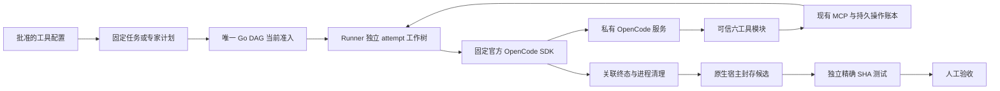

# OpenCode 固定执行：架构、交互与 AI SOP

状态：1.0.0 当前实现；负责人：控制面／执行节点／工作台。关联 P2、P4、P5 以及需求9、10、12。[接口合同](../../contracts/opencode-sdk.md)、[验收证据](../quality/opencode-execution-verification.md)、[完整计划](../delivery/implementation-plan.md)。

## 领域与模块

控制面继续拥有唯一派发权，SDK 内部工具调用不建立第二个任务队列。工具领域拥有公开能力和证据合同；Runner 拥有进程、本机配置、工作区与封存；TS 包只负责官方 SDK、私有服务和受控桥接。新增接入复用现有数据库、资源账本、私有／Pool 回执与候选流，不新增业务表或历史迁移。

固定 SDK 与服务版本都是 1.19.4，产品运行时为 1.0.0。参考提交与依赖锁文件记录来源；不保留旧 OpenCode JSONL 协议别名，不猜测厂商终态。界面类型复用后端生成合同，避免重复手写派发与证据模型。

## 配置与权限

管理员在本机许可命令中指定 OpenCode 可执行文件、模型、端点与秘密的环境引用；[示例](../../deploy/runner/opencode.example.json)中的路径和检查必须改为真实安装位置。先构建 `@suma/opencode-runtime`，完整保留其 manifest 与实际插件依赖资产。普通工作流不能注入可执行参数、私有根目录、账户、任意插件或模型端点。

平台公开配置只包含版本、provider/model、端点 origin、摘要及能力边界。一次预览把它固定到计划和开发节点；开始、专家待执行项、当前读取、领取及原子额度预留均核验固定依据。节点不能携带另一份原生或 Codex 选择，不能绕过工具档案直接执行。

该接入只能观测用量，费用未定价。组织或项目存在强制预算时停止准入；不能将管理员填写的通用费率当作提供方账单或硬上限。未知／部分用量不填零，配置确认不证明提供方实际模型身份。

## 执行、失败与恢复

每个 attempt 使用独立工作树、空 HOME／XDG 和生成配置，私有服务只监听认证后的 loopback 地址。拒绝托管配置，禁用项目配置、默认插件／外部技能、原生任意命令和隐式附加模型任务。分发真实锁定插件依赖树，避免配置加载器在运行中自动安装依赖。

文件和检查只通过已有 os.Root／CAS／MCP 宿主，复用持久 operation receipt。操作身份绑定请求、session、message、call 和工具；串行调用不自动重试未知副作用。SDK 无权直接提交 Git、改变验收、合并分支或发布生产。

整轮成功必须同时满足关联最终 assistant、finish=stop、completed 时间、无错误及挂起工具；步骤结束和 HTTP 成功不能推进任务。私有服务保持在 Go 进程控制范围内，最终证据须经过宿主清理；停止无法确认时进入核对。取消若已建立 session，必须有原 session 的 abort ACK；尚未创建 session 时不制造该回执。已接受但响应丢失的请求不重新创建或重新 prompt。

成功后仍由原生宿主核验与封存、传输候选，再由独立执行节点对精确 SHA 测试。业务负责人验收和代码集成保持独立。当前不支持 SDK 会话重连、任意交互式输入、原生冲突修复、模型辅助规划／提炼／分诊的此工具路径；这些范围继续留在全平台待办中。

## 简洁交互

1. 工具详情展示固定模型和许可状态，配置摘要、版本与端点放在可展开的“配置与执行依据”。不会因程序存在而显示模型账户健康。
2. 普通任务与专家项沿用现有模型位置，显示“由批准工具固定”；不提供一个无法生效的模型或硬预算选择器。
3. 预览与刷新保留原计划固定依据。配置改变显示重新预览原因，不静默替换；错误成功响应保留原操作标识等待核对。
4. 运行详情使用原有进度／终态／独立测试／人工验收区域，配置确认、服务停止和正式验收分别说明。
5. 中文／英文成对维护；版本、provider/model、原始证据和摘要是数据，不随语言变化。新语言按现有 BCP47 目录扩展，不复制页面。

## AI 与人工开发 SOP

- 修改共享合同后同步 Go、生成 OpenAPI／TS、Runner、封闭 TS 消费者和双语文案；不增加旧入口包装。
- 官方 SDK 负责协议，宿主负责业务权限与效果。新增工具必须有实际宿主合同、当前权限、幂等与未知状态，再进入模型工具列表。
- 变更只运行受影响配置／授权／停止／候选检查和代表性交互；未改的有效证据复用，不重复调用模型。
- 验收报告分开记录源码、协议夹具、真实 SDK、真实厂商 CLI／模型及生产；尚无证据的能力继续待办。
- 阶段提交必要源码、配置例、依赖锁、设计和精简证据。缓存、秘密、数据库、插件分发依赖树、原始日志及二进制不进入 Git。
