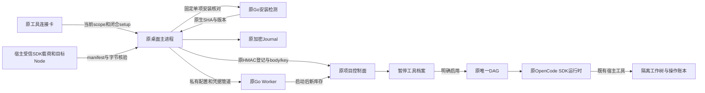

# OpenCode快捷接入架构与AI SOP

T-OPENCODE-QUICK-CONNECT-177；suma 1.0.0。状态：源码、真实SDK资源及限定组件验证通过；完整原生模型旅程待验。[本阶段合同](../../contracts/opencode-quick-connect.md)定义新接缝，[原SDK合同](../../contracts/opencode-sdk.md)继续定义执行与停止事实，[验证报告](../quality/opencode-quick-connect-verification.md)区分实际与合成证据。

## 来源和原执行链

不新增数据库、模型目录CLI或第二套身份。renderer只提交安装SHA与 `provider_id/model/base_url/api_key_env_ref?`，不能提供Node、原生路径、脚本、manifest、任意argv／env或密钥原值。主进程先核当前窗口、账号、组织、项目及工作区，再从可信来源形成私有配置；平台登记只接原身份和来源证明。

## 不混淆的配置事实

| 事实 | 来源及核验 |
| --- | --- |
| 原生程序 | 当前单项检测的原生OpenCode路径、字节SHA与精确1.19.4版本 |
| 执行载荷 | `resolveOpenCodeAssets`解析宿主资源；Go再次核Node、manifest及完整SDK／plugin资产 |
| 配置摘要 | 原 `OpenCodeConfigurationDigest(OpenCodeSpec)`：`policy_version=1`、`sdk_version=1.19.4`及完整provider结构，包含原生路径、提供方、固定模型、地址、可选环境引用；采用原Go JSON编码 |
| 当前库存 | 本次Worker启动后上报的Node SHA、`suma-opencode-runtime 1.0.0`及准确 `opencode_execution` |
| 连接回执 | 六项metadata来自原持久配置：model、原生tool_version、原生executable_sha256、configuration_sha256、provider_id、安全endpoint_origin |

配置摘要不替代Node／manifest／资产SHA；凭据值不进入公开摘要或renderer。库存Node SHA不能与原生server SHA互换。回执不包含完整服务地址，任务继续读取原 `fixed_opencode`；原preview／Start／Claim和observe-only预算门禁继续复核一致性。

原body/key和Worker身份先持久保存，再执行登记。结果未知时只恢复原操作，不能由新草稿更换配置。正常停止且没有未结操作后才允许明确改配；停止未确认保留unknown。主进程和Runner继续使用原进程控制及Journal，不能以入队、EOF或包装器ACK代替实际停止。

## 打包接缝

原打包计划的 `resources.opencode_runtime` 对应控制程序旁的 `control/opencode-runtime`。`prepareOpenCodeRuntime`准备固定SDK／tool／plugin依赖、完整manifest、目标Node及其许可，`validateOpenCodeRuntime`在原打包链核验；桌面 `resolveOpenCodeAssets`消费同一目录及 `desktop-runtime.json`。开发态只使用仓库既有dist和明确探测的本机Node，不接受renderer路径。

Node须满足22+及目标平台／架构。跨目标缺少相应资源应失败；仅检查目标文件格式不能声称已在目标系统执行。打包hooks与资源解析的源码接线不等于完整安装包已验收。

## AI开发与运维SOP

1. 先读合同和当前实施状态，复用原SDK、Worker、工作区与任务权威；不另建协议解析器或调度器。
2. 被动检测精确安装，保留当前来源；不能自动安装、登录、运行模型或降级未知版本。
3. 采用用户明确固定配置。只从主进程环境按允许的引用取模型凭据，不借平台机器／Agent令牌。
4. 新登记前核可信资源；以原HMAC和原body/key恢复身份，以启动后库存证明当前连接。
5. 暂停登记与启用分开，任务仍固定原工具版本；候选、独立测试和人工验收各自留证。
6. 改配前先正常停止。网络／进程结果未知就保留原操作核对，不重复模型或隐式换发身份。
7. 各层做必要定向验证，由主集成统一记录集成、真实原生／厂商和打包证据；当前文档不宣称这些已通过。

本片独立实现，成熟依赖和[参考许可边界](../integrations/opencode-quick-connect-reference.md)不变。完整31项／P0–P7与58／34／92继续保留。
