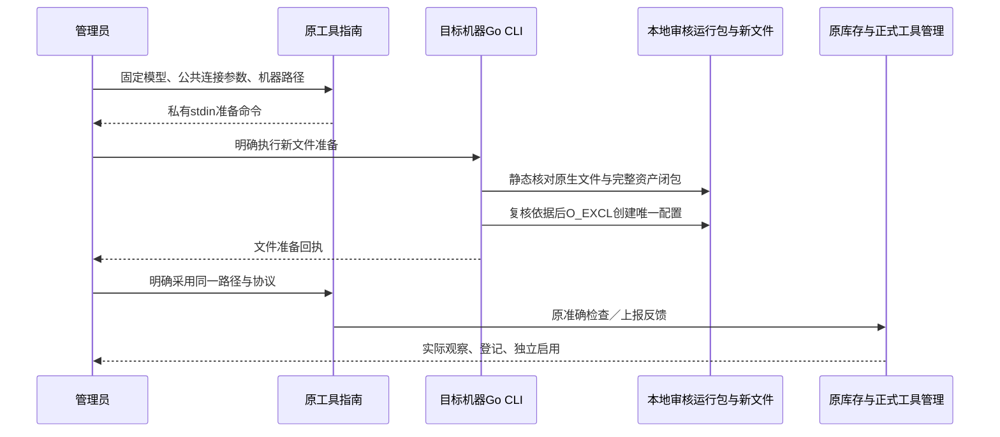

# OpenCode 配置准备架构与AI SOP

状态：本阶段限定验证；版本1.0.0；阶段T-OPENCODE-PREPARATION-207；负责人：主集成及领域代理。以[准备合同](../../contracts/opencode-tool-preparation.md)和[产品验收](../product/opencode-tool-preparation.md)为准。

Web不获得执行权；CLI不获得平台身份。准备内核不启动进程，固定审核SDK版本与原生CLI实际版本分别记录。复用原managed构造、原生文件检查、manifest资产闭包与原rooted writer，没有新配置权威、供应方适配器、资源调度或数据表。唯一输出命令的检查数组为空，正式独立测试继续使用原质量运行与同提交证据。

AI实施时先核当前固定依赖和原合同，不为方便添加任意argv、凭据值或额外入口。输入必须在创建文件前闭合验证；路径和资产检查失败保持原件；只接受全新目标文件。共享Guide只接受准确三字段公开草稿，沿当前调用者与单调nonce消费；不放宽其他协议的闭合验证。

排障依次核对公开输入、目标路径权限、原生文件、审核manifest及资产、配置生成回执、实际库存，再检查登记和启用。不因本地文件已存在把工具显示为在线，不重放不确定的业务操作。准备失败可在修改公开草稿后明确重试新文件准备；原库存／登记操作仍沿各自原回执恢复。

阶段检查限本次输入、文件安全和准确交接。真实CLI生成文件、受控组件、实际供应方、正式业务／测试／验收与生产各自取证；不以合成界面或固定版本字符串代替后几项。
