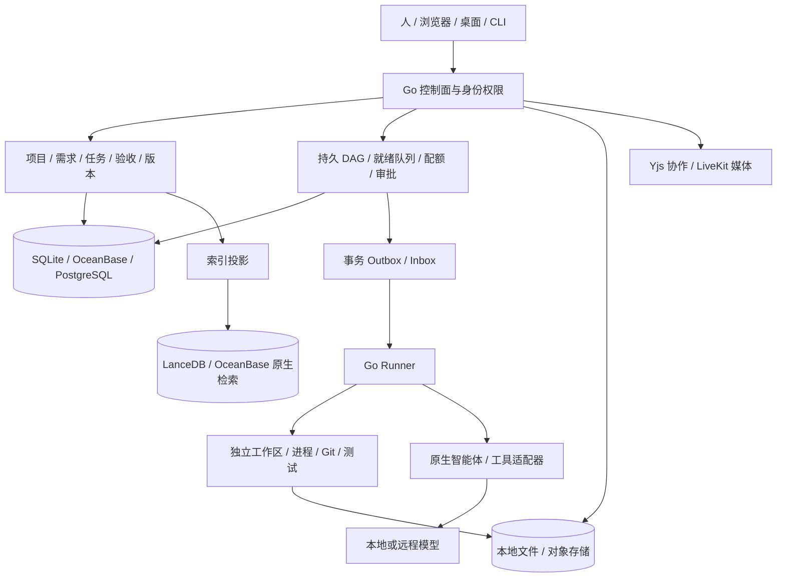
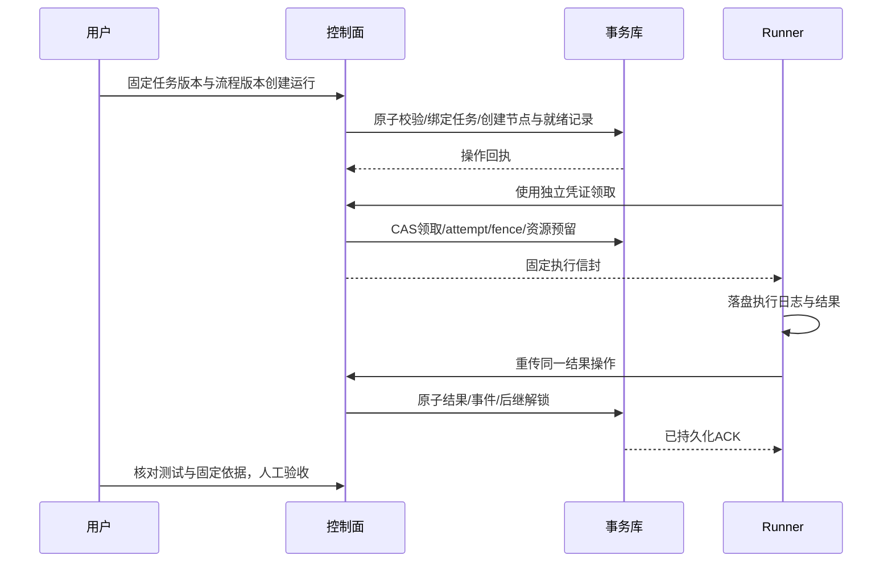

# 系统架构设计

状态：目标架构与当前实现边界。负责人：平台。

## 模块与所有权

控制面拥有正式业务和执行状态。Runner 只证明已授权执行事实，并保留可重传回执。智能体在节点内使用有限工具；需要独立预算、恢复或人审的工作交回 DAG。检索库是可重建投影，不能批准业务动作。媒体与协作文档服务不拥有任务状态。

当前代码入口：`cmd/suma-control`、`internal/platform`、`internal/dag`、`internal/runner`、`apps/web`、`apps/desktop`、`packages/agent-runtime`、`packages/knowledge`。目标服务拆分与当前可用能力见交付矩阵。

## 三种运行拓扑

| 拓扑 | 组件 | 状态与故障域 |
|---|---|---|
| 桌面独立 | Electron、本机控制面、SQLite、Lance、本地 Runner | 单机文件与业务备份；无网络也可处理已配置本地能力 |
| 单机/私有团队 | 浏览器、控制面、Runner、SQLite 或 OceanBase | 服务重启恢复；数据库迁移由明确管理流程执行 |
| 分布式 SaaS | 多控制面/调度副本、OceanBase、对象存储、多个 Runner、协作/媒体 | 节点租约/fence、持久回执、配额、环境隔离和数据库容灾 |

## 关键约束

- 事务内不执行模型、工具、网络请求或长时任务。
- SQLite 使用短写事务和单控制面装配；分布式数据库方言分别验收。
- 当前 DAG 使用数据库调度锁保证原子性，尚未通过目标规模；生产拆分为租户/运行分片锁需要压测证明。
- 内部事件至少一次投递；业务效果依靠操作回执、版本、幂等和结果核对。
- 所有跨项目操作在服务端授权。代码目录必须显式配置，文件访问不能跳出允许根目录。
- 浏览器端不持有数据库、模型或存储主密钥。

## 执行时序

