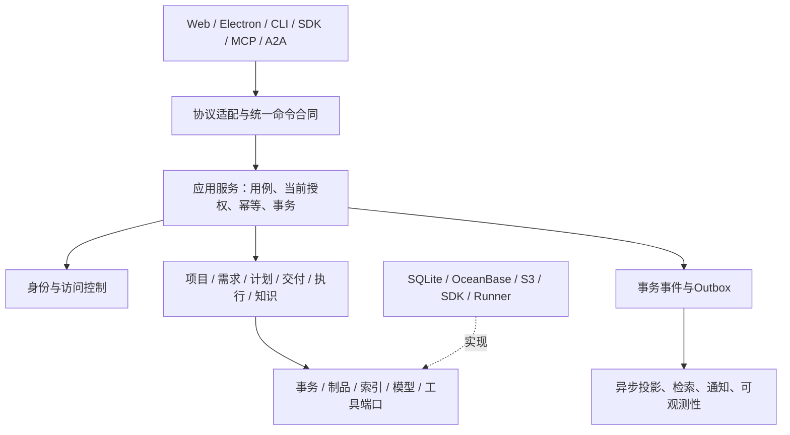

# 可复用平台基础与工程架构

状态：目标架构及当前增量约束，不能作为功能完成证明。日期：2026-10-24。负责人：平台。关联：[产品基础需求](../product/platform-foundation-prd.md)、[总架构](overview.md)、[AI开发SOP](../delivery/ai-engineering-sop.md)、[实施台账](../delivery/implementation-plan.md)。

## 分层与依赖方向

协议层负责类型、大小、身份入口和错误信封；应用层负责完整业务动作，不能让HTTP、CLI或插件各写一套业务状态机。领域不导入浏览器、SDK、支付或数据库供应商对象。存储适配器实现事务和查询合同；不得把事务拆成远程调用链。

| 领域 | 正式拥有的数据 | 对外边界与复用规则 |
|---|---|---|
| 身份与访问 | 人员、外部身份关联、会话、角色、资源授权、机器委派 | `subject + tenant + resource + action + policy_version`，每个受控写入在同事务复核；范围令牌不得提升成浏览器身份 |
| 项目与规划 | 组织／团队、项目、任务、依赖、迭代、容量、需求基线 | 执行者资源目录不授予身份权限；计划工时与机器额度分开 |
| 交付与质量 | 需求验收、测试计划、固定证据、版本候选、审批 | 审批绑定依据版本，变化使证据失效；AI无权自批 |
| 执行与调度 | 流程版本、DAG、attempt、派发、租约、资源、效果核对 | 单一平台派发权；池身份与明确双边项目授权，稳定回执与fence |
| 能力与插件 | 工具、模型、技能、MCP／A2A注册和版本、健康观察 | 声明、探测、认证、实际执行分别记录；插件只能调用获授端口 |
| 知识与协作 | 原件清单、派生索引、文档协作操作及设备水位 | 正式原件与可重建索引分开；进入模型上下文前再次授权 |

当前模块化单体位于`internal/platform`和`internal/dag`，Runner独立；新能力按独立文件／组件归属实现。现有较大的App／Workflow与平台HTTP入口逐步提取应用服务和功能工作区，不能用一次大范围机械重写破坏已验证行为。服务拆分以权限边界、独立扩缩和事务证据为依据，不以增加进程数作为成熟度指标。

## 成熟框架与SDK选择

已采用React、Radix Dialog、ReactFlow／ELK、Monaco、Electron、Bubble Tea及正式SQL驱动，准确已解析版本见[依赖清单](../delivery/third-party.md)。新增能力先查现有依赖，再评估官方SDK、维护状态、许可、运行时基线、离线安装、可测试性和升级成本；没有实际使用理由不增加依赖。

| 能力 | 优先方案 | 接入决定与验收门禁 |
|---|---|---|
| SSO | [coreos/go-oidc](https://github.com/coreos/go-oidc)与[golang.org/x/oauth2](https://pkg.go.dev/golang.org/x/oauth2) | SDK负责OIDC验证／OAuth流程；速码拥有`issuer+subject`关联、组织归属、会话与当前授权。不能仅凭同邮箱自动合并账号 |
| MCP | [官方Go SDK](https://github.com/modelcontextprotocol/go-sdk) | SDK处理协议与传输；工具调用映射统一应用命令，完整身份／资源／审批合同仍由控制面执行 |
| A2A | [官方Go SDK](https://github.com/a2aproject/a2a-go) | 2026-10-24官方主分支说明要求Go≥1.26，当前项目已验证Go1.24.5；必须评估兼容版本或单独验证工具链升级，不盲目接入latest。协议版本和SDK版本分别锁定 |
| 可观测性 | Go结构化日志；跨服务按OpenTelemetry生态评估 | 先统一关联字段与去敏规则，再接采集SDK；无采集后端不能显示“监控已就绪” |
| 授权策略 | 统一访问控制端口与正式事务数据 | 可评估成熟策略引擎，但缓存／SDK决策不能替代当前组织角色、资源版本及事务内撤权校验 |

T-P4-019已固定官方MCP Go SDK v1.8.0、Go1.26.10，完成受控13项项目工具的入站协议、当前授权及实际客户端验证，见[架构与AI SOP](../integrations/project-mcp.md)。上表2026-10-24的Go1.24.5为研究时基线，已被本阶段替换。SSO、A2A、出站MCP与插件执行仍待后续，不把工具链准备视为这些集成已完成。

## 扩展合同

每项扩展至少声明：稳定ID、版本、能力、输入输出Schema、身份类型、资源与网络范围、配置Schema、秘密引用、健康探针、截止时间、重试／取消语义、事件与证据格式。默认禁止扩展直接取得数据库主连接、任意文件根和平台管理员密钥。

技能是版本化执行资产；插件是隔离的能力实现；MCP是工具／资源协议入口；A2A是智能体任务交换入口。它们复用同一授权与DAG合同，不能自行建立第二个任务派发中心或用远端“成功”替代速码验收。需要独立审批、预算和恢复的远端任务对应`external_workflow`或平台子流程，映射原远端任务ID与幂等身份。

## 稳定性与可维护性

- 公共接口、事务边界、锁序、所有权、版本／fence、未知效果、重试范围和不明显的算法选择必须有说明注释。避免逐句翻译代码及复制过时注释。
- 使用命名清楚的类型和小型领域模块；前端表单、异步恢复、事实展示和导航分别组织，沿用成熟控件的焦点与键盘行为。
- 日志包含请求／操作、租户、项目、运行、节点、attempt、dispatch和fence等必要关联字段；记录阶段、耗时、稳定错误码和可重试性。禁止记录token、密码、模型原始请求、未授权文档和秘密配置。
- 配置有Schema、默认值、边界、环境覆盖来源和变更记录；界面能够预览、核验和显式采用高影响调整，未知结果恢复原操作。
- 分布式正式状态在事务数据库；缓存、通知和连接状态不拥有业务真相。网络失败、持久ACK、备份／恢复和升级回退均要有真实验证。

## 可验收的依赖关系

SSO先验证身份绑定与账号恢复，再接自定义角色；插件注册先有受控应用命令与秘密引用，再接MCP／A2A传输；远端智能体先有持久任务映射与停止／核对，再开放自动化。每一步均提供浏览器／协议实际旅程、负向权限测试和精简交付证据，进度不以配置项数量计量。
