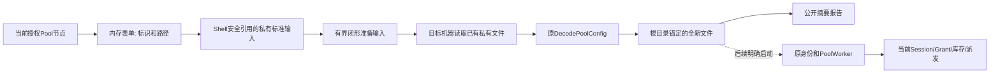

# Pool配置准备架构与AI SOP

版本1.0.0；状态：T209限定实现与验证通过。负责人：Runtime。关联：[闭形合同](../../contracts/pool-config-preparation.md)、[原Pool运行](../agents/execution-pool-runner.md)、[限定证据](../quality/pool-config-preparation-verification.md)。

## 模块与信任边界

Web不访问目标文件、不读取消费项目数据、不保存草稿、不提交新的业务写入。Shell只是传输明确输入；最终字段、来源文件和配置权威在Go。准备函数不构造执行Client、Worker、系统凭据库或模型，不将静态输入当作观察结果。

新文件只使用原PoolLocalConfig，不复制字段到新存储；commands沿原DecodeCommands，model_deployments沿原模型解码，external闭形解码后沿原Pool校验。私有文件读取与最终编码均受上限约束。目的文件根目录锚定和独占创建沿原允许列表准备机制，不覆盖现有配置，不用临时兼容格式。

并行开发、派发fence、工作树和质量回写仍由原执行域负责。本阶段没有执行副作用，因此不新增业务操作表或幂等回执；“重试时拒绝覆盖”避免意外改写，成功摘要用于本地核对，不能代替服务端授权。

## 失败处理

| 失败 | 行为与恢复 |
|---|---|
| 表单不完整或超过64 KiB | 保留当前内存草稿，就地指出原因，不生成可执行命令 |
| 本地文件不可读、链接、格式错误或超过限额 | 安全错误，目标保持未创建，用户修正准确来源后重做 |
| 目标已存在 | 拒绝覆盖；核对原文件或明确选择新文件，不自动换名 |
| 账户／Pool／节点变化 | 清除旧作用域表单，不把旧命令交给新节点 |
| 配置改变而旧Journal有未决操作 | 沿原核对流程处理；准备功能不删除或迁移Journal |
| 新配置没有当前Grant／有效身份 | 原运行时拒绝；不自动补授权 |

## AI开发与维护SOP

1. 先读取当前Pool配置合同和目标节点来源；先判断问题属于静态配置、连接、工具库存还是业务执行。
2. 所有准备变更保持单一原配置和固定闭形输入，不引入任意脚本模板或凭据值字段。
3. 准备错误只记录稳定原因与必要范围；不得记录原JSON、命令、路径、环境值或模型凭据。
4. 按变更选择闭形、限额、文件安全、模式互斥或作用域回归；不重复无关调度／厂商测试。
5. 真实脚本→CLI生成与合成页面分别取证；更新报告和能力边界，阶段完成后提交明确文件清单。
