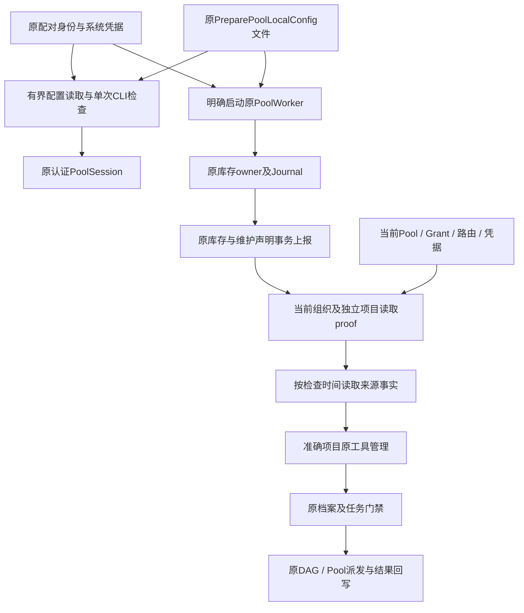

# Pool连接事实架构与AI SOP

版本1.0.0；状态T212限定实现与验证通过。负责人：控制面／Runtime。关联：[产品](../product/pool-connection.md)、[合同](../../contracts/pool-connection.md)、[验证](../quality/pool-connection-verification.md)。

## 模块与权威

| 模块 | 负责内容 |
|---|---|
| `internal/poolconnectioncontract` | 共享5个事实DTO；原API生成器产生OpenAPI与客户端类型 |
| `internal/runner/pool_connection.go` | 复用原配置解析及普通文件／父目录保护，限制2 MiB；保留原文件字节SHA，核对原PoolSession完整响应 |
| `cmd/suma-runner/pool_connection.go` | 单次检查入口；模式参数闭合，先配置与身份范围后系统秘密，不使用环境token备用 |
| `internal/platform/pool_runner_readiness_service.go` | 同一当前读取事务中的组织管理权限、独立项目proof、原维护身份及新鲜库存来源核对 |
| 原PoolWorker、库存owner与Journal | 原出站认证、单一库存owner、持久操作与ACK恢复；维护模式不进入业务领取循环 |
| 原ToolWorkspace／Quick／Doctor | 当前目录和共享Worker复核、准确定位及正式资格，不增加第二派发或配置权威 |

新读取接口只接收准确`tenant_id`／`project_id`。组织当前管理权限和Pool拥有权先行；仅共享Grant元数据时保持`restricted`，不读取该项目的路由、库存或维护声明。同租户项目也须取得原`purposeBrowserProjectRead` proof，并在同事务复核。数据库错误、损坏来源及授权错误不折算为空库存或正常未知状态。

`source_current`需同时满足当前Pool、Runner、凭据、准确Grant及路由；原维护身份绑定这些版本和凭据摘要。库存和维护声明均须新鲜、合法，观察时间为同一时刻。复用原库存TTL读取方法；Pool写入统一原高精度数据库时间，重放原操作回执不续时。无新增表、列、健康状态或调度器。

原文件SHA描述落盘字节；原PoolWorker私有配置摘要描述解析后运行绑定，两者不相等也不互相代替。`historical_last_seen_at`仅由原新库存上报更新，PoolSession读取不更新它。当前快照由服务器`checked_at`界定，浏览器按剩余期限保守失效；模型或网络耗时不改变已保存事实。

## AI维护SOP

1. **先确认范围**：记录当前账户、组织、Pool、Runner、项目与API来源；先辨认准备、单次检查、持续维护、工具资格和执行结果分别缺哪一环。
2. **保留原依据**：使用原身份和系统凭据接口；不要以环境token、改配对目的、删除Journal或重建状态目录绕过未确认操作。
3. **明确执行授权**：维护与任务模式按用途给出最小开关，安装检测单独同意；复制命令不作为已执行证据，不在读取接口运行工具探针。
4. **沿正式门禁交接**：当前组织证明不扩大项目权限；准确工具入口只定位，后续登记、启用、模型预算和派发继续原版本与操作标识合同。
5. **处理变化与失联**：轮换凭据后重新获得当前来源；旧ACK只能恢复原回执，不能刷新观察。保留未知副作用，沿原核对／停止回执恢复，不自动再次执行。
6. **限定验证和记录**：只复验受影响授权、来源、生命周期或交互；区分真实系统凭据、编译CLI、库Worker、合成浏览器桥、自有命令及正式验收证据。

本阶段实际持续运行通过原库入口完成，未执行复制出的前台CLI启动命令。跨机器网络分区、不同系统凭据库、OceanBase／PostgreSQL及正式开发任务闭环仍需各自真实验收；完整31项／P0–P7保持进行中。
