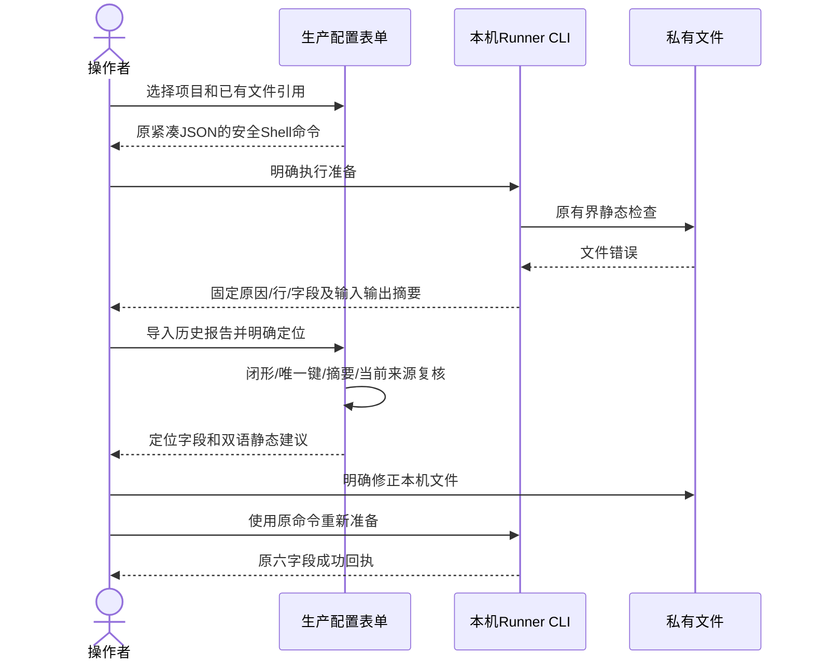

# 本机准备诊断架构与AI SOP

版本1.0.0；状态T211限定实现与验证通过。负责人：Runtime／主集成。关联：[唯一合同](../../contracts/pool-preparation-diagnostics.md)、[交互](../design/pool-preparation-diagnostics.md)、[限定验证](../quality/pool-preparation-diagnostics-verification.md)。

类型化诊断位于Runner领域，只持有固定事实，不捕获原PathError或嵌套错误文本。CLI负责当前语言说明，浏览器用自己的语言目录，不渲染用户报告的message。词法唯一成员检查提取原工作区已用的纯函数，原消费者与新报告共用，避免多套不一致JSON解析。

摘要协议按原传输字节定义：native完整stdin TrimSpace后SHA-256；浏览器对当前原四字段／九字段紧凑JSON做UTF-8 SHA-256。不得使用Go重编码或尝试多个摘要。输出按原参数字符串摘要。4 KiB报告、64 KiB输入和原2 MiB文件上限独立保持。摘要并非签名或授权，导入操作不产生正式健康状态。

| 摘要 | 准确含义 |
|---|---|
| 诊断input_sha256 | 本次完整准备请求去除首尾空白的原始字节 |
| 诊断output_sha256 | 目标路径参数的原字符串，不是文件内容 |
| 成功configuration_sha256 | 实际写入的完整配置文件字节，含换行 |
| 原PoolWorker私有configSHA | 解析目录、固定项目环境后的运行配置重新编码，作为本机Journal依据 |

以上摘要不能互相比较或代替。后续“已连接／可派发”必须核对原PoolSession、准确Grant和新鲜工具库存，不能从准备文件摘要或诊断回贴推断。

异步摘要绑定当前账户／组织／Pool／Runner／API来源、原观察代次及编辑revision。结果回来后再次确认当前来源，不能复活旧分析或改写任何输入。项目切换继续原T210七字段隔离。

AI维护SOP：先区分输入格式、目录、私有文件、原配置约束、来源变化及写入未知；保留原件，只新增固定安全原因；不为诊断调用模型或读取秘密；改动后仅执行相关契约与一次必要联调；将真实文件I/O、合成元数据／剪贴板和生产验收分别记录。需要自动执行的修复仍通过原授权任务与DAG，不从错误文本执行命令。
