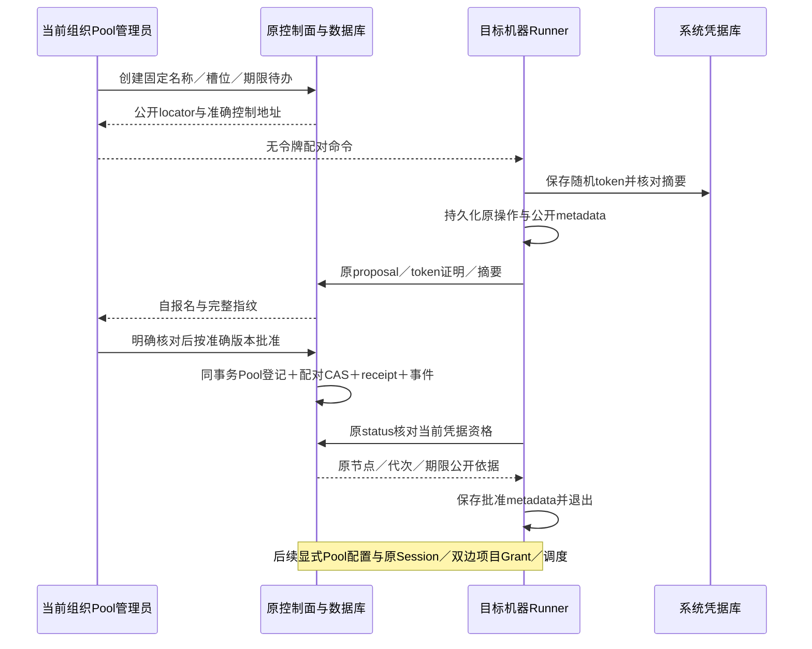

# Pool机器配对架构与AI SOP

状态：本阶段限定验证；版本1.0.0；阶段T-POOL-RUNNER-PAIRING-208；负责人：主集成及控制面／Runner／Web领域代理。类型和路由以[唯一合同](../../contracts/pool-runner-pairing.md)为准。

## 边界与一致性

Pool配对是组织基础设施身份，项目配对是项目执行身份，两者各自闭合DTO、系统库service、账户键和HTTP目的。私有公共层只复用文件规范化、锁、父目录身份、原始字节比对与原子保存，不包含租户、token、Grant或授权规则。重构后的项目身份保留原领域验证。

原Pool注册提取同事务摘要helper，原手工模式继续首次返回秘密；配对模式只有机器持有秘密。两者共用当前组织／Pool授权、节点上限、原runner／credential表和事件。新配对表只保存公开固定输入和原提案摘要；没有第二台账、槽位或派发器。审批、唯一登记、receipt与事件原子提交。

机器proposal／status只证明准确Pool待办和原请求，不授予人类Actor或读取项目数据。批准status再次检查原凭据版本、撤销、期限与Pool状态；本地批准记录不替代服务器当前认证。所有时间与名额竞争沿数据库时间和原授权锁。列表游标固定原owner／Pool／过滤与创建水位，但每页授权及逻辑状态仍取当前事实。

## 本机配置与恢复

机器用固定go-keyring SDK保存秘密，独立公开metadata含purpose和原proposal操作；账户绑定准确控制面、Pool、配对和身份文件规范路径。没有明文降级或令牌枚举。保存不确定或身份缺密钥时保留原件，不自动换新token。

启动必须显式`--control`，并先与公开metadata及原Pool配置pool_id／runner_id匹配，随后才读取系统秘密。原PoolLocalConfig没有control_url，不增加重复权威；原环境令牌手工模式与身份模式明确分开，不互相回退。原PoolWorker、Session、项目路由、资源预留、fence、停止证明和质量链不变。

AI排障顺序：检查当前组织Pool资格 → 原配对和准确版本 → 原proposal操作／指纹 → 系统库账户与metadata一致性 → 当前凭据代次与期限 → 原Pool Session和项目双边Grant。未知ACK优先恢复原请求；不能靠重建身份或直接改库消除未知效果。

## 实施与验证纪律

控制面、Runner、Web分别拥有领域源；主代理拥有唯一合同／Go wire、生成OpenAPI／TypeScript、实际整合和文档。只执行新权限、事务、竞争、恢复及直接受影响旧分支；不重复厂商／模型或无关全套。源码、注入系统库、实际系统库、同机HTTP、物理多机与生产分别取证，不互相替代。
