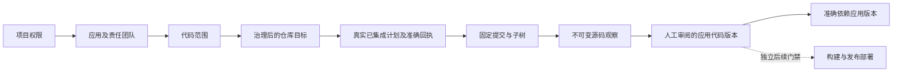
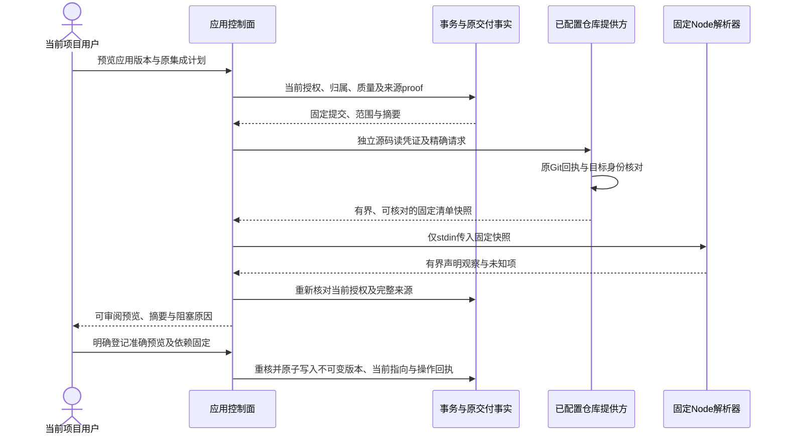

# 应用、固定源码与依赖版本架构

状态：1.0.0当前设计与实现合同；关联需求25、阶段T-APPLICATION-123。负责人：项目、仓库、质量与应用领域。实际执行证据由质量目录单独维护，本页不代替验收报告。

关联：[完整需求](../product/application-delivery.md)、[操作与API](../development/project-applications.md)、[提供方与解析器配置](../deployment/application-source-inspector.md)、[术语](../../GLOSSARY.md)、[English](../en/project-applications.md)。

实现入口：`internal/platform/project_application*.go`、`internal/repositoryprovider/source_inspection.go`、`packages/source-inspector`；实际证据从[质量入口](../quality/verification.md)追溯。

## 领域边界

项目继续承载当前账号、组织与项目权限。应用父子关系表达产品结构和导航，不增加子项目独立ACL。应用责任团队必须真实存在且当前可用；团队归属不自动扩大成员的项目权限。

`ProjectApplication`包含稳定应用标识、层级、责任团队、状态、代码范围和当前登记版本。`ApplicationCodeScope`绑定已治理的`RepositoryIntegrationTarget`身份、受控引用、配置摘要与安全相对目录。目录重叠须按当前规则明确共享和说明，不能以包名、候选提交或字符串路径猜测仓库归属。

`ApplicationCodeVersion`登记应用、准确源码、解析观察、人工依赖固定及理由的不可变快照。版本标签和包清单中的`version`是不同事实。登记新版本更新应用的当前指向，历史版本及其依赖不会随之改写。登记不产生构建、发布、部署、自动升级或生产验收。

## 真实来源资格

来源使用原仓库集成计划，而不是接受用户提供的任意提交。计划必须为`integrated`，原阶段为`apply`，提供方观察及Git回执为`applied`；准确`ResultCommit`必须与原候选及当前正式交付依据一致。

控制面同时检查当前目标身份、原操作／请求／回执摘要、原托管运行与attempt结果、候选来源、独立测试和正式Review。普通已成功命令、模拟回执或单独的候选SHA不具备这项来源资格。现有唯一Go DAG继续调度开发、测试和仓库集成，不为源码检查建立第二套派发器。

提供方在自己的固定bare目标内复核原本地apply记录和Git receipt，再读取准确提交的tree／blob。Git对象读取不依赖当前工作目录或源码安装；增量候选bundle不能单独假装完整源码归档。

提供方IO与解析在权限事务之外运行，避免长时间占用数据库事务。IO之后重新授权、核对来源和预期应用版本；相同稳定操作恢复原登记结果。撤权、团队失效、代码范围变化或来源依据变化均不能通过旧预览继续写入。

## 来源与解析合同

`internal/repositoryintegrationcontract/source_inspection.go`定义源码请求、提供方快照、文件摘要、范围与限额；`source_dependency.go`定义唯一共享解析输出。公开业务DTO从这些事实投影，不存入原清单正文或Base64。接口和生成类型沿已有合同生成流程维护。

提供方`POST /source-inspections`只接受原apply身份、目标／引用／配置摘要、原操作／请求／回执摘要、准确提交和排序且不重叠的相对范围。它没有用户自选URL、本机路径、自由Git命令或可提升的限额。空目录字符串是唯一仓库根表示。

Git树中的符号链接与submodule不跟随，相关覆盖范围明确为部分。只有固定支持的清单文件能进入解析输入；对象批量读取使用Git原始blob，不执行checkout、smudge、textconv、安装或生命周期脚本。

固定解析器使用成熟`semver`、`yaml`、`minimatch`处理npm／pnpm工作区声明。每条观察保留准确快照、文件位置、文件摘要、解析器版本、原声明摘要、关系种类与兼容性范围。来源文件位置使用JSON pointer等可追溯定位，不用模型解释代替源码事实。

当前支持四类声明：`dependencies`、`devDependencies`、`peerDependencies`、`optionalDependencies`。明确的`workspace:`范围、包别名和相对引用可识别；安全的本地`file:`／`link:`只匹配输入中已存在的包，不读取链接目标。缺失目标、歧义、非法范围和不支持的定位保留独立状态。

HTTP／Git等不支持的声明可能含凭据；公开观察将`raw_range`置空并标记`range_redacted`，保留原字节摘要，不回显原URL。诊断只包含稳定代码和安全定位，不输出解析器异常正文或源码片段。

## 观察与人为决定分层

源码声明为观察层。候选应用匹配利用已登记应用的包身份，但匹配到同名包不等于准确版本已安装或已兼容。多个候选、范围外目标、外部依赖、未解析锁文件均保留未知。

人选择准确的目标应用版本ID及快照摘要，说明原因，形成独立依赖固定层。修改声明范围的业务策略时登记新版本，继续保存`ObservedDeclaredRange`。固定版本是明确的管理决定，不能冒充源码已修改或运行时兼容性已验证。

依赖图读取各应用当前登记版本及其准确固定边；影响查询固定图摘要并返回有界直接／传递影响。它表达已登记关系的潜在影响，不检查生产流量，也不直接创建跨应用开发或发布运行。

## 完整性与历史语义

覆盖信息分别表达提供方树／清单收集、解析成功范围、声明识别和应用依赖覆盖。某个范围解析完整，并不表示完整外部锁定树、全语言源码依赖、运行时依赖、漏洞扫描或发布就绪。未知和部分范围在预览中显示，必要时由人明确确认缺口，不能默认为已验证。

旧版本仍保留其准确提交、范围、观察与摘要。当前仓库分支推进不会重写旧版本；当前代码范围、来源质量或授权条件改变，可以使其`BasisCurrent=false`。这表示旧依据当前不适用，历史内容不因此消失或改变。

当前需求25仅推进应用目录、真实治理源码、声明观察、人工依赖固定、不可变登记版本及有界图／影响。独立子项目ACL、全部语言／锁文件解析、应用版本集自动联动、跨应用任务计划、各应用完整构建测试与部署仍须分别交付和验证。
