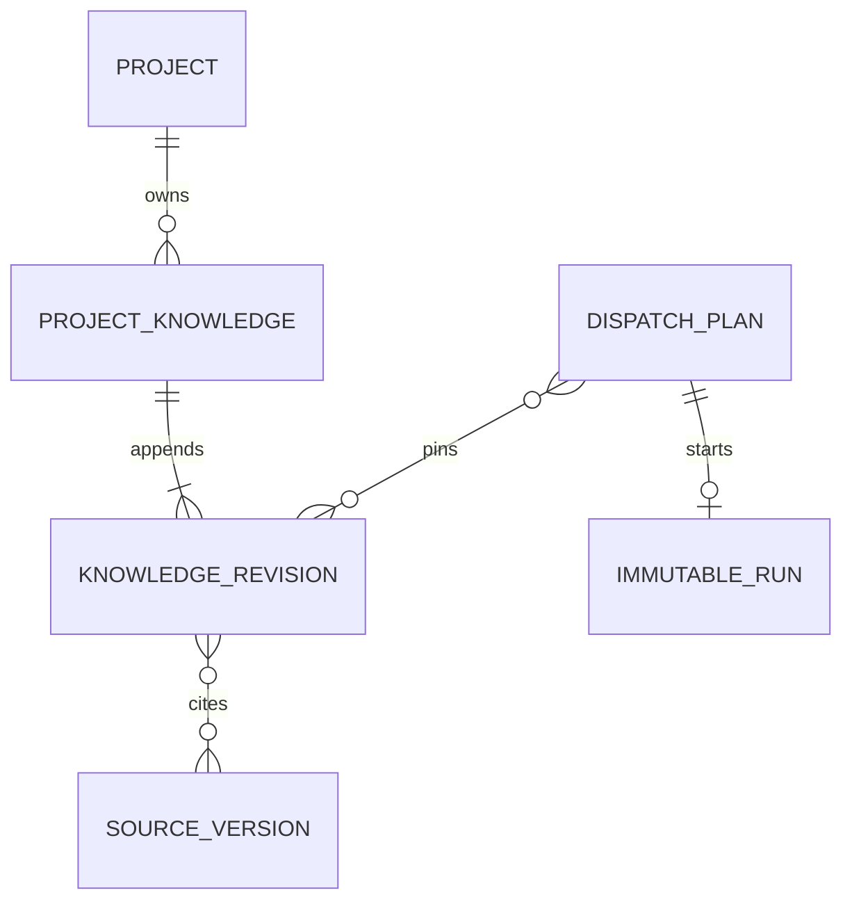
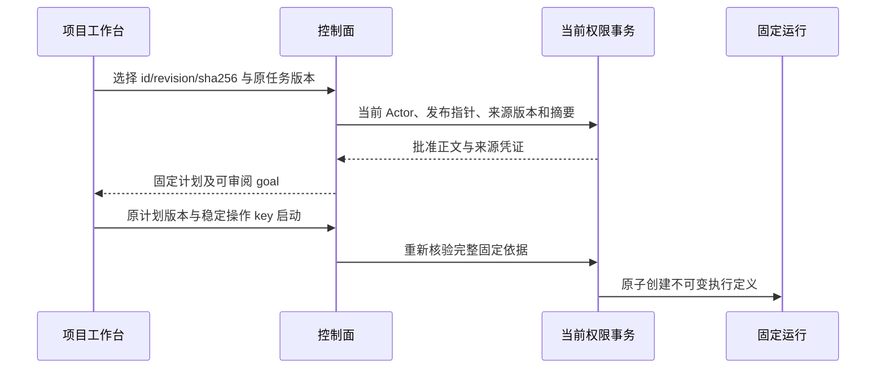

# 项目知识：版本、权限与执行上下文架构

状态：T-P4-015 限定范围本地已验证；完整平台继续实施。日期：2026-10-25。
负责人：知识领域与平台集成。关联：[产品需求](../product/project-knowledge.md)、[统一合同](../../contracts/project-knowledge.md)。

## 模块与权威数据

新领域位于 `internal/platform/project_knowledge*`，复用现有 SQL 方言、Actor、事务证明和业务回执。
不增加模型 SDK、ORM、独立调度器或与既有授权并行的角色系统。

| 表／模块 | 实际职责 |
|---|---|
| `suma_project_knowledge` | tenant／project／id 聚合，version CAS、kind、state、latest_revision、published_revision、列表标题／说明和时间 |
| `suma_project_knowledge_revisions` | 同范围 knowledge_id＋revision 主键，append-only 完整 JSON 快照 |
| `project_knowledge_service.go` | 创建、提取、完整草稿修改、发布／退役、回执资格投影与同事务审计 |
| `project_knowledge_store.go` | 当前读取、来源批量核验、固定发布解析、列表与历史分页 |
| `project_knowledge_http.go` | 严格 DTO、必要字段、整数词法、筛选与游标入口 |

## 本地技能文件解析

导入采用工作台已有草稿编辑器和知识写入合同。浏览器用固定版本的 YAML 解析器读取有界 UTF-8 文本，避免手工拆解多行说明、引号或注释。只有名称、说明和正文进入可编辑草稿。保存使用现有项目授权和原操作标识，解析不会发起写请求。

导入交互参考 Multica 的技能接入入口，速码按自己的项目草稿权限和发布门禁独立实现。 [Multica 技能命令](https://github.com/multica-ai/multica/blob/ee8604de4741d71d2f51e5ced7f0eb126b03ea0e/server/cmd/multica/cmd_skill.go) · [Agent Skills 文件规范](https://agentskills.io/specification)

CLI 的离线导入和浏览器遵循同一技能文件输入边界。Go CLI 使用独立的受限 YAML 解析器生成可交给现有创建命令的 JSON，权限、写入及回执均归原服务处理。项目可在预览时固定，显式提交时由现有 CLI 校验一致性。 [Go YAML v3](https://pkg.go.dev/go.yaml.in/yaml/v3@v3.0.6)

## 修订与发布状态

创建 v1／revision1 为草稿；每次编辑、发布、退役都追加新修订，并原子推进聚合版本。
修订记录自身 created_by／created_at，`based_on_revision` 保留来源修订链；旧作者、正文和时间不重写。
发布从所审阅的最新草稿复制正文、方法与来源到新 published 修订；摘要绑定内容和完整来源快照。
编辑已有发布时仅前移 latest_revision；published_revision 保留原值，聚合 state 仍为 published，has_draft=true。
新发布切换批准指针；退役追加 retired 修订并将 published_revision 置零，不取消已存在的运行。
列表同时提供 latest 标题与独立 `published_*` 显示字段，选择执行依据时使用后者。

## 当前权限、来源和回执

交互写入先由真实 Actor 取得同事务 proof，再读取操作回执；变更、修订插入、CAS、审计和回执原子提交。
草稿动作使用 ProjectWrite；发布／退役使用 BrowserProjectApprove；管理读取与历史使用 ProjectRead。
所有 SQL 带 tenant／project 范围；来源表名只来自 documents／requirements／tasks／issues 固定集合。
来源正文由说明、文档 content 和需求／任务验收条目组成，标题独立；客户端不能提供可信来源 hash 或批准者。
空 quote 选完整可见文本，非空 quote 必须逐字包含；归档／删除或 version／正文摘要变化使新采用失败。
来源按类型去重并分块最多 200 个 ID 查询；列表 SQL 筛选／LIMIT，快照一次 join，避免逐条来源读取。

回执正文是历史事实，不能作为当前版本或权限。重放仍检查 Actor；返回时只更新其自身发布修订的资格。
`none/current/source_changed/retired/publication_changed` 是显示资格码，不是审批或执行证据。
不会把最新 published 正文替换进旧回执；UI 成功后重新读取当前详情再发起下一次 CAS。

## 固定派发与 Agent 消费

`ProjectKnowledgeReference` 只接受 id／revision／sha256，不接受调用者正文。
`ProjectKnowledgeContextItem` 包含批准正文；其 Sources 使用不带 quote 的 `ProjectKnowledgeContextSource`。
消费凭证保留 kind／id／version／title／sha256，完整 quote 仍在修订与历史 API；批准 sha256 绑定完整修订，而非另算一份删减后的摘要。16,000 字节正文仅传一次，避免来源重复消耗上下文。
Agent 的 `project.knowledge` 仅用同一发布解析器投影明确修订，不能读取草稿、修改知识或改变工具许可。
来源改变、新发布或退役阻止旧未启动预览；已经开始的运行继续保留原批准快照及独立测试／人审门禁。

## 容量与排障 SOP

硬上限：正文 16,000、标题 200、说明 1,000 UTF-8 字节；8 来源、16 上下文引用、总 goal 32,000 字节。
列表 q 上限 200，默认 50／最多 100；历史默认 20／最多 100。游标绑定原租户、项目、条件或知识。

| 现象 | 核对与处置 |
|---|---|
| 401／403 | 核对当前登录、原页面身份、项目角色和 kind；重新认证不等于自动批准或重放其他身份的操作 |
| CAS／幂等冲突 | 保留原正文与 key；读取当前详情区分版本变化和不同内容复用 key，不静默覆盖 |
| source_changed | 回到正式来源核对版本／状态／原文，修改草稿并重新人审，不补造原版本或旧 hash |
| publication_changed／retired | 重新选择当前批准修订并生成新预览；不修改旧运行或直接取消已发生副作用 |
| 内容或 goal 超限 | 缩小来源片段、减少所选知识或拆分任务；不截断验收条件，不提高既定安全预算掩盖问题 |

恢复操作顺序：

1. 从恢复区核对原路径、方法、key、正文及账户／组织／项目，不创建替代 key，也不自动换成当前新版本。
2. 使用原请求明确重试；当前 Actor 失效时先处理登录／权限，新的认证不自动改变原请求身份或批准内容。
3. 成功后重新读取正式详情与列表；用当前聚合版本发起下一步，不能从历史成功响应继续 CAS。
4. 若本地记录损坏或丢失，保留编辑内容，核对正式知识、不可变修订和活动；确认结果前不另发等价命令。

定位时关联知识 id／revision、operation key 和 task／run，查看不可变历史与活动；日志避免包含正文或凭证。
本阶段提取是 extractive，技能是文本 SOP；外部记忆同步、新知识资产的语义索引投影、模型提案与可执行插件仍待实现；真实分布式数据库另待验收。

验证及剩余范围见[阶段报告](../quality/project-knowledge-verification.md)。
