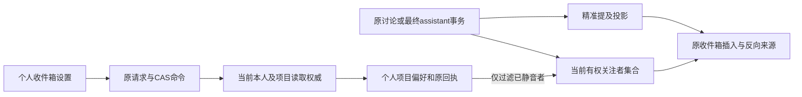

# 项目个人通知偏好架构与AI SOP

T-NOTIFICATION-PREFERENCES-167；速码1.0.0；2026-10-31。负责人：主集成代理。状态：业务与独立只读视觉已限定核验。关联需求：原始31项中的团队协作、可视配置、事件预警与易用性；继续现有Multica协作方向，完整58限定／34待交付／92项不变。合同见[项目通知偏好](../../contracts/project-notification-preferences.md)，交互见[设计规范](../design/project-notification-preferences.md)。

## 模块与权威

偏好是账号＋组织＋项目的个人领域，不是项目级通知总开关，也不是任务关注本身。表`suma_project_notification_preferences`使用独立id主键、tenant/project/user唯一键及版本。缺行只读返回v0/false/空时间；读取不创建偏好。viewer有权管理自己，不能选择别人的接收人或扩大项目写权限。

所有入口复用现有控制面及当前授权事务。Browser／ProjectAPI被显式允许；Runner／Agent／Pool与代他人请求在进入领域前拒绝。组织→当前用户／凭据→项目的既有锁序不变，不能为了过滤接收者再逐人拿锁。人／API消息与正式assistant结果已使用相同权威和项目事务边界，偏好更新与消息提交据此确定先后。

## 写入、版本和恢复

命令闭合包含project_id、expected_version、followed_discussions_muted、idempotency_key，全部必需。false与0是有效显式值，不能从缺字段或null默认补齐。操作标识按UTF-8字节验证，HTTP16KiB边界、未知／重复字段与额外查询参数检查不放宽。

先验证当前权限，再按原body/key恢复原回执；没有原回执才读当前偏好做CAS。真正改变才加版本和更新时间。no-op仍持久原回执，默认false的首次no-op不插偏好行。偏好写、CAS行数、回执与最终授权检查同事务；任何失败整体回滚。

旧回执证明的是原操作，不是此刻设置。UI确认后必须另读当前状态，不能用旧v1覆盖已有v2。冲突不自动换expected_version或另建key重发；不确定提交保留原请求，不能以刷新成功或看到相同布尔值冒充原操作已确认。

## 发送与读取分离

只在`projectTaskSubscriptionFollowersTx`当前有权关注者的集合SQL中加入同tenant/project/user的静音排除，复用唯一键查询，没有每接收人额外授权锁／网络请求。精准提及仍先沿原投影写入；被提及者不再收到同消息的重复关注通知。

静音不会改变关注行、历史通知、来源反向绑定、未读计数或已读版本。解除静音不补发历史讨论。人／API消息和完整来源绑定的最终assistant回复使用同一个过滤点；模型片段、运行进度及日志没有通知资格。交接、验收和其他通知来源不进入此过滤。通用收件箱插入器和读取器不读取偏好，避免用“读时隐藏”伪装发送抑制。

初始schema守卫位于`Service.Initialize`任何新DDL之前，已存在的不完整／未登记结构拒绝，保留原数据。复用SQLite／OceanBase／PostgreSQL方言；没有旧版本适配、回填或默认数据修复。不同数据库、真实并发规模与生产能力分别需要证据。

## 接口与代码接缝

- `GET /api/v1/notification-preferences?project_id=...`：当前个人观察。
- `POST /api/v1/notification-preferences/commands?project_id=...`：原请求、CAS及回执。
- `ProjectNotificationPreferences`、`ProjectNotificationPreferencesCommand`、`ProjectNotificationPreferencesReceipt`从Go同源生成OpenAPI／TypeScript，当前输出闭合且不接受身份覆盖。
- Go领域在`internal/platform/project_notification_preferences*.go`，过滤复用原`task_subscription_projection.go`；React控制器在个人收件箱内常驻，沿原write-action与独立领域存储作用域，不新建通知调度器。

参考Multica固定`e8ae72c9dfc1b4474b61a9087f51b33cbee6a048`的个人通知分组与集合投影思路；本阶段独立实现并复用速码原权威／回执／收件箱，没有复制新版产品源码或引入依赖。此设置只覆盖关注讨论，完整通知分组、投递渠道与平台目标继续原计划。

## 人工与AI操作SOP

1. 确认本人、组织和当前项目，读取正式偏好；未知读取不能显示成未静音。
2. 明确修改一个开关，使用已读版本及新操作标识；AI/API不得代写其他成员。
3. 保存中禁止重复提交；若结果不确定，沿原path/body/key核对，不新建请求“补发”。
4. 原回执确认后重读当前状态；若他人窗口已改到较新版本，展示当前值，保留原回执事实。
5. 检查新讨论的原始通知投影与来源链接，而非只检查页面是否隐藏；精准提及与历史通知仍应存在。
6. 撤权先清受保护状态并保留原操作元数据；恢复权限后再核对。不得用设置保存宣称任务执行、测试、验收或发布成功。
