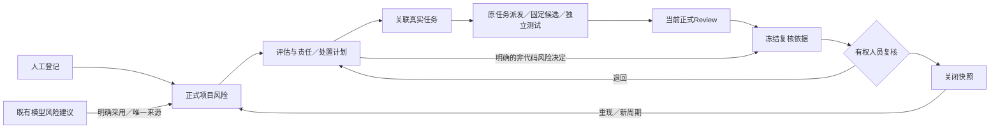

# 项目风险领域架构

状态：T-PROJECT-121实施中；产品1.0.0。负责人：项目治理、质量、工作台。需求：[PRD](../product/project-risks.md)。接口与执行不变量见[合同](../../contracts/project-risks.md)。

## 领域边界

`PlanningAlert`是固定规划输出的建议投影，保留原确认／处理语义；`ProjectRisk`是人员明确建立并持续负责的风险聚合。正式来源映射由领域拥有，不把可编辑通用记录的Data当作风险身份或验收依据。

风险域负责当前评估、责任、处置策略、关联、复核和关闭历史；任务域负责开发派发与当前正式验收；DAG／Runner负责真实执行；质量域负责固定来源测试。关闭风险不修改任务、运行、质量或发布状态。

## 一致性与权限

读写复用当前项目权限和治理协调事务。所有写入使用原操作身份与明确版本；当前授权在回执恢复之前核验。旧请求恢复原结果，不把当前后续版本当作原决策。

负责人必须是当前有项目访问资格的人类资源。关联仅允许同租户同项目的真实任务、需求与问题。风险的链接不会扩大权限或给模型派发权。业务版本变化通过正式复核依据表达，不能从日志或原建议标题反推。

提交复核时读取并冻结当前风险评估、负责人资格、关联记录和适用的任务验收依据。批准关闭时在同事务中重新核对。开发过程中链接的任务可以正常演进；已提交的复核只适用于其固定依据，变化后须重新复核。

代码缓解要求原任务的当前正式验收与质量门禁；接受、避免、转移、不适用保留人员的理由与证据声明，不据此宣称存在独立测试。重开产生新周期并保留历史关闭快照。

代码依据沿当前父节点attempt的受保护子流程关系递归读取同租户、同项目的成功子运行，最多32层、累计10,000节点。子流程的代码不能因顶层没有候选而被当作非代码行动。未提供等价证明的映射、外部流程和复杂代码来源明确返回`risk_execution_source_unsupported`，不自动放行。

## 模块与扩展

`internal/platform/project_risk*`拥有业务DTO、验证、事务存储和HTTP处理；公共Schema和TypeScript从Go模型生成。Web复用项目概览、项目计划、标准详情及任务派发入口；列表和有界历史分页不引入新的执行中心。

新风险表属于当前platform领域初始化，产品仍为1.0.0。保持现有当前库声明与新库初始语义，不添加旧字段别名、迁移链、回填或用户库重置。未来外部告警、跨项目组合与自动策略需要各自的当前授权和来源合同，不能借通用风险字段执行外部操作。
