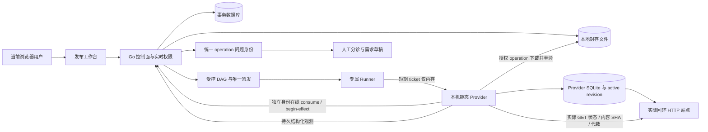
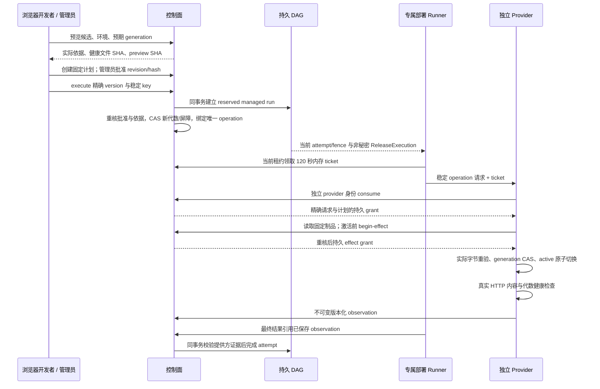
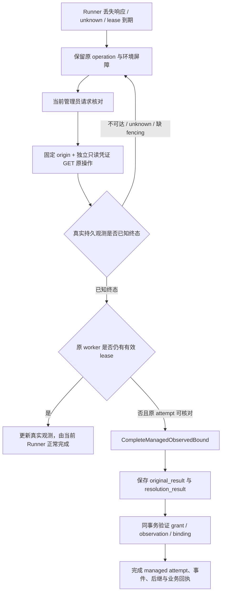

# 发布证据、授权与未知结果恢复架构

| 文档属性 | 内容 |
|---|---|
| 状态 | 2026-10-24，当前本机实现架构；完整平台仍在实施 |
| 负责模块 | 主集成代理、发布控制面代理、Runner/Provider 执行代理 |
| 关联需求 | [实施计划](../delivery/implementation-plan.md) P5：质量、发布、运维与问题回流 |
| 正式合同 | [发布执行](../../contracts/release-execution.md)、[发布控制面](../../contracts/release-control.md) |
| 数据设计 | [制品存储与一致性](../data/release-artifacts.md) |
| 操作与验证 | [部署手册](../deployment/release-control.md)、[控制面验证](../quality/release-control-verification.md) |

## 1. 架构范围与信任边界

本轮将真实静态制品、固定源码构建/包测试、业务人工验收、发布计划、独立批准、受控 DAG 和实际 HTTP 健康连接起来。首提供方为 `local_static_site_v1`，传输协议为 `suma.release.v1`。它只在管理员固定的本机回环站点服务静态文件，不执行上传文件、任意发布 shell 或用户指定健康 URL。

浏览器负责形成和审阅计划；Go 控制面拥有平台任务派发权、当前权限与正式证据；Runner 只领取受控 assignment、执行固定命令或调用登记提供方；Provider 独立验证授权、持久操作与环境 fencing，并报告实际效果。普通 `external_workflow` 的输入、图上 approval 节点、`passed:true`、`source_ref` 或静态插件 token 都不能获得发布权。

图中 Provider 下载实际经控制面的授权 HTTP 接口完成，不能直接拿文件区路径。箭头表示职责和数据关系，不表示已部署分布式对象存储。

首轮信任管理员管理的 Runner、固定命令配置、控制面与 Provider 主机。profile SHA 是配置摘要，未测量可执行文件或脚本的实际字节，不能证明管理员主机未被攻破，也不是第三方签名、公证或可复现构建认证。外部厂商 CI、云发布、S3、真实 OceanBase/PostgreSQL、生产流量与跨平台安装分别保持待验收。

## 2. 证据分层与关联键

| 层次 | 持久对象 | 必须绑定的依据 |
|---|---|---|
| 源码执行 | DAG attempt、workspace evidence | tenant/project/run/node/attempt/fence/worker、固定源码 C、实际命令结果 |
| 文件事实 | upload、blob、sealed artifact | 真实长度与文件 SHA、规范 manifest SHA、当前上传身份 |
| 构建/测试事实 | ArtifactProof | 当前成功 attempt、profile SHA、workspace SHA、同一 artifact/manifest/C |
| 业务验收 | Review、ReleaseTaskBasis | 实际任务版本、run、需求/依赖依据、人工验收 ID |
| 可交付范围 | ReleaseCandidate | 同 run 的两类 proof、同一包与源码、按 ID 排序的任务 scope SHA |
| 发布授权 | ReleasePlan、独立 approval history | 不可变 revision/hash、候选、环境策略、代数、保留 run/node |
| 外部副作用 | Deployment、authorization grant、observation | 稳定 operation、精确 assignment、request SHA、generation、effect grant |
| 实际服务健康 | HealthObservation | 本代 active、manifest/file SHA、实际 HTTP 状态/内容/时间和 fencing ACK |

这些层次不能相互替代。制品已封存仍可能未构建证明；构建与测试通过仍未人工验收；批准只授权指定计划；已激活而健康失败表示实际服务已变化，不能回写成“未部署”。

业务任务、执行图和部署 operation 的身份保持分离。当前 ReleaseCandidate 要求任务正式验收覆盖本次真实构建/包测试的同一 run；它不是跨多 run 或多分支任意拼接的发布聚合器。

## 3. 不可变内容与可变投影

| 对象 | 不可变部分 | 当前状态与复核 |
|---|---|---|
| Artifact | manifest、摘要、upload 来源 | 文件完整性按消费路径复核；封存元数据不能冒充实时自检 |
| ArtifactProof | 原 attempt 与最终回执关联 | proof 留作历史；当前节点换 attempt 或结果依据不匹配即不可用 |
| Candidate | 名称、proof ID、任务 basis、scope SHA | 返回 `eligibility/blockers`；任务或需求变化不改写旧候选 |
| Plan | `revision/sha256/content` | `version/state/approval/execution_operation_id` 随有权操作更新 |
| Approval | 各次 actor、decision、reason、时间、plan SHA | 当前 approval 与不可变 approval_history 分开 |
| Observation | operation/version/evidence SHA 的每条观测 | 最新 deployment 与 environment active 是独立投影 |

计划当前每个新对象 `revision=1`；内容变更通过新计划表达。预览尚未分配 run/node，创建时分配唯一保留身份并生成最终计划 hash；因此 UI 应分别确认 preview SHA 与创建后的 plan SHA，不能认为二者必相同。流程中的任何 Config 都不能注入这些服务端绑定。

候选、计划、审批或环境策略发生变化后，读取历史仍保留原记录，但当前门禁失效。读到 `approved` 或旧幂等回执不能推导仍可启动；危险写在处理回执之前重新验证当前真实身份。

## 4. 授权链与单一派发

权限和身份分为四类，凭证不得互换：

- 当前 browser 项目 admin 或组织 owner/admin：配置环境、批准、撤销、执行、核对和回退。browser developer 可提计划；普通 reviewer、API/Agent/Runner token 不能批准发布。
- 管理员登记的专属 worker 凭证：只绑定一个 tenant/project/worker、profile 集与可选 deployment 权限。普通共享 Runner 自报能力不能领取 managed 部署。
- Provider 对控制面的独立服务凭证：固定 tenant/project/provider audience，执行在线 consume、begin-effect、观测与授权制品读取。
- 控制面对 Provider 的独立只读 reconcile 凭证：从管理员固定 HTTP 字面回环 IP origin 查询 operation；不能创建发布或执行副作用。

Runner 到 Provider 还使用固定 worker 传输凭证；该凭证只识别调用方，单独无部署权。短期 ticket 只保存 hash，原秘密不进入 Assignment、Config、journal、普通 receipt 或日志。丢失 ticket 响应可以为原操作重新领取，未消费旧 ticket 作废；已消费授权通过精确绑定的只读 inspect 恢复。

`CreateManagedRunBound` 将不可复用的内部 workflow、预留 run、领域绑定和 ready 队列同事务提交。绑定失败不留下可领取节点。公开 workflow 创建/复用、子流程与通用运行命令不能重新启动该内部部署。`ClaimEligible` 在创建 attempt 和占用资源前过滤无权 worker，避免其先抢走受控节点。

## 5. 事务边界、锁序与外部一致性

控制面所有同时触及授权、调度和环境的写入遵循 **organization → scheduler → environment**：

1. before 回调先锁当前组织并复核实时成员、角色和会话。
2. Engine 锁 `dag_lock`，使用数据库时间检查 lease/fence，再执行状态迁移。
3. 领域 bind/commit 回调在同一事务内锁环境，核对 candidate、approval、receipt、代数和屏障。
4. 状态、证明、事件、队列、资源和回执一起提交；任一校验失败全部回滚。

回调只使用传入的 `*sql.Tx`，不在锁内访问网络、不再次调用 Engine 写入口。实际制品接收先在锁外写有界文件；Provider inspect 在数据库事务外执行，返回后在新事务再次核验版本、身份和完整绑定。读到的外部快照不能越过 CAS。

这是当前正确性优先的单 scheduler 写锁，不是已完成分片增量调度或高吞吐证明。每个 SQLite handle 的串行连接、组织锁、文件 rehash 和完整列表等还存在规模成本；不能以本机正确性测试支持千槽位或 P95 指标。

Provider 另有进程独占根锁、按环境串行互斥和 SQLite generation CAS。它将完整 revision 物化后，以数据库事务更新 active 指针、fence 与操作记录；HTTP 选择同一 active 快照，并再次校验文件。文件系统写入和数据库无法组成统一事务，崩溃恢复依据持久操作、实际 revision 与 active 指针重新核验，不凭“请求发出”宣告完成。

## 6. 观测、健康与环境屏障

generation 表示最高预约代数，active_generation 表示已观测实际活跃代数，两者可能不同。归档或同站点重建不能重置环境身份；旧 generation 的迟到观测可保留历史，但不能改变新 active、当前健康或屏障。

| 提供方事实 | 控制面解释 | 屏障处理 |
|---|---|---|
| 已知未开始且持久 fence ACK 覆盖预约代数 | failed/cancelled 等已知终态 | 精确当前 operation 可释放 |
| applied 且本代 HTTP 内容/状态/代数均通过 | `deployed_healthy` | 精确当前已知终态可释放 |
| applied 且本代实际健康失败 | `deployed_unhealthy`，保留 active 事实 | 已知终态可释放，问题仍需处理 |
| effect unknown、无 fencing ACK 或事实不完整 | `reconciling` | 持续占用 |
| 只收到 Runner 停止或租约超时 | 执行归属不确定，不能证明远端未做 | 持续占用 |

成功观测必须匹配 protocol、provider、plan revision/hash、environment、operation/request SHA、generation 和 observation digest；还要求实际已消费授权，applied 时有持久 effect grant。每条健康检查绑定计划中的文件 SHA，实际 GET 核对状态、长度、内容 hash、`X-Suma-Generation`、`X-Suma-Artifact-SHA256`，另查询 `/.suma-release` 标记。错误内容的 200、重定向或进程存活单独都不能通过。

同 observation version、相同摘要幂等；同版本改内容返回 409。较旧合法版本只追加历史，不回滚最新投影；终态不能任意覆写。健康失败观测也必须保留实际时间、固定路径与本代制品依据，不能只传布尔失败。

## 7. 未知结果与 observed resolution

通用 DAG 的手工 reconcile、停止 ACK 或重试不能生成发布成功证明。Provider 已合法开始副作用后，即使 Runner 不再可达，也必须围绕**原 operation**恢复。

`ReconcileReleaseDeployment` 不接受 outcome 或健康结论输入。它读取真实 Provider 持久记录；仅在 `reconciling` 或 lease 已过期的 running attempt 且观测为已知终态时，调用 `CompleteManagedObservedBound`。该内部入口要求 authority 和 commit 回调、ReleaseEvidence，拒绝 ArtifactEvidence/unknown，且只接受服务生成的 managed run。当前 attempt/fence/worker 必须仍匹配。

恢复在一个事务保存 `dag_managed_resolutions.original_result/resolution_result`，追加 `managed_observation_reconciled` 事件，再核验已保存授权、请求摘要和 provider evidence，更新最终 attempt 与后继。原 Runner 的 unknown/失败报告不会被历史抹除，也不虚构失联 worker 发过 `Stopped`。本路径不能生成新的 build/package_test proof。

必须区分**现在还能否授权**和**过去实际上发生了什么**：consume/begin-effect 持续重验当前权限、候选和批准；已合法 effect grant 后真正完成的 active/健康，不能因之后撤批、撤权或修改任务而被抹掉。observed resolution 可确认这个已发生事实，同时保留当前审批 revoked、候选失效和问题未关闭。它没有重新批准计划，也没有给失效依据创造新的激活权。

## 8. 同操作问题回流与独立回退

Provider failed、健康失败、effect unknown/reconciling，以及 managed run 的失败投影，都汇入 deployment 的同一个 `issue_id`。实现使用 [release_failure_projection.go](../../internal/platform/release_failure_projection.go) 和 [ensureReleaseIssueTx](../../internal/platform/release_deploy_observations.go) 在组织与 scheduler 锁下围绕原 operation 建立唯一问题身份，避免一个故障分别从 Provider 与 `run_failed` 产生两条新问题。

问题保存 run、plan、operation 和首个来源事实；后续完整 Provider 观测、run attempt、原始结果与核对事件仍在各自历史中，不依赖问题描述覆盖证据。该投影不自动关闭问题；后续健康恢复、回退或人工诊断不代表缺陷已经验收完成。用户将问题提交需求池，沿用 [IssueToRequirement](../../internal/platform/delivery.go) 的稳定 `issue-intake-<id>` 操作身份生成需求草稿，重复提交恢复同一需求。

回退选同环境历史真实健康 operation 的准确候选与制品，当前任务/验收依据仍须有效。它重新经过 preview/create/approve/execute，使用新的 operation 和更大 generation；Provider 重验历史目标及字节，再做实际 HTTP 健康。回退不覆盖旧部署、不撤销旧失败、不自动关闭回流需求；无自动回退或任意 undo shell。

## 9. 实现索引、证据与待交付范围

| 模块 | 当前源码 |
|---|---|
| 规范 manifest/profile 与 wire DTO | [artifact.go](../../internal/releasecontract/artifact.go)、[deployment.go](../../internal/releasecontract/deployment.go) |
| 受信 worker、真实字节和 proof | [artifact_workers.go](../../internal/platform/artifact_workers.go)、[artifact_storage.go](../../internal/platform/artifact_storage.go)、[artifact_proofs.go](../../internal/platform/artifact_proofs.go) |
| 候选、固定计划与门禁 | [release_candidate_service.go](../../internal/platform/release_candidate_service.go)、[release_deploy_plans.go](../../internal/platform/release_deploy_plans.go) |
| 在线授权、观测和恢复 | [release_deploy_authorization.go](../../internal/platform/release_deploy_authorization.go)、[release_deploy_observations.go](../../internal/platform/release_deploy_observations.go) |
| managed 原子创建与最终结果 | [managed.go](../../internal/dag/managed.go)、[scheduler.go](../../internal/dag/scheduler.go) |
| Runner 制品/journal 与发布桥接 | [artifact.go](../../internal/runner/artifact.go)、[release.go](../../internal/runner/release.go) |
| 实际本地副作用与健康 | [execution.go](../../internal/deployer/execution.go)、[health.go](../../internal/deployer/health.go) |

已有范围证据包括 [控制面验证与故障修复](../quality/release-control-verification.md)、[执行原始事件](../quality/evidence/release-execution-tests.jsonl)、[执行源码与命令摘要](../quality/evidence/release-execution-verification.json)。真实 A/B/A、ACK 丢失、进程崩溃、包损坏、错误 200、并发重复与旧代数等场景各自记录范围；这些不能替代所有浏览器旅程或全平台最终验收。新增统一 operation 问题投影需以包含其源码版本的后续回归证据确认，不能倒用更早记录宣称已验收。

后续仍需交付跨机器制品与 Git 对象分发、S3/存储迁移与备份恢复、工具实际字节/环境固定、外部 CI 身份与签名、容器和云目标、生产健康/灰度策略、自动化处置治理及容量验收。历史 Windows/六平台 runtime 产物具有各自冻结源码版本，本轮源码能力不能自动归入这些旧包。
