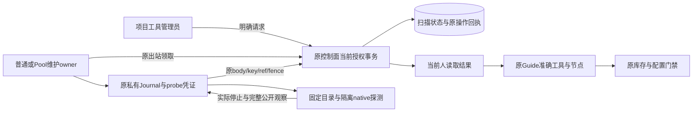

# 远程工具检测架构与 AI SOP

版本1.0.0；T-REMOTE-TOOL-SCAN-205；负责人：主集成代理；状态：本阶段实现与限定验证通过。关联[PRD](../product/remote-tool-installation-scan.md)和唯一[合同](../../contracts/remote-tool-installation-scan.md)。

## 领域与数据流

安装检测是节点级维护操作，不能伪装为已有profile重检。唯一ToolInstallationScan合同定义固定目录、能力、请求、claim／fence、结果和停止证明。一张请求表保存正式状态，原操作表保存幂等回执；机器能力仍附原ToolMaintenanceCapability，不新增调度器或缓存权威。

普通节点沿登记人当前项目资格；Pool沿当前拥有方、机器、本地scope、双边grant和项目路由。服务器对创建、领取、结果和读取分别核验当前权限及私有身份摘要。公开source摘要固定请求与逻辑instance，不随claim变化；摘要不是授权。

## 关键决定

- 复用DiscoverInstalledTools固定目录、一次PATH快照、12秒总期限和真实进程树停止收集；新远程目的使用隔离HOME／APPDATA／temp，避免读取原用户配置。请求不接受任意exe／args。
- 原serviceToolInventory和Pool维护owner串行消费；未确认库存、原profile检查及未知维护优先。与旧检查双向互斥，避免独立维护器并发启动本机进程。
- 明确允许安装检测与执行任务是不同权限。维护专用模式不新claim或execute业务，原未确认业务Journal不能被模式切换重置。
- pending300秒、claim60秒采用DB时间。租约过期转unknown，原ref可核对结果，不能重新派发。结果先持久化再传送，ACK丢失重传原操作。
- 完整结果需要全部请求项与真实停止证明；原回执但丢结果可closed_unknown，只表明停止已核对而结果仍未知。没有可靠回执时保留占用。
- 公开结果去除路径、内部Command和凭据；协议及产品名由正式目录核对。历史结果与当前能力、配置、登录、任务和验收分别展示。

## 存储、接口和演进

初始schema按原SQLite／OceanBase／PostgreSQL声明登记一表及必要索引；不增加旧版本分支、不重置现存数据。API和TypeScript由Go类型生成，固定目录和受限状态约束由生成器补充；当前身份和跨记录一致性仍在原事务中校验。

创建恢复先核对原操作，再读取准确ID当前状态。浏览器轮询有界、隐藏暂停，scope／caller变化停止旧读；只读历史不能覆盖未确认写入意图。后续严格操作和文件因果、远程配置写入须独立设计，不由安装时间推断。

## AI开发与排障SOP

1. 核对准确Worker、机器明确允许项及当前维护声明；未声明时回原Guide准备，不能拿浏览器电脑的安装结果代替目标机器。
2. 先恢复原未确认操作，检查原request／claim／fence和source；不要换key重试native操作。
3. 区分安装、准备原因、实际停止及平台配置；launch_supported不表示可派发。
4. 无完整结果时检查私有Journal与真实stop receipt。未知必须保留；不能从“没有PID”或“租约超时”补造证据。
5. 仅验证本次权限、并发、回执、固定探测与代表界面。缓存、私有SQLite、日志和图片留在忽略目录，Git只交付相关源码、设计和精简报告。

限定实际范围、原失败与剩余矩阵见[验证报告](../quality/remote-tool-installation-scan-verification.md)。
