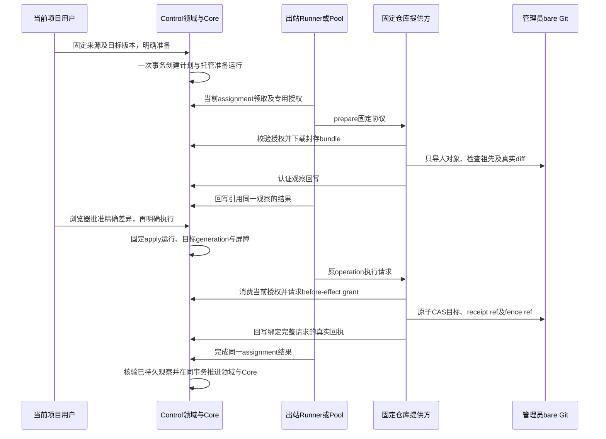

# 受控仓库集成架构与 AI SOP

状态：T-P4-028 限定本地已验证；版本：1.0.0。以下为冻结协议及当前代码分层说明，真实验收以阶段质量记录为准。
关联：[合同](../../contracts/repository-integration.md)、[PRD](../product/repository-integration.md)、[交互设计](../design/repository-integration.md)。

## 领域与依赖方向

`internal/platform/repository_integration*.go` 持有当前授权、来源资格、目标绑定、计划、批准、目标代数及独占屏障。
`internal/repositoryintegrationcontract` 定义前缀为 `Repository` 的独立协议，复用 `CandidateBinding` 和完整 assignment 身份。
`internal/repositoryprovider` 与 `cmd/suma-repository-provider` 持有本机 Git 目标及持久操作；
`internal/runner/repository_integration.go` 复用既有 external bridge、出站 Worker、租约、取消、Journal 与结果回写。

准备和执行仍为既有 DAG 管理的 `external_workflow`。通过独立的 `Assignment.RepositoryIntegration` 和
`Result.IntegrationEvidence` 传递合同，不伪装成模型工具、普通命令或 `ToolProfile`，不另建调度器。
仓库集成证据与 release／部署证据分别处理；Control 不读取 Runner 本机目录。

## 固定对象与持久化

| 对象／存储 | 职责 |
|---|---|
| `suma_repository_targets` | 不可变提供方／别名／分支／配置绑定，当前版本、目标代数及活动操作 |
| `suma_repository_plans` | 固定候选、代码验收快照、目标、准备／执行运行、期限与状态 |
| `suma_repository_approvals` | 审批者、理由、决定时版本、prepared SHA 与 basis SHA |
| `suma_repository_operations` | 原操作与唯一 run/node、固定执行、assignment、路由及请求摘要 |
| `suma_repository_authorizations` | 短期授权票据的摘要、消费状态及实际 effect grant |
| `suma_repository_observations` | `(operation, version)` 不可变提供方观察及摘要，拒绝同版本异文 |
| `suma_repository_reconciliation_grants` | 当前批准者签发的原操作核对票据及消费事实 |
| 提供方本机状态与 Git receipt ref | 不含秘密的意图／checkpoint，以及原子效果的不可变证明 |

`RepositoryIntegrationBasis` 固定任务版本、正式验收快照、来源节点、运行和封存 `CandidateBinding`。
候选原件不因当前名称或后续状态更新而变化。现有普通候选导入权限不因此扩大为任意跨运行读取；
专用 bundle 下载仍由 Control 按原操作、来源、请求摘要与当前 assignment 授权。

请求摘要绑定执行与完整派发身份；票据、`LeaseUntil`、`DispatchState` 不进入稳定摘要，其余输入及 audience 不可替换。
准备后的 `prepared_sha256` 绑定真实预览；摘要计算不把其自身递归计入。
Git 目标级 generation 和 fence 独立于 DAG 节点 attempt/fence，不能用后者替代目标互斥。

## 权限、事务与执行

准备使用当前项目写权限；绑定目标及批准／拒绝使用浏览器项目批准权限。
执行与核对允许当前项目批准者通过浏览器或范围 API 发起，apply 仍需要原浏览器审批者及批准依据当前有效。
Agent／Runner 凭据只承担获授权执行，不承担治理批准。

来源验收、测试、依赖、工具／知识及当前权限在准备时复验，固定版本在批准、创建执行及副作用 arm 前继续复验。
创建托管运行、唯一绑定、领域计划、批准引用、目标代数和屏障沿现有事务提交；网络和 Git IO 不在 SQL 事务内执行。
before-effect grant 还核对真实租约、Worker、路由及 Pool machine／slot／grant／credential 身份。
arm 前撤权阻止新效果；已获授权的效果可能完成，后续撤权不能擦除真实终态。

Control 先持久化认证的提供方观察，再接受 Runner 引用该版本与摘要的结果。
只有观察与执行、完整请求、effect grant、Git 回执一致，才可在 Core 结果事务中推进为已集成。
Runner 的输出文字、退出码或目标恰好等于候选均不能独立构成成功证明。

## Git 效果与未知核对

提供方只操作固定 bare 仓库；prepare 导入已核验的 64 MiB 以内 sealed bundle，不移动目标 ref。
祖先检查成立时，结果就是原已测试 candidate HEAD。实际文件清单最多 1000 项、diff 最多 512 KiB；
超限、二进制审阅不支持或目标分歧时阻断，不能生成不完整的可批准预览。

apply 使用一次 `git update-ref --stdin` 事务，原子完成目标 ref CAS、原操作 receipt ref 和目标 fence ref。
回执内容固定 request SHA、operation、目标身份／配置、before／result、bundle／prepared SHA、generation 与 effect grant。
禁止使用允许局部成功的批量更新；不执行 checkout、reset、push、任意 fetch、外部 diff 或 textconv。

提供方必须在副作用前写持久非秘密意图。重启、超时、取消或 ACK 丢失时仅检查同一操作，不盲目重做 apply。
存在合法正向回执时，即使目标后来前进，仍保留本操作实际已生效的证明。
没有回执时保持 unknown 和目标屏障；读取检查不产生负向结论。

负向核对另需当前批准者签发的一次性 reconciliation grant。提供方重新核对原请求后，通过原子事务建立
`not_applied` 回执并推进 fence，与可能残留的旧 apply 竞争同一预期 fence。正向或负向证明只能一方成立，
不能先解除屏障再希望旧事务不再写入。Control 只接受与该核对 grant 和原请求一致的证明。
托管恢复仍拒绝当前有效租约；浏览器不提交人工选择的 outcome。

## 运行与跨平台边界

管理员固定绝对 Git 可执行文件、独立 bare 仓库和 `refs/heads/*`；拒绝链接、浅仓库、replace、alternates、
符号目标 ref、重复物理仓库／分支别名及配置漂移。Git 环境隔离 global/system 配置、hooks 和外部执行入口。
保持 Windows／Unix 文件身份与锁语义的真实差异，不以某一平台的本地通过推导全平台安全隔离。

提供方仅监听配置的 loopback 地址，三类秘密分别承担 callback、Runner transport 和 Control inspect／reconcile。
票据、秘密、管理员文件路径均不得出现在公开 DTO、浏览器、模型、日志或持久 Journal 原件中。
原私有与 Pool 出站路由复用，不要求 Control 直接访问 Worker 磁盘；真正跨物理主机及远端 Git 托管仍需后续验收。

## AI 开发与排障 SOP

1. 先读任务的真实验收、run、独立测试及 sealed source；不能根据标题、Agent 总结或 exit 0 推导来源有效。
2. 从管理员预置 alias 开始绑定目标，核对实际 ref／配置／HEAD；不让模型或普通用户构造 shell、URL 或本机路径。
3. 固定版本准备，检查完整 diff 和 prepared SHA；审批只对该计划及依据生效。
4. 明确执行后沿 plan → operation → run/node/attempt/fence → provider observation → Git receipt 定位实际效果。
5. 断线恢复原 key；409 先读取当前计划，保留文字但重新确认。目标或来源变化需新预览，不直接修改旧批准版本。
6. unknown 保留屏障，先看当前租约与持久原操作，再走授权核对；不能靠手工改状态、重开进程或再次 apply 猜测修复。
7. 只验证受影响的权限、原子事务、Git 竞争及恢复路径。浏览器实际流程与本地／远端／生产证据分别记录，保留完整 P0–P7 后续范围。

阶段实现、实际 Git／中英文旅程及未验收边界见[限定验证](../quality/repository-integration-verification.md)。
