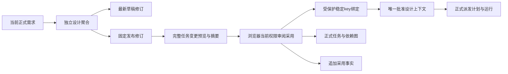

# 需求设计聚合与原子任务采用

状态：T-P4-016 限定范围本地已验证；完整平台继续实施。日期：2026-10-25。
负责人：平台领域／主集成；统一合同：[requirement-design](../../contracts/requirement-design.md)。
源码：[store](../../internal/platform/requirement_design_store.go)、[validation](../../internal/platform/requirement_design_validation.go)、[service](../../internal/platform/requirement_design_service.go)、[adoption](../../internal/platform/requirement_design_adoption.go)、[HTTP](../../internal/platform/requirement_design_http.go)。

## 领域与持久化边界

正式 requirements Record 保存当前需求；设计由四张专用表负责，不复用可编辑 Record.Data 作为批准来源。

| 正式表 | 职责 |
|---|---|
| suma_requirement_designs | 聚合 version、latest_revision、published_revision、状态及最近采用指针，按租户／项目／需求唯一 |
| suma_requirement_design_revisions | 保存草稿、发布和退役的不可变完整快照；修订号与聚合版本分别递增 |
| suma_requirement_design_task_links | 稳定 task_key→task_id、活动状态、采用修订／需求版本、task_basis、adoption_id；项目内 task_id 唯一 |
| suma_requirement_design_adoptions | 追加采用事实，固定计划摘要、设计版本、任务身份与实际版本；采用不改写设计修订 |

修订固定服务端读取的需求 id/version/title/description/acceptance_criteria，以及设计正文、完整任务提案与 SHA256。
SHA 绑定实际需求快照、正文和提案，不以客户端提供的来源对象或可编辑任务数据充当证明。
保存新草稿保留旧 published 指针；发布克隆已审阅正文为新发布修订，退役追加修订并清除当前发布指针。
聚合、快照和正式任务元数据分别投影，读取接口返回真实标题和正文；历史分页保留可审计的旧内容。

## 当前授权与并发控制

所有公开入口从实际 Actor 进入当前事务 proof。读取／预览为 ProjectRead，草稿为 ProjectWrite，发布、退役和采用仅 BrowserProjectApprove。
副作用命令在授权后先取得与 Review 相同的 DAG 项目 guard，再读回执和正式记录；避免验收与设计失效交错提交。
发布和采用对正式需求使用当前锁读；采用批量锁读已绑定任务，重新计算同一完整计划 SHA，再执行 CAS 写入。
聚合 CAS 与当前任务 CAS 均失败则整体回滚；授权范围、事务和实际主体不能由旧 Principal 或用户输入替换。
回执检查在当前权限之后；成功历史正文保持不变，仅重新投影该回执自身发布的当前资格，不能把新发布正文混入旧结果。

## 校验、预览和采用

草稿先校验安全结构与上限，再保存可继续编辑的完整性诊断；发布要求三段正文、需求验收、任务自身验收、无环闭合依赖和完整覆盖。
预览只读且不预留 task_id。计划 SHA 绑定聚合版本、完整当前需求、固定发布、全部有关绑定及完整当前任务，包含未变化和非活动绑定。
新 key 在采用事务内分配 task_id，依赖 key 映射为正式任务 id；已知 key 更新或恢复同一身份，不导入未经明确匹配的手动任务。
同一发布且内容／绑定一致的 keep 不重写任务或 adoption_id；无变更采用仅恢复最近采用结果，不追加新采用事实。
新发布即使任务文字相同也要求 update，推进正式绑定到新的设计基线；独立编辑造成的偏离必须通过明确预览修复。
更新与移出先传播验收失效，再显式归档移出项，避免失效逻辑重新打开已归档任务。旧 run_id 保留，当前 verified 依据清除。
一次采用的任务写入、图校验、绑定、失效、采用事实、聚合 CAS、审计及回执处于同一数据库事务；完整正式图仅复用一次校验，避免每任务全图扫描。
发布／退役也失效当前已绑定任务及其依赖验收，但历史运行定义、结果与证据不变，不自动取消运行。

## 执行消费边界与资源预算

resolveTaskRequirementDesignTx 只从受保护绑定和不可变发布解析：无绑定返回 nil；停用绑定、旧发布、来源变更或 task_basis 偏离均返回冲突。
消费上下文只含固定需求／设计版本、SHA、task_key、adoption_id 和三段批准正文，不重复整份任务提案。
TaskContext、启动、BindRun 和人工验收继续核对正式 TaskDispatchPlan.Context.Design；任意 Record.Data 或普通 run 不能冒充采用依据。
新草稿不会漂移已固定计划；新发布、退役、移出或独立任务偏离均需重新审阅。已开始节点保留其原版本定义。
设计正文合计16,000 UTF-8字节、提案256KiB、最多100任务；完整 goal 仍32,000字节，保持预算而不截断用户内容。
类型、错误定位和 API 合同集中维护，中英文展示由稳定诊断代码与统一语言目录提供；用户正文不翻译改写。

## 排障与恢复 SOP

1. 先核对实际身份、组织、项目及当前权限；403不以历史成功或更换身份绕过。
2. 使用当前设计 GET 比对需求版本、发布指针、资格和最近采用；revision 与 aggregate version 不可混用。
3. 遇409保留正文，检查来源变更、正式任务独立编辑和完整预览摘要；人审后重新生成计划。
4. 结果未知保留原 caller/path/method/body/key，恢复同一回执；明确成功后重新读取当前聚合，再发下一次 CAS。
5. 读取修订／采用历史定位旧基线及 task_id，保留原 run_id；先重新采用再派发，不能把旧结果标成新设计验收。
6. 来源归档后仍可由当前有权浏览器退役；不要删除不可变修订、改写绑定表或直接补 verified 数据修复界面。
7. 单批失败查看有界错误和事务结果，不记录设计正文或秘密；数据库故障排除后恢复原操作，避免局部手工补任务。

定向证据覆盖真实 HTTP、来源／任务元数据、旧发布与草稿、稳定 ID、排除后恢复、实际批准、旧运行门禁、预算及事务中途失败回滚。
SQLite 定向结果不代表 OceanBase／PostgreSQL 生产部署或规模验收；相关矩阵、实际 UI 和后续能力由主集成台账持续记录。
模型生成、外部设计导入、UED 原型编辑、跨项目复用和外部记忆／插件适配仍是后续边界，本模块不执行技能插件或模型调用。

实际浏览器、数据库升级及源码证据的精确范围见[阶段报告](../quality/requirement-design-verification.md)。
