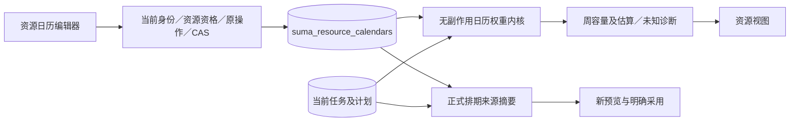

# 工作日历架构与领域边界

状态：T-CALENDAR-134；产品1.0.0。负责人：计划／控制面／工作台。需求与验收以[日历合同](../../contracts/resource-calendars.md)、[实施计划](../delivery/implementation-plan.md)及[限定报告](../quality/resource-calendars-verification.md)为准。

`internal/planningcalendar`只处理受限日期、七日工作制、日期例外和权重，没有数据库、权限或第二套调度器。领域服务拥有当前日历、资源资格、事务及回执；`planningCapacityTx`从原任务计划和日历派生本周数据。前端只编辑配置、展示原事实，不实现另一套分摊算法。

## 数据与一致性

`suma_resource_calendars`主键为tenant_id／project_id／member_id，保存version、schedule及updated_at。新增独立表沿当前已声明初始化合同安装，不改写旧表、不导入旧周工时，也不删除用户数据。全新库不创建旧周总量表。未声明的旧库仍沿现有初始化拒绝规则处理；已存在但缺少当前日历列的表在初始化写入前拒绝，不猜测结构。

日历写入复用同一当前授权事务和命令回执，先校验资源再判断重放；版本0以主键约束创建，其后以预期版本更新。日期和小时在入库前完整验证。历史原回执保留该操作产生的版本；当前投影需重新读取当前头。真实人员撤权后不能继续读取或重放修改。

## 权重算法

含首尾日期的区间按完整周数量与至多七天余数计算各星期出现次数，再应用至多366个日期例外。未知日数量与已知小时分别累计；明确null例外消除旧已知值，0例外消除该日可用小时。使用UTC日期／Unix日差，避免夏令时和大年份time.Duration溢出。复杂度O(7+例外数)，不逐日展开长任务。

只有完整任务区间全部已知且正估算的分母大于0时，才按可用小时比例分到重合周。UI可格式化小数，服务端不把显示舍入写回计划。未完整排期、未估算、未知／零分母分别保留，不能相互补零。

工作日历属于计划配置。它不证明真实出勤、请假审批、工作日志、机器在线或执行配额；不自动安装节假日数据，也不调用模型。外部HR／节假日同步、正式工时、连续历史与预测、跨项目组织容量及真实分布式数据库矩阵仍在原完整平台范围内。
