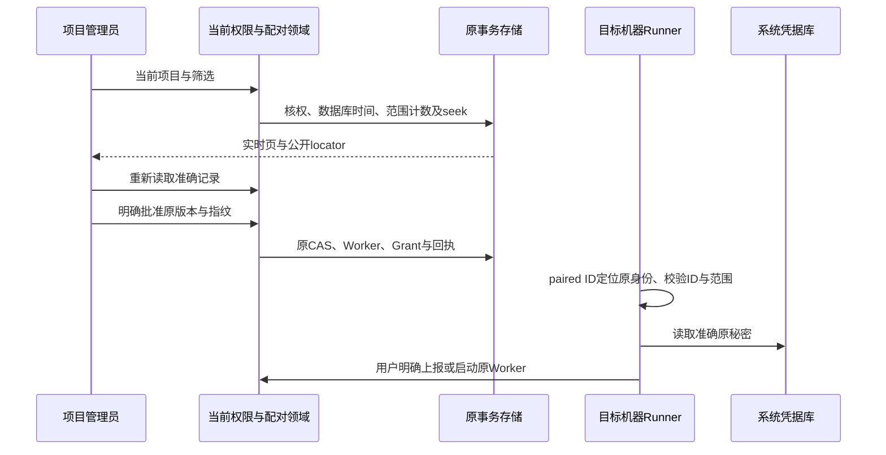

# 配对收件箱架构与AI开发 SOP

状态：1.0.0；负责人：主集成；需求：T-RUNNER-INBOX-185。接口：[合同](../../contracts/runner-inbox.md)，类型：`internal/runnerpairingcontract`，实现：`internal/platform/runner_pairing*`、`internal/runner/remote_identity.go`、原 Web 工具登记模块，证据：[验证](../quality/runner-inbox-verification.md)。

读模型复用原配对表的正式字段与 payload。固定 JSON 表达式兼容 SQLite、OceanBase MySQL 和 PostgreSQL 方言；没有新状态副本、表列回填或第二套凭据。新增范围／状态／期限索引优化有效待办查询，JSON created_at 排序仍需单独评估容量，不宣称已覆盖索引。

列表每次读取重新核验真实浏览器项目管理权限。游标携带末项 created_at／ID 和范围绑定，只用于 seek，不能赋权。计数与逻辑状态采用本次数据库时间；下一页不是冻结快照。并发修改通过刷新重新获取当前资格，不能从列表快照直接批准。

reason_code 是当前浏览器投影，既不是保存状态，也不是 Worker 健康证明。原写回执仍保留原事实；机器响应不增加浏览器诊断。operator 地址变化时仅原 CAS reject 可关闭有效待办，approve 和机器协议继续阻止漂移。

CLI 选择器与路径入口共用严格身份读取。选择器先验证 metadata pairing_id，再取系统秘密，随后原参数范围断言与 journal 初始化。系统库 SDK、account 派生、token、身份格式及 Worker 派发均沿用原实现。

AI SOP：先冻结共享 DTO → 按 backend／runtime／Web 文件所有权并行 → 仅新增及受影响检查 → 一次最终类型／词条／代表交互 → 核对源清单与未提交用户文件 → 独立提交并正常推送 dev。原184系统库实测在相关输入不变时复用，不用合成UI证明实际多机运行。
