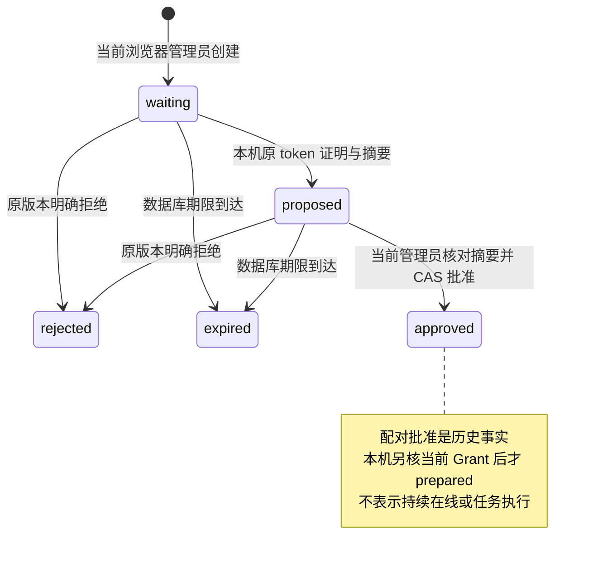

# 远程执行节点配对架构

T-RUNNER-PAIRING-184，suma 1.0.0。遵循[合同](../../contracts/runner-pairing.md)，复用原项目管理权限、独立 Runner Grant、Worker 登记及库存流程；不放宽桌面 HMAC／回环接口，不建立另一套身份权威。证据见[专项报告](../quality/runner-pairing-verification.md)。

## 状态与权威

共享 DTO 位于 `internal/runnerpairingcontract`，平台使用公开别名，Runner 使用同一合同。状态只包含图中的五种，版本从一递增。`can_approve` 仅来自本次当前浏览器管理员读取；机器结果恒为 false。客户端时钟不决定授权或到期，读取不延长期限。

## 两端交接

浏览器创建时先以真实 Actor 进入原 `artifactAdminTx`，再检查原 receipt。当前项目锁／SQLite writer guard 内同时检查最多八个有效待办并插入十分钟记录。运营方的安全 `Server.PublicURL` 固定在原件，包含准确路径，不从 Host、转发头或客户端正文推导。

机器不能公开创建待办。proposal／status 只接收既存随机 locator、准确项目及原操作键，必须携带本机原 Bearer token；服务端验证其 SHA 与固定摘要。名称仅为有界自报文本。原 proposal 的名称、摘要和操作固定后不可替换；陌生主体不能查询其他机器或列举项目。

approve 在当前浏览器管理权限与原 CAS 下完成：配对状态、服务端生成的 `remote-` Worker、原二十四小时 Grant／slot／digest／scope、活动与 metadata receipt 同事务保存；profiles 为空、deployment 为 false。薄共同摘要发行 helper 仅接受内部 desktop-runner／remote-runner 域，原桌面 wrapper、slot hash 和私有证明不变。浏览器、响应和业务 receipt 不含 token。

机器读取批准结果必须再走原 Runner 当前权限与准确 Worker 绑定；历史批准不能绕过凭据到期、撤销或成员资格。短效配对过期不撤销已发行 Grant。无效机器候选先独立只读拒绝，有效候选再进入原 writer 事务，按 authority → project → domain 顺序重新核验全部当前事实；不在同一 SQLite 读快照中升级写锁。批准后的 proposal 恢复结束其原事务后，才另行核验原当前 Runner 资格。

后续 approve／proposal／status 都将固定控制 URL 与当前运营配置准确比较，包含路径；变化时拒绝，不重定向或重写原件。reject 只结束 waiting／proposed，不撤销已批准 Worker，撤销沿原入口。

## 本机持久化与恢复

Runner 在首个 HTTP 前保存系统库 secret 和完整原请求。公开协议 `suma-runner-identity-v1` 固定 control、project、pairing、proposal operation、device name、credential SHA，批准后增加 Worker 和凭据 expiry；不包含秘密。系统库 account 同时绑定控制面、项目、配对和 identity 文件位置。本机锁、严格有界读取及原子写拒绝链接、损坏和混用。

创建／命令恢复原写回执快照，随后另 GET 当前状态；机器按同一 proof、正文和操作读取当前绑定元数据，不重新发行。secret 丢失或摘要不符直接拒绝。`--identity` 为原 report／显式 Worker 读取准确身份，显式 control／project／worker 不符时在网络和 journal 变更前拒绝；默认 journal 与该 identity 隔离，原库存 scope 约束继续有效。

固定 keyring SDK v0.2.6 适配 Windows、macOS、Linux；macOS 通过 `security -i` stdin 传递秘密。实现覆盖不等于跨系统实机验收。当前阶段不自动报告、Claim、发任务 Heartbeat、启用或执行任务。

## AI SOP 与证据

AI 保留原 locator、Actor／项目／版本、摘要、正文和操作键；未知写入先核原操作，不轮换凭据或清日志。名称不充当机器证明；批准必须由当前管理员核对准确摘要。公开 identity、库存、持续运行、启用、模型及业务验收分别记录。

已取得受控 HTTP／SQLite 和原身份协议定向证据。Root 的 Windows 实际系统库／HTTP 及代表界面限定结果见专项报告；注入 provider、合成 UI 与真实系统库分别计证。其他平台、真实多机、其他数据库、厂商模型和完整平台仍需验收。
