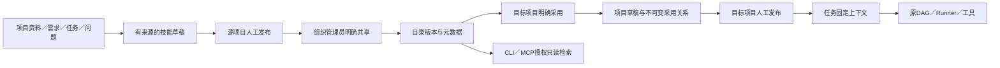
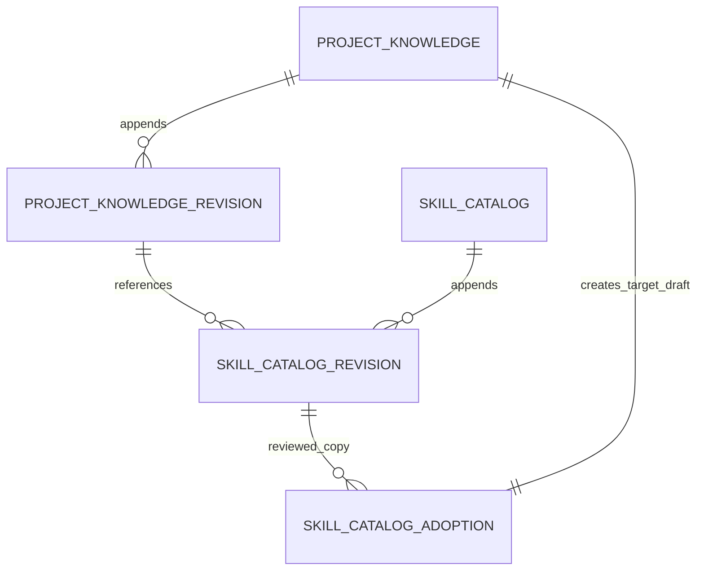

# 组织技能目录架构与 AI SOP

版本：1.0.0；阶段：T-P4-025；负责人：平台集成；关联接口：`/skill-catalog`、`project.skill_catalog_list/get`、`project.knowledge`。

## 领域边界与数据流

项目知识拥有正文和发布生命周期；组织目录拥有共享审核、元数据与修订指针；目标项目知识拥有采用后的独立草稿和发布。调度器仍拥有唯一派发权，技能目录不启动任务。

`suma_skill_catalog` 保存组织内当前 CAS 聚合和查询元数据；`suma_skill_catalog_revisions` 保存不可变审核快照；`suma_skill_catalog_adoptions` 保存目录版本、源发布与首次目标草稿的 ID／修订／SHA／审核者／原因。共三张新表、三个索引。目录不复制正文，按 tenant、origin project、knowledge、revision、SHA 解析原不可变正文；分享投影不返回原资料来源数组或 quote。

项目草稿后续编辑仍保留首次采用关系，但关系中的 SHA 指向首次草稿，不表示后来每一版正文与源完全相同。任务固定自己的批准正文、发布 SHA 和该溯源关系，允许逐步审查改动。

## 当前权限与事务

读取使用指定项目当前 read proof；API 还需其固定 scope。共享／更新为浏览器组织管理员加源项目批准权限，采用为浏览器目标项目批准权限。原生 Agent 默认目录不扩大。MCP 新增两项只读应用工具，取正文要求明确 `id/version/origin_sha256`，变化返回冲突，绝不以当前新版本替换旧 pin。

同一当前权限事务内完成 CAS、源资格校验、目录／知识／采用关系、审计、回执。当前权限先于回执检查。所有源和目标 tenant 从可信 Actor 与数据库确定，调用者不能提供正文、审核者、来源 snapshot 或租户覆盖。借用组织共享权限读取的正文不等于取得源项目权限。

共享与采用时检查源知识仍为当前有效发布、摘要一致、项目未隐藏、引用来源的版本与可见原文仍一致。源草稿编辑不改变旧发布；源重新发布／退役／归档或来源变化阻止新采用。历史目录读取和已有独立采用保留，历史运行不被改写。

目录 retired 不允许复活；如需重新共享，创建新的明确审核记录。更新固定原项目和原知识身份；不允许把相同目录 ID 偷换成另一技能。分页游标绑定 tenant、当前项目、筛选及边界；查询数量有界，不把关键词 LIKE 宣传为语义检索。

## 异常与恢复

- 409：保留本地草稿，读取新版本，逐项核对；来源发布变化后重新明确确认共享。
- 响应丢失：原 key／body／caller 重放，恢复原结果；重新检查当前权限与当前资格，不伪造新成功。
- 源已变化／隐藏：目录旧原文可追溯，不允许新采用；已采用项目决定是否另行更新。
- 采用事务失败：知识草稿、采用关系、回执均回滚，不能漏出半个草稿。
- 旧恢复请求跨账号／组织／项目：拒绝复用；不自动改写目标或生成新 key。

## AI 开发与运维 SOP

1. 先读当前状态、本合同与项目知识合同；确认技能是文本还是执行插件。当前目录仅为审核文本。
2. 从真实任务／问题／文档选择有权访问的来源，提取后展示原文与版本。模型建议属于草稿，不能自批共享或采用。
3. 先复用项目知识的不可变修订、来源校验和现有调度入口；不要新建相同正文仓库或直接写任务 goal。
4. 公共 DTO 进入 Go 合同生成器，同步 TypeScript／OpenAPI／MCP 目录；新增显示文字必须有中英配对，原始审计内容保持。
5. 并行代理按后端目录、UI、CLI分配文件；主集成代理负责旧知识接线、MCP、生成合同、预览和文档，避免覆盖共享文件。
6. 验证受影响的权限、CAS、事务、分页、MCP pin、采用→发布→派发。真实界面只检查代表性中英流程、刷新、窄屏及关键恢复，不重复无关完整测试。
7. 预览升级先验证隔离构建，保留原数据库与全部原表证据；只新增目录表。源代码、必要设计和精简证据本地提交，凭据、DB、日志与截图保留忽略目录。
8. 排障先查目录版本／source_current、原发布 SHA、首次采用关系、项目当前发布及任务固定上下文，再查运行。不要把检索成功、草稿创建或模型建议当作执行成功／质量验收。

## 能力边界

本阶段不增加依赖，复用 Go SQL 事务、SQLite／既有方言、官方 MCP SDK、React／Radix／i18next。OceanBase／PostgreSQL 真库、并发规模、向量服务、自动萃取评估、专家团队级共享与执行包签名仍须对应环境验收。实现证据见[限定验证](../quality/skill-catalog-verification.md)。
