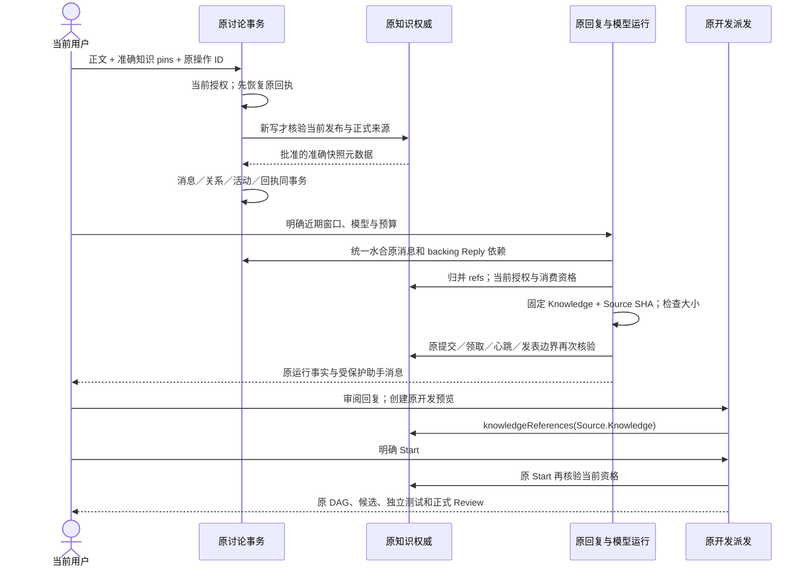

# 讨论知识的来源与消费边界

T-CONTEXT-145 冻结实现设计，初始 1.0.0；验证状态由阶段证据另记。[合同](../../contracts/task-conversation-knowledge.md)是字段和行为权威，本页说明既有模块如何共同保持准确来源。

## 权威与数据所有权

| 模块 | 拥有的事实 | 本阶段复用点 |
| --- | --- | --- |
| 项目知识 | 草稿、批准发布、退役、不可变修订和正式来源 | `resolvePublishedKnowledgeTx` 仍是当前可消费发布解析器 |
| 任务讨论 | 人／用户 API 消息、任务序号、当前写权限及原操作回执 | 原 Append 事务追加固定引用关系，不创建发布权 |
| 智能回复 | 固定 `Source`、摘要、模型选择、预算、受保护助手消息 | 原来源编译与当前核验加入知识依赖 |
| 开发派发 | 预览、Start、任务绑定及唯一 DAG | 原 `TaskDispatchPreviewRequest.Knowledge` 接受同一批准确 refs |

`suma_project_knowledge` 与 `suma_project_knowledge_revisions` 保持原发布模型。新消息关系独立保存 tenant／project／task／message、ordinal、准确修订与摘要、发表时标题和类型；不改变旧消息基础表、不回填、不根据正文猜引用。没有引用时可选字段省略，原纯消息 JSON 与来源摘要不因空数组而变化。

`TaskConversationKnowledgeReference` 只含 `id, revision, sha256, title_at_post, kind_at_post`。消息公开元数据不携带资料正文。批准正文仅在授权的准确历史读取和原受保护 `Reply.Source.Knowledge` 中使用，后者为 `ProjectKnowledgeContextItem[]`，包括原来源依据。

## 写入与准确读取

原 Append 先取得当前任务写授权，再恢复同一调用者的原操作；仅新写才验证 pin 当前可消费。消息、引用关系、原活动和回执同事务提交，任一失败全部回滚。恢复旧回执不因资料后来退役重新执行新写，也不调用模型。

GET `/project-knowledge/{id}/revisions/{revision}?project_id=…` 直接读取准确不可变修订并核验摘要，返回 `ProjectKnowledgeRevisionDetail`。它沿当前 `ProjectRead`，严格校验路径与闭合查询，不遍历历史分页、不回退 latest。历史修订的可读性和新消费资格是两个判断。

原 `taskConversationMessageMetadataTx` 统一水合列表、准确单消息、回复来源及开发来源：

- 人类／用户 API 消息读取固定关系，保持 ordinal 和发表时元数据。
- assistant 必须具有同租户／项目／任务的真实 completed backing Reply。核对受保护关系、Reply 的 MessageID、sequence、RunID 和 Source.SHA256 后，才从其 `Source.Knowledge` 派生引用。
- 消息自报 `reply_id` 不足以证明来源；assistant 上伪造的人类引用关系应拒绝。派生不递归展开 Reply.Source.Messages，也不解析正文中的链接或名字。

这使 assistant-only 近期窗口仍保留原知识依赖。历史显示不重新要求原作者保持活跃，也不把当前标题替换历史元数据；新的消费方仍须独立通过当前权限和发布资格。

## 来源编译、预算与再次核验

`taskConversationReplySourceTx` 在原最多 20 条近期消息内按顺序归并 refs。同一 ID／修订／摘要去重，同 ID 冲突明确拒绝，最多 16 项。通过 `resolvePublishedKnowledgeTx` 取得当前有效的批准正文后，写入可选 `Source.Knowledge`，参与原稳定序列化和 `Source.SHA256`。

知识计入原完整上下文 32,000 UTF-8 字节与最终请求 64,000 字节限制，不另开不计预算的附带正文通道。超过数量或大小明确失败，不自动截断、摘要或替换版本。单份知识沿原 16,000 字节正文上限；模型 Token／费用预算和模型窗口仍由原模型合同控制。

`checkTaskConversationReplySourceTx` 对固定 refs 再次调用原解析器，比较准确内容和来源摘要。创建与受控运行提交、原 claim／heartbeat、发表等已有边界均沿原当前权限／来源检查；新的发布、退役、来源变更或撤权阻止后续消费或发表。真实运行、用量及已产生的结果事实保留，取消／停止仍由原执行合同处理。

这些控制面边界不等于对外部提供方每个网络字节提供原子撤权，也不新增 SDK 默认模型、第二调度器或独立工具权限。资料属于不可信项目数据，不能覆盖系统指令或扩大权限。

## 开发传播与初始化

`taskDiscussionDevelopmentSourceTx` 仍核验准确回复及 protected 助手来源。预览将 `knowledgeReferences(reply.Source.Knowledge)` 交给原任务派发上下文，而非仅拼进 `reviewed_goal`；`taskContextForDispatchTx` 与原 Start 继续重核资料资格。新开发选择自己的模型、工具和预算，不借用回复授权。

新关系是当前初始 schema 的独立组成，沿组件预检／初始化注册，保留已有有效知识、消息与运行历史。发现局部或不符合当前约束的结构应在初始化写入前拒绝；不重置数据，不通过 alter／回填制造历史引用。

## 参考来源与采用边界

本阶段只读参考本地 Multica 锁定提交 `2083970b`，不复制该提交的源码或界面。下列定位记录实际能力，不作为速码已实现同类所有能力的证明。

| Multica 准确文件／符号 | 可参考的实际能力 | 与速码本阶段的区别 |
| --- | --- | --- |
| `server/internal/handler/project_resource.go`：`claimProjectContext`、`resolveClaimProjectContext` | 各 claim 共用 workspace 范围的项目身份、资源元数据和仓库解析 | 清单不是批准版本正文；速码准确引用失败不能降级到别的资料 |
| `server/internal/daemon/execenv/context.go`：`writeProjectResources` | 将项目清单写入 `.multica/project/resources.json`，处理已有文件碰撞 | 文件存在不证明模型读取其引用的内容 |
| `server/internal/daemon/types.go`：`ChatAttachmentMeta`；`server/internal/daemon/prompt.go`：附件提示 | claim／提示携带附件 ID、文件名、类型，要求显式获取 | 附件元数据不是附件字节，也不是 OCR 结果 |
| `server/cmd/multica/cmd_attachment.go`：`runAttachmentDownload`；`server/internal/cli/client.go`：`DownloadFile` | 请求附件元数据，再实际下载并保存文件 | 下载与模型实际解析仍是不同事实；本阶段不增加二进制附件通道 |
| `server/internal/handler/file.go`：`loadAttachmentForDownload`；`server/internal/handler/attachment_capability.go`：`DownloadAttachmentWithCapability` | 普通下载检查 workspace 成员资格；签名下载有独立 capability 边界 | 不据此宣称每字节都有当前项目授权事务 |
| `server/internal/service/source_context.go`：`SourceContextSnapshot`、`PrepareSourceContextCapture`；`server/internal/handler/source_context.go`：`cloneSourceContext` | 固定历史背景并实际复制所选附件对象 | 历史捕获不等于速码当前发布资格，不能绕过 retired／source_changed |

该提交 `LICENSE` 的 Part I 附加条件与 Part II Apache 正文共同构成 Multica License；第三方托管／商业嵌入、派生 UI 标识及后端归属各有条件。本阶段采用方式为行为与接口思路参考、速码独立实现，不把该源码视为无附加条件的 Apache 代码。既有旧提交采用记录仍见[原来源说明](../../third_party/multica-legacy/PROVENANCE.md)，不与本次参考混淆。

本设计不宣称通用附件解析、OCR、提供方实测、多机或生产验收。[产品](../product/task-conversation-knowledge.md) · [交互与 AI SOP](../design/task-conversation-knowledge.md)
