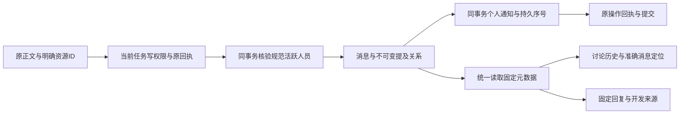

# 任务讨论提及：事务与来源

状态：T-MENTIONS-140 实现基线；验证结果由阶段报告记录。合同见[任务讨论精准提及](../../contracts/task-conversation-mentions.md)，既有边界见[任务会话](../../contracts/task-conversations.md)及[智能回复](../../contracts/task-conversation-replies.md)。

`AppendTaskConversation`保持唯一人／用户API写入入口。新增可选`mention_resource_ids`保持输入顺序；最多20项，重复、非人、跨项目、非规范绑定或失权接收人导致整个新发送失败。原回执恢复先于新发送的版本及接收人检查，发送成功后接收人撤权不会把未知提交变成再次发送。

提及关系单独存入`suma_task_conversation_mentions`，保存租户、项目、任务、消息、顺序、资源、固定接收用户、`name_at_post`及通知关系。旧消息表不增加字段、不回填正文中的名字。无提及的请求及消息使用`omitempty`，既有纯消息JSON和受保护来源摘要保持原形状。

消息、提及、个人通知、两类序号和回执使用原授权事务。任一步失败即全部回滚，包括不消费个人收件箱序号。新通知来源绑定准确消息与固定接收人，而不是当前任务负责人；不能复用任务分配的负责人相等条件来伪造提及事件。

普通历史、单消息详情、回复上下文及讨论转开发的读取统一经过`taskConversationMessageMetadataTx`，水合同一份不可变人员快照。不能仅在普通页面追加当前目录名称：这会使固定模型上下文与重新核验的消息JSON不一致。智能体回复继续只接受经原run／attempt／fence／模型依据核验的纯文本结果，不能创建提及关系。

当前人员目录与历史快照各自承担不同职责。目录在每次读取重新核验当前项目读取资格；选中ID模式保持原顺序并省略不可用对象。它不授予发送权限，追加事务仍重核全部目标。目录游标绑定当前人员、租户、项目、任务、查询及条数，不能用于另一范围。

收件箱仅水合当前有权的任务摘要与准确消息锚点，不缓存讨论正文。`task_mentioned`必须同时满足原人员消息、正确提及关系及通知反向绑定；损坏或缺失来源保留个人事件，清除链接和当前来源。个人已读／归档沿用独立版本、原操作回执及权限，不改变任务执行或验收。

会话消息序号是受JavaScript安全整数约束的任务内序号；收件箱序号是以十进制字符串返回的项目级BIGINT。两者不可混用。准确定位使用消息ID直接读取，不依赖循环遍历最新历史页。

新域初始化只创建当前空关系结构。既有局部表、视图、缺少主键或唯一约束的形状应在其他初始化写入前拒绝，不自动修补或推断历史。

定向检查覆盖真实规范接收人、自提及、viewer资格、原子回滚、撤权后恢复原回执、固定名称、普通零提及JSON、原回复／开发来源、超过最新窗口的准确定位及收件来源损坏降级。协议测试不替代真实提供方、浏览器或其他数据库验收。
