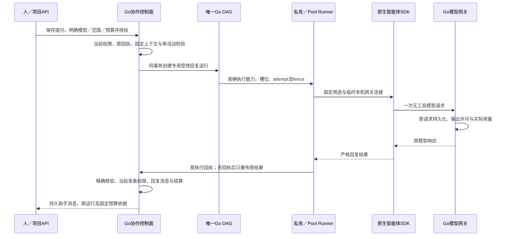

# 多轮任务回复架构

状态：1.0.0，T-REPLY-128；负责人：协作、模型网关、Runner、工作台。完整P0–P7、需求1–26保留。字段语义见[合同](../../contracts/task-conversation-replies.md)，操作见[AI SOP](../development/task-conversation-replies.md)，证据见[验证](../quality/task-conversation-replies-verification.md)。

## 领域和数据

`task_conversation_reply_*`模块负责来源、创建、观察、准入、结果与命令；原`task_conversation`仍负责不可变顺序流。`internal/taskconversationreplycontract`定义Go侧受限回复结构，原生SDK有对应严格解码。新用途复用既有模型合同、Go网关、预算账本及执行者，不能自己向提供方请求或记第二本费用账。

`suma_task_conversation_replies`保存准确版本及固定来源；`reply_active`按任务唯一阻止并发／未知重发；`reply_outcomes`保存原attempt／fence／结果摘要；`reply_messages`以消息ID、回复ID唯一关联原提问及独立运行。消息表无需添加历史解释或回填逻辑；人／API字段按当前定义为零，助手字段必须由受保护关系补齐，否则读取拒绝。

来源窗口最多20条，用户明确选择；正文与整个提示分别有界。较早内容未包含时明确显示，不自动假设长期记忆完整。正在运行时出现新消息，仍回答原提问；后续轮次使用新的准确来源和预算。回复完成不改变任务业务、开发、质量或发布事实。

## 授权与故障

登记的只读回复运行按其受保护关系进入普通执行节点准入，不借用部署权限。领取与心跳核验原身份、当前能力／路由／模型及来源；完成回执分开保存真实执行事实与“可否发表”。任务变化或撤权不能变成另一笔模型调用，旧fence不能覆盖新状态。

模型可用、已配置、当前费率、预留量和实际用量是独立事实。项目API读取模型选项复用项目读取权限；撤销登记者权限可能同时使其执行节点库存失效，不能把失效库存继续显示为可用。密钥只留在Go宿主和私有网关，不写入提示、消息、读响应或通用活动。

回执丢失按Runner原journal及原结果操作标识恢复；同一模型调用和助手消息不得重复。本阶段实际验证的是完成提交后断开连接，再重传同一原结果操作，尚未验证从持久结果Outbox重启恢复。仍有效原attempt的只读完成核对沿原DAG机制；失效节点缺少原终结证据时保持未知。取消必须等待真实停止；精确版本、活动占用释放和命令回执同事务完成，通用运行入口不能绕过。

## 产品边界

本阶段提供原生多轮只读建议及真实CLI执行承载。回复不能请求文件工具、运行shell、自动接受设计或交付；正式开发仍走任务计划和已有执行节点。交互PTY、完整自主开发策略、附件／私密会话及跨端离线协作继续作为完整平台要求。

*English: Each explicit saved question creates a separately managed, budget-bound read-only reply. Exact task/requirement/message versions and real attempt/model receipts determine whether an assistant message may be published. The task's development run and acceptance remain unchanged. Unknown work is inspected, not resubmitted; cancellation waits for actual stop evidence.*
