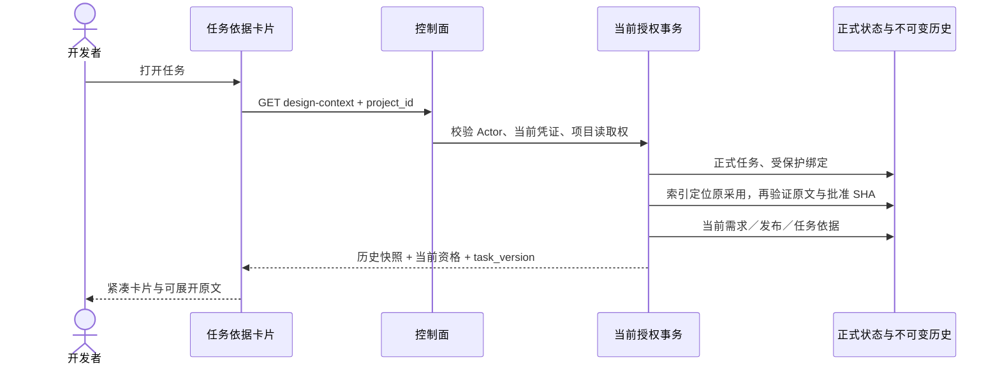

# 任务设计依据：领域、读取模型与 AI SOP

状态：T-P4-017 实现；负责人：平台集成。关联：[PRD](../product/task-design-provenance.md)、[合同](../../contracts/task-design-context.md)、[需求设计领域](requirement-design.md)、[CLI](../api/cli-project-context.md)。最终证据见[阶段验收](../quality/task-design-context-verification.md)。

## 模块边界

`task_design_view_types.go` 定义公共只读 DTO；`task_design_view_http.go` 只解析严格的单项目查询并分派；`task_design_view.go` 处理当前授权、任务归属、来源证明和资格；`task_design_view_store.go` 负责派生关系索引及迁移。批准、采用和派发仍留在既有领域模块。前端独立卡片消费正式接口，CLI 复用统一 HTTP 客户端，不复制服务端权威逻辑。

## 来源定位与证明

追加关系表 `suma_requirement_design_adoption_tasks` 保存采用版本、任务稳定 key／ID、动作及任务版本。它与正式采用记录同事务写入；迁移按稳定组合键每页32条回填，重复迁移幂等，不改旧任务、采用或修订正文。读取按任务索引定位，不扫描整个项目采用历史。

索引只能定位，不能授予权限或证明正文。服务仍检查租户／项目／需求、采用 JSON 的 task key／ID／action、固定需求版本、发布修订及 SHA。活动绑定使用其实际采用；排除绑定寻找不晚于排除记录的最近 create/update；keep 不改变实际来源身份。缺少或篡改原始材料时，返回 bound=true 与 source_unavailable，并清除未获证明的内容。

资格优先级为 source_unavailable、excluded、retired、publication_changed、requirement_changed、task_changed、current；none 仅代表无绑定。常规任务状态、版本递增和运行关联不构成 task_changed，正式字段比较复用 taskBasis。当前需求消失和原始证据损坏是两种事实：前者可保留独立可证历史，后者不能拼接正文。

## 一致性与交互

公开读取由当前同事务授权保护。调用者、项目、任务、版本或刷新标识改变时，前端立即撤掉旧视图；作用域检查阻断晚到结果。原批准正文与当前版本元数据分开，展示失配不自动修改任务。是否派发、绑定运行或验收，继续由相应领域命令复核，不能依赖页面读取时的资格快照。

中英文成对目录扩展现有 i18next 架构，不以中文正文做 key；原文和用户数据保持。组件展开由稳定事实标识保持，语言变化不重置。类型与 OpenAPI 从同一生成器输出，检查应确认 readOnly 字段、身份范围及路径一致。

## 维护冻结与部署边界

控制面新增显式 `--maintenance` 启动模式。在解析业务请求前冻结 API 写入，只允许精确登录／登出及 GET／HEAD／OPTIONS，其他命令返回423与维护诊断；自动化、DAG调度、索引及故障投影 ticker 同时暂停。此模式用于升级核验，读取和认证协调元数据仍可能写入；不是数据库只读，也不冻结其他控制进程或已有外部副作用。模式不可通过在线 API 解除，需要正常重启，避免核验期间自动恢复派发。见[升级操作手册](../deployment/preview-upgrade.md)。

## AI 开发与排障 SOP

1. 从正式任务与受保护绑定开始，确认原采用 ID；禁止根据标题、Record.Data 或相近版本推断来源。
2. 出现来源不可用时，区分当前需求缺失和原采用／修订验证失败；只记录 ID、版本、摘要与错误码，日志不输出凭证和完整私有正文。
3. 索引问题先读取不可变采用原文，核对关系中的稳定 key／ID／动作；使用幂等迁移重建派生关系，不修改批准历史来迎合界面。
4. 新增资格或字段时，同时修改领域 DTO、生成合同、中英文目录、相关组件与设计文档。未知外部错误保留原证据，不能自行归类为已批准。
5. 修改只跑受影响领域、合同和消费者检查；迁移及权限边界保留关键回归。构建到隔离目录，代表性真实界面验证后再切换预览；必要源码和精简证据通过阶段 commit 留痕，原始数据库／日志／密钥／程序不入 Git。
