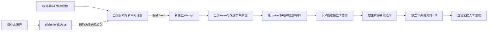

# 同任务候选续作架构与AI SOP

状态：1.0.0；负责人：主集成；需求：T-DEVELOPMENT-CONTINUATION-186。权威：[合同](../../contracts/task-development-continuation.md)；实现：`developmentcontract`、原讨论／派发及 code-input 模块、Runner原工作树与候选模块；证据：[限定验证](../quality/task-development-continuation-verification.md)。

新 DevelopmentContinuationBinding 与已验收跨任务 CodeBaseline 是不同的正式类型。前者只证明当前明确采用同任务代码，不具备 AcceptedBasisSHA256，也不继承原模型、预算或质量状态。结构摘要固定任务、原运行版本和全部封存来源。

原 TaskDispatchPlan 是唯一完整绑定原件，不新增第二套派发或工作区管理。节点只带计划ID marker；可编辑流程、客户端 transfer ID 和本地 Git 对象都不能授予导入权限。新 Start 改变当前任务运行后，通过原 task_run_provenance 保留准确历史关系，避免错误地要求旧运行仍是当前运行。

控制面按当前主体／项目／任务权限选择来源，固定 node、attempt、fence、worker、结果及完整 bundle。原 code-input broker 在读取原件前后检查当前消费授权和原来源。执行直接输入互斥；TaskContext 中既有已验收祖先事实保留，新开发节点选中 M。

Runner复用现有下载、摘要、大小、Git前提与祖先校验。工作树输入是 M，产物是 N，完整传输以管理员 B 为前提锚点。即使本地已有提交仍要求新授权；不复制旧工作树、CODEX_HOME 或登录。正式结果与进度沿原 journal／回执，未知效果按原恢复协议处理。

参考：当前本地 Multica 提交 `5a2cc891a` 的任务执行、会话状态与工作区隔离思路。该快照 LICENSE 包含 Apache2正文及额外条件；本阶段在 Suma 原有模块上实现流程，未分发 Multica 源代码。旧 thread-resume 不是本合同的代码连续性证明。

AI SOP：冻结唯一共享类型与marker → 控制面／Runner／Web按文件所有权并行 → 定向核验源漂移、授权与真实Git链 → 最后一次类型／词条和代表交互 → 固定源清单与证据 → 正常提交推送dev。未变化的模型SDK、配对、安装矩阵不重复运行。源码、受控HTTP／SQLite、真实Git进程、合成界面、真实厂商与生产分别记录。
