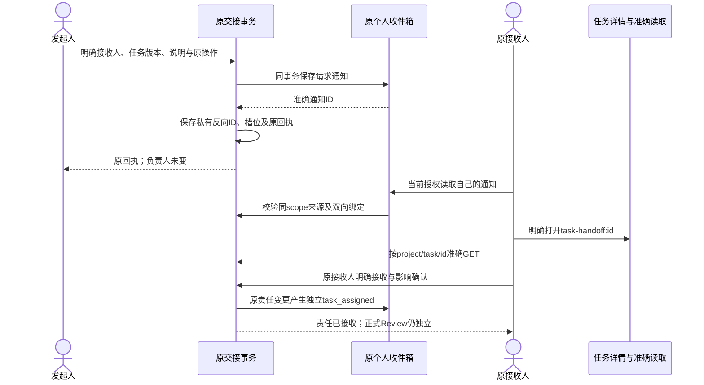

# 交接通知的事务与来源一致性

T-HANDOFF-INBOX-148，速码1.0.0。状态：实现与定向检查中，最终Git交付和GUI验收尚未完成。负责人：任务协作／通知／前端交互及主集成，按[合同](../../contracts/task-handoff-inbox.md)分工。[产品](../product/task-handoff-inbox.md)定义用户目标，本页说明当前模块协作，不构成生产验收。

## 权威与事务所有权

| 模块 | 拥有的事实 | 本阶段连接方式 |
| --- | --- | --- |
| 原任务交接 | 待接收槽位、固定依据、接收人与责任决定 | 在原事务内创建请求通知，保留原版本和命令回执 |
| 个人收件箱 | 私人事件、序号、已读与归档 | 按正式来源核验后投影当前任务及准确handoff ID |
| 任务责任 | 当前负责人、任务版本和交付失效 | 只有正式接收动作改变，产生独立task_assigned事件 |
| 交接面板 | 当前授权读取、用户输入和恢复入口 | 准确读取与有界历史页分离，不拥有业务决策权 |

`CreateTaskHandoff`沿原授权事务先恢复同一原操作；新写才验证任务版本、依据、接收人员及可选团队。新交接、pending槽位、`task_handoff_requested`、活动和回执原子提交，通知失败使全部写入及序号变化回滚。通知没有独立于业务命令的公开发布入口。

请求通知的`source_event_key`是原handoff ID，kind单独验证；接收user／resource和任务版本来自该交接的固定接收人及`basis.task_version`，不按当前负责人反推。

## 私有反向绑定

`taskHandoffStored`沿既有payload嵌入公开`TaskHandoff`并增加私有`notification_id`。创建及后续决定持续保留该ID；公开DTO、通用回执和公共metadata不包含它。没有DDL、通知回填或第二套事件表，旧无通知交接继续保持原事实。

收件箱读取只在以下条件全部成立时暴露`source_available=true`、`handoff_id`和当前任务：

- 原任务仍可读，通知与正式交接行属于相同tenant／project／task。
- 行ID、任务ID、版本和状态与payload一致，状态属于pending／accepted／returned／withdrawn。
- payload的接收user／resource及原任务版本与通知固定字段一致。
- payload反向`notification_id`与当前通知ID一致。

缺失、损坏或不匹配来源保留私人通知及其生命周期，只隐藏任务水合和跳转。SQL／扫描等执行故障直接返回错误，不能降格成“来源不可用”。请求通知不设置assignment_current，当前分配事实仍由task_assigned独立表达。

接收命令保留原角色、当前授权、依据与CAS检查；改变负责人和任务状态、失效已验证交付及下游结果，并投影独立任务分配事件。决定后仍保留请求通知，不自动已读或删除。责任接收不等于Task Review。

## 准确读取合同

`GET /api/v1/task-handoffs/{id}?project_id=P&task_id=T`只接受两个单值、非空、规范ID查询。未知、重复、缺失、跨任务及机器身份请求拒绝；不扫描历史页、枚举接收人或回退latest。

原`taskHandoffStoredTx`先验证同租户／项目的行和payload一致性；准确任务匹配后，沿现有依据与allowed_actions投影重新核验。终态可读不恢复写权限；GET不接受责任、不写通知状态。写入保留原数值lexeme进行强类型解码，不把小数版本舍入成合法CAS。

## 前端读取与草稿边界

路由固定为development/tasks、record=taskID、panel=task-handoff:handoffID。准确定位、分页历史及当前决策各有读取状态；页外卡片不注入历史页或改变计数。

编辑中的决策必须有成功的准确授权读取。失败或缺失时，即使旧分页仍有同ID卡片，也不能提供决策来源；有准确结果后才可结合已读更高版本继续当前版本核对。

读取绑定当前caller与范围，使用取消和代次隔离迟到结果。caller变化重建面板读取；401／403／404清除受保护事实和可执行入口。当前身份失权不能被旧响应覆盖。

同一按人员／组织／项目／任务隔离的草稿中，发起字段与决策字段独立。仅持久自己的原文、选择和版本；接收影响确认不持久，采用新版本后清除。原回执只清理完全匹配的部分，不抹除另一部分或后续输入。

## 实现与证据定位

- [事务与命令](../../internal/platform/task_handoff.go)、[私有载荷与准确读取](../../internal/platform/task_handoff_inbox.go)、[HTTP查询边界](../../internal/platform/task_handoff_http.go)。
- [通知来源投影](../../internal/platform/notification_inbox.go)、[原通知写入](../../internal/platform/notification_inbox_store.go)。
- [交接面板](../../apps/web/src/TaskHandoffPanel.tsx)、[草稿与DTO验证](../../apps/web/src/task-handoff-model.ts)、[收件箱](../../apps/web/src/NotificationInbox.tsx)。

[交互与AI SOP](../design/task-handoff-inbox.md) · [English](../en/task-handoff-inbox.md) · [阶段验证](../quality/task-handoff-inbox-verification.md) · [机器摘要](../quality/task-handoff-inbox-summary.json)。最终指标留在质量记录，不在设计文档重复汇总。

本切片没有改变原执行、测试和正式验收权威。完整58 limited／34 pending／92总项及P0–P7／需求1–26继续进行；真实GUI、供应方、多机、其他数据库和生产分别验收。
