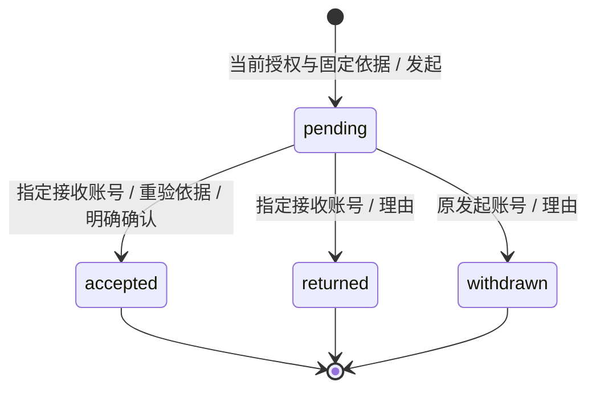

# 任务交接架构与 AI SOP

状态：T-P4-022 本地实现与必要验证完成，最终事实见交付状态。领域模型与 HTTP DTO 见[冻结合同](../../contracts/task-handoff.md)及[生成 OpenAPI](../api/openapi.json)。

## 领域与事务边界

TaskHandoff 是独立聚合，保存固定 TaskHandoffBasis、接收资源／账号／团队版本与决策。suma_task_handoffs 保存分页历史，suma_task_handoff_pending 以 tenant/project/task 唯一主键保存当前槽位；历史使用同域 keyset 索引。不存在第二调度器或额外授权平面。

写入复用现有 authority transaction：当前凭据与组织锁 → 项目 guard → 幂等回执 → 正式源读取／依据与目标资格重核 → 任务与交接 CAS → 槽位释放、下游失效、活动和操作回执 → 原子提交。当前权限在回放之前核验；同 operation ID 不同内容拒绝，未知结果不擅自补发。

接收修改负责人时遵循既有 taskBasis 规则，旧 run_task_basis 与原 run_id 保留为历史，verified_run_id 被移除，InvalidateDependentsTx 更新正式依赖资格。任务变化、交接变化及回执必须同事务成功。接收并不授予接收人任何权限，不创建 Runner、模型请求、运行或人工评审。

依据从当前任务与需求、关联运行及其相关执行／测试／证据／评审读取，摘要不把原始输出暴露给交接页面。子流程、补偿、活跃及未知尝试属于原执行核对范围；不能仅看主 run 的文字状态宣称可转交。

## 模块与可扩展性

- task_handoff_types.go 定义同源类型；task_handoff_store.go 管迁移、身份及分页；task_handoff_basis.go 固定并重核依据；task_handoff.go 执行业务状态与事务。
- task_handoff_http.go 校验唯一查询、严格整数词法、必填／null／未知字段及执行令牌边界；cmd/suma-contracts 同源生成 API 和 TypeScript。
- TaskHandoffPanel 只组合绑定当前账号的 API、AbortController 与既有 write-action；未知结果保持原 caller、操作和正文。服务器当前资格与不可变历史分别展示。
- 现阶段采用 SQLite 实际检查，OceanBase／PostgreSQL 复用已有 SQL 方言与索引适配；未运行的数据库不标已验收。

## AI 开发与操作 SOP

1. 确认项目、当前任务与需求／设计／知识修订，读取真实任务版本和交接历史。
2. 选择已登记并绑定真实账号的接收资源，必要时绑定其有效团队；发起一份固定说明和依据。
3. 若原执行仍活跃或结果未知，先按原 attempt／操作核对；不取消后盲目重跑，不自动转换为已知成功。
4. 接收人重新检查依据及影响，明确确认后接收；依据或资格变化则退回旧提案或由发起人撤回，并按当前事实重新发起。
5. 责任转移后使用新任务版本创建现有固定派发计划，运行在独立工作树与既有执行池，独立测试后再进行正式任务评审。
6. 交接说明和结论可作为后续知识提炼的审阅线索；知识、记忆、技能的发布与团队采用仍遵循各自版本和权限，不直接导入私人 CLI 会话数据库。
7. 仅检查改变的状态、权限、事务、重放及界面；保留真实失败，不重复未变运行、模型或全量矩阵。
