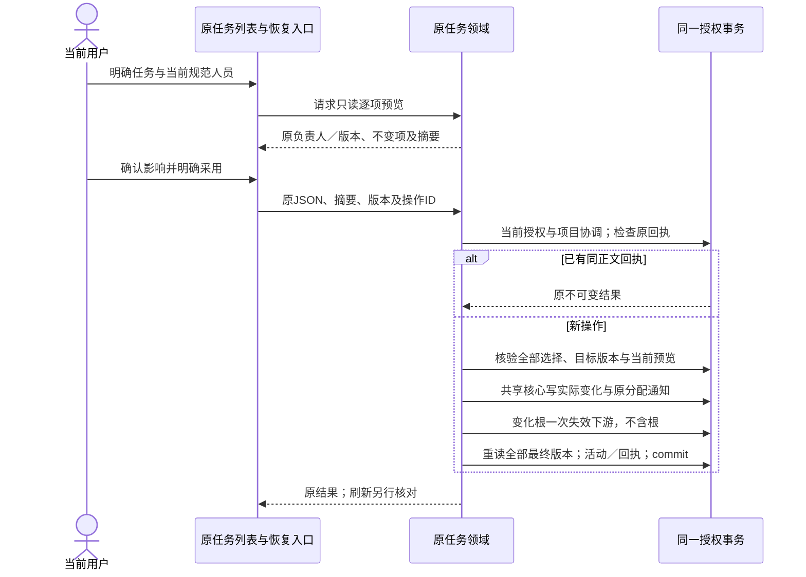

# 批量负责人变更的事务边界

T-MULTICA-BULK-150，速码1.0.0。状态：合同冻结、实现进行中；负责人：任务领域／前端交互／主集成，按[合同](../../contracts/task-owner-changes.md)分工。本页区分原有能力与本片组合要求，不构成验收结论。

## 原权威与组合要求

当前[普通任务更新](../../internal/platform/records.go)拥有字段验证、依据重置、CAS、分配通知与依赖失效；[任务列表](../../apps/web/src/TaskCollection.tsx)保留明确最多16项选择。本片必须复用这些正式语义，不另建任务、执行、人员或通知权威。

合同要求单项Update与批量入口共享同事务更新核心。不能循环调用自行commit的Service.Update，也不能复制逐渐漂移的任务更新实现。每项负责人变化仍转为in_progress并清除verified_run_id，保留原运行／测试／Review历史。

## 目录、预览与采用

`GET /api/v1/task-owner-targets`只读当前项目的canonical human资源、规范user绑定、存续账号和当前组织／项目访问。调用者为有项目写资格的browser／project API人类；目标可有viewer访问，分配不新增权限。字面q、分页及游标每次重验作用域，不承诺历史快照。

`POST /api/v1/task-owner-changes/preview`不写回执、活动、通知或任务。预览返回规范目标、逐项版本／原负责人／will_change及真实变化计数。preview_sha256仅绑定预览依据，不是凭证或批准；不提供虚构下游计数。

`POST /api/v1/task-owner-changes`沿封闭强类型JSON接受1～16项显式有序任务、目标资源版本、摘要、明确影响确认及操作ID。拒绝重复、跨项目、额外字段和无效精确版本，保留数值lexeme，不将小数舍入成合法CAS。

## 一次事务与最终结果

当前授权／项目协调先于原回执。无回执时，全部所选任务和规范目标必须在任何写入前完成版本与摘要核验；冲突、通知或序号投影失败使任务、活动、通知及回执全部回滚。全无变化的新操作拒绝。

只对负责人实际变化项调用共享更新核心；不变项无空更新或分配通知。然后对变化根仅调用一次InvalidateDependentsTx(includeRoots=false)，避免前置失效先抬高已选后续版本而制造伪冲突。

失效后重读所有所选任务，按显式顺序返回真实最终版本／状态。负责人不变的所选后续仍可能失效；owner_changed=false不等于最终版本未变化。迭代／里程碑沿原规划失效语义处理，不改变独立测试或正式Review权威。

## 前端与恢复约束

当前接线为[Records(tasks)→TaskRecordsScope](../../apps/web/src/App.tsx)→[TaskViews.selectionActions](../../apps/web/src/TaskViews.tsx)→TaskOwnerChanges，始终挂载恢复组件；TaskCollection是embedded内容，controls=null，不能将原App通用actions槽当运行入口。Modal复用Radix、设计令牌及原写保护，零选择不卸载原操作。

未知结果保留原JSON／摘要／版本／操作ID；409保留选择和目标并明确重新预览。父层401／403／404同步遮蔽私有来源，abort读取并retire迟到写回调，不把已可能发生的服务端写当作撤销。保存成功与刷新失败分别表达。

blocked时仅由用户明确GET task-owner-targets?project_id=P&limit=1，携带原视角头证明当前写资格；成功才通知TaskRecordsScope清denial并刷新读取。该结果不选人员、不授予角色，也不释放原写；必须显式Restore才核对原回执，不自动重放。

[产品](../product/task-owner-changes.md) · [交互与AI SOP](../design/task-owner-changes.md) · [English](../en/task-owner-changes.md)。[Multica图谱](../integrations/multica-priority-map.md)仅提供已记录行为参考，本片没有新增源码复制。完整58 limited／34 pending／92总项保持进行。

[CLI](../../internal/cli/task_owner_changes.go)提供task-owners targets、preview --file及apply --file；POST只在正文携带项目，原tasks数组／版本保持，apply要求准确摘要、明确ack及原idempotency_key。

后续[验证报告](../quality/task-owner-changes-verification.md)／[摘要](../quality/task-owner-changes-summary.json)由主集成生成。原子性、原Update回归、真实HTTP／GUI、其他数据库和生产分别留证，本页不预报通过结果。
