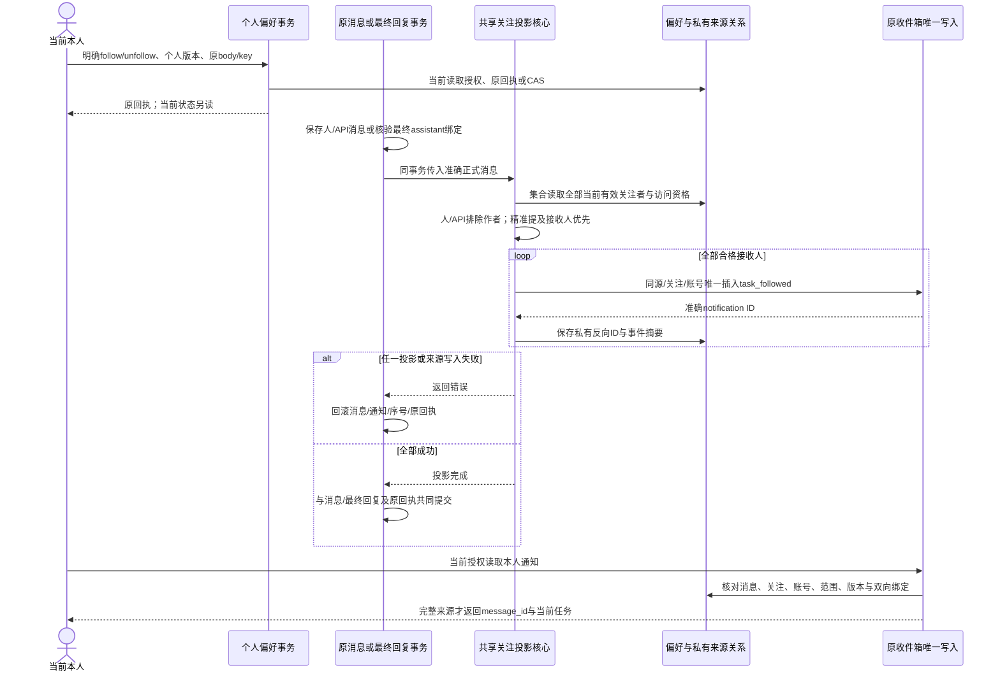

# 本人任务关注的事务与来源

T-MULTICA-FOLLOW-154，速码1.0.0。状态：限定接缝已通过独立SQLite／Windows Electron软件离屏的实际HTTP与GUI验证，完整平台未验收。本页按[冻结合同](../../contracts/task-subscriptions.md)说明领域接缝；[产品](../product/task-subscriptions.md)定义用户目标，[交互](../design/task-subscriptions.md)定义可见状态。

## 权威与数据所有权

| 领域 | 拥有的事实 | 本阶段接缝 |
| --- | --- | --- |
| 当前身份／项目授权 | 当前人员、组织、项目和准确任务的读取资格 | 每次读、写、回执恢复及通知源读取均重验；viewer可管理本人偏好 |
| 个人关注 | 本人任务偏好、单调版本和原命令回执 | 独立于任务业务版本；不枚举其他关注者 |
| 原讨论／最终回复 | 不可变消息、原任务版本、消息序号、正式回复绑定与原回执 | 在源事务内调用同一个关注通知投影核心 |
| 原个人收件箱 | 固定接收人、唯一事件、持久序号、已读和归档 | 继续唯一插入权威，不新增消息调度器或公开发送接口 |

逻辑数据分为个人偏好和私有通知来源关系。偏好由tenant／project／task／user唯一定位，持久行拥有私有ID、version、following及updated_at；不存在的行用version0／false／空时间纯读投影。取消保留该行，重新关注沿同一行递增版本，不建立新的接收身份。

每个关注通知的私有来源关系绑定准确消息、原关注行ID、接收账号、租户／项目／任务、原消息任务版本、反向notification ID和确定事件摘要。通知的source_resource_id使用私有关注行ID；公开TaskSubscription不含该ID，公开DTO／回执不暴露私有反向关系。来源引用不保存正文、标题或模型输出。

新表与索引遵守单一1.0.0初始架构，沿SQLite／OceanBase／PostgreSQL方言及已有声明校验。任何新DDL前先完整验证领域结构；残缺或未登记的既有结构拒绝，不回填、重置或删除用户数据。物理表名、索引和校验由领域实现维护，本页不另立一份可漂移的DDL。

## 个人命令与未知结果

| 接口 | 冻结语义 |
| --- | --- |
| `GET /api/v1/tasks/{task}/subscription?project_id=P` | 返回本人TaskSubscription；无行读取不写偏好、通知或审计 |
| `POST /api/v1/tasks/{task}/subscription/commands?project_id=P` | 闭合正文project_id、task_id、expected_version、action、idempotency_key；action仅follow／unfollow |

当前账号与组织来自凭据，不接受user／recipient／tenant覆盖。路径、查询和正文范围必须一致；未知或重复字段、null、非规范ID／操作标识及非法数值拒绝。浏览器和当前用户API沿各自既有身份约束，机器凭据拒绝。

在当前授权事务先按原操作ID及正文核对回执，再处理新命令的个人行CAS。相同原请求恢复原回执，同key不同正文拒绝；回执恢复也不能绕过当前读取权限。CAS不是任务版本检查，不改变任务的开发／验收事实。

新命令在expected_version与当前个人版本一致时才能采用。真实变化递增版本，目标状态已满足不空更新；version0的首次unfollow可以只保存无副作用命令回执而不创建偏好行。旧回执保持原结果，随后当前读取可能已有不同版本。

前端沿原useWriteAction，在网络外发前保存原body／key和caller范围。未知结果仅核对同一操作，阻止并行切换；当前GET、刷新或相同following值均不能代替原回执。存储失败不外发，冲突不自动采用新版本。

## 原消息事务中的投影

下图中的表是逻辑所有权；人工发帖与最终assistant复用同一内部投影，不能由客户端调用它任意创建通知。

人工／用户API入口沿[AppendTaskConversation](../../internal/platform/task_conversation.go)的原事务，在正式消息和精准提及关系确定后投影。最终assistant沿[原回复结果事务](../../internal/platform/task_conversation_reply_outcome.go)接入；必须具有完整原Reply、消息和真实最终结果绑定，不能从流式片段、进度或工具日志发通知。assistant不套用人／API作者排除，因此已关注的请求人仍可收到最终回复。

接收人选择覆盖提交时全部following=true且当前有项目访问权的账号；关注偏好本身不是当前授权证明。集合读取和现有索引核对资格，不能静默LIMIT截断，也不能逐接收人再获取身份锁而颠倒原授权锁顺序。该集合属于同一源事务，不在收件箱读取、打开页面或重连时补发。

同一消息对同一人的精准提及优先，已有task_mentioned时不再增加task_followed；原自提及语义保留。人／API自发消息不额外通知作者。所有关注通知仍经[insertNotificationInboxTx](../../internal/platform/notification_inbox_store.go)分配原序号和唯一事件，投影失败连同消息／回复、来源关系、序号及原回执一起回滚。原操作重放不投影第二次。

## 当前读取与私有来源核对

沿[原收件箱读取](../../internal/platform/notification_inbox.go)增加task_followed来源核验。只有当前任务可读，且准确消息、关注行、接收账号、租户／项目／任务、原任务版本、反向notification ID和确定事件摘要全部一致，才返回source_available=true、message_id和当前任务。assistant来源还必须保有完整原回复绑定。

后来following=false不否定已提交的事件。来源缺失或损坏时保留通知及私人生命周期，但隐藏正文水合、当前任务和跳转；当前撤权仍拒绝整个范围。数据库执行失败直接报错，不能伪装成“来源不可用”。打开准确消息复用[精准提及的message定位](../../contracts/task-conversation-mentions.md)，不写已读、不派发、不改变任务。

## Multica准确参考与选择

2026-10-30仅只读本地`D:\codes\github\multica`的既有Git对象；未fetch、checkout或修改参考目录。本次实际HEAD与FETCH_HEAD均为`890628511e423864d21c694231277805ce9f113c`；`4157f5b26e3acbbd53ae5abbb659c579dc7320eb`是前阶段保留的本地pin，不把它写成此次工作树状态。旧调查pin为`fe23bd1161498537d9b87ad93f22a26abff5cd0a`。

| 定向对象 | 890628的blob | 与既有local4157及旧调查fe23比较 |
| --- | --- | --- |
| [subscriber.go](https://github.com/multica-ai/multica/blob/890628511e423864d21c694231277805ce9f113c/server/internal/handler/subscriber.go) | 9729d861a0c514cb2a7ba23761b76e0e5d961b18 | 三者相同 |
| [use-issue-subscribers.ts](https://github.com/multica-ai/multica/blob/890628511e423864d21c694231277805ce9f113c/packages/views/issues/hooks/use-issue-subscribers.ts) | 17c3070ef0fa6b27241a81c54d685796972e41ad | 三者相同 |
| [LICENSE](https://github.com/multica-ai/multica/blob/890628511e423864d21c694231277805ce9f113c/LICENSE) | 9286fa5f8ecaf1132ed9c01ff52a262309c608aa | 890628与local4157相同；本轮未重查全部refs |

handler的[59–112行](https://github.com/multica-ai/multica/blob/890628511e423864d21c694231277805ce9f113c/server/internal/handler/subscriber.go#L59-L112)体现明确关注，但79–83行仍允许正文覆盖user_id／user_type；取消路径也有该能力，并支持子树退出。hook的[134–175行](https://github.com/multica-ai/multica/blob/890628511e423864d21c694231277805ce9f113c/packages/views/issues/hooks/use-issue-subscribers.ts#L134-L175)只在查询成功时确认状态、同步阻止重入，另有重连刷新与失败反馈。这里借鉴“未知保持未知、操作串行、失败可见”的行为；不沿用其公开关注者列表、替他人／Agent操作、自动规则、子树退出或整表乐观回滚，也不引入其运行层依赖。

现有[采用边界](../integrations/multica-priority-map.md#核对基线与源码边界)与该pin完整许可保持：本轮只观察行为，不复制其源码、图标、样式或资产；新增复制产品源码0。采用既有速码事务、React、Lucide与原收件箱，可保留本人权限、CAS及原操作恢复，而无需第二套通知服务。

本次[实际HTTP／GUI回执](../../dist/quality/task-subscriptions-154/receipt.json)绑定精确合成候选source SHA `05fc56e46395b823adbda0da320e4eee3481cc219e6b3b8fe913c839993a3043`。夹具通过正式setup、邀请／接受、viewer项目授权、规范人员资源与任务接口创建，没有直接数据库写入。丢失响应由真实上游提交200后中断给页面的响应制造；明确恢复保留原字节／key，五次传输只有四个偏好命令，最终version4。

实际证据限于Windows Electron35.7.5生产preload、软件离屏与独立SQLite。最终assistant未在GUI中调用或伪造；完整接收集合、事务回滚、来源损坏、三种方言与其他领域检查由主集成另行记录，不从本旅程推断。其他数据库、物理多机、规模和生产未验；完整58／34／92不变。
