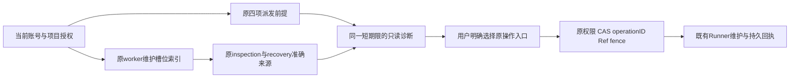

# Doctor维护决策架构与 AI SOP

状态：T-TOOL-DOCTOR-199阶段实现；suma1.0.0；关联[需求](../product/tool-doctor-maintenance.md)、[合同](../../contracts/tool-doctor-maintenance.md)、[交互](../design/tool-doctor-maintenance.md)。

原`GetToolProfileDiagnostics`在当前授权读事务中追加维护决策；普通availability collector不扩职责。维护槽位与核对头使用现有tenant/project/worker及inspection索引，有界读取，异常来源传播。业务执行、质量证据与维护状态继续各有唯一状态机，不以诊断引入新写路径或第二调度器。

父期限取原诊断、库存、维护能力及有效pending／claim／recovery的未来最早截止。客户端使用单调计时及读取耗时失效；过期capability只能按原T195规则核对准确旧unknown，不能据旧能力新probe。原recovery的inspectionRef、worker与不可变来源SHA必须匹配；proof保存与正式关闭分开。

同worker跨配置占用属于原检查。Web先GET原inspection，读取原profile及准确diagnostics并重新核对项目／worker，再进入原面板；本机未决写入的body／key／journal优先，不能由新推荐替换。原操作详情可读不等于当前审批或机器允许写；每个原命令仍独立核验当前授权、版本和owner。

Go公开类型生成OpenAPI和TypeScript，固定action/reason与ID形状闭合；Go纯验证函数只验证观察形状，CLI复用，不能被用作授权。CLI新增局部JSON／table展示，无后台任务、外部SDK或新依赖。

## AI维护 SOP

1. 读取准确profile诊断，分别解释派发资格和维护建议，确认目标、版本及期限。
2. 若有原检查／核对，先取原对象与准确来源；跨配置明确进入原配置，不改写旧操作所属。
3. 根据用户明确选择进入原创建或核对确认；保存并复用原body、operationID和回执。未确认停止与未知结果保持阻塞，不自动重发新probe。
4. proof_stored仅说明证据已保存；等待原机器ACK后再读取原关闭事实。新的检查使用新的明确操作，不复用旧未知结果冒充成功。
5. 观察事实变化或撤权后重新读取；未知、连接故障、无能力与无权限分别处理。诊断文本和固定reason都不形成执行权。
6. 将真实结果、原操作和问题回流证据交给原任务及质量领域。工具恢复不直接完成开发任务、独立测试或人工验收。

## 参考采用边界

参考本地Multica固定提交`5a2cc891ac338eed1919aa11a1eef5957cd82cec`中的发现／兼容性／运行实例状态分离及公开探测摘要模式，并复核[官方项目说明](https://github.com/multica-ai/multica)。本阶段独立接续速码原控制面和维护合同，没有复制受限制源码；不采用旧profile缺失放行或协议帧覆盖宿主退出错误的做法。远端源码最新提交尚未锁定，不能把本地固定版本称为最新基线。

[限定验证与剩余范围 / Scoped verification](../quality/tool-doctor-maintenance-verification.md)。
