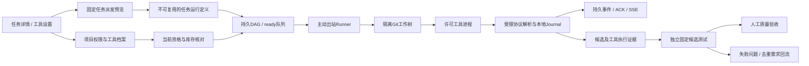
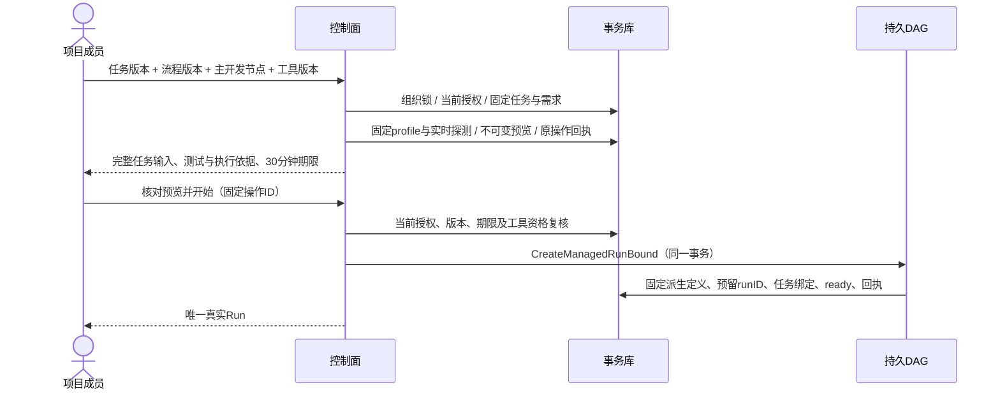

# 工具执行与固定任务派发

状态：T-P4-004 本机纵向阶段验收通过；厂商、分布式及生产范围继续实施，证据见[阶段验收](../quality/tool-execution-verification.md)。负责人：主集成、平台、Runtime、工作台代理。需求：P2/P4 外部智能体执行与P5质量闭环。合同：[工具执行](../../contracts/tool-execution.md)。实现：`internal/toolcontract`、`internal/platform/tool_*.go`、`task_dispatch*.go`、`internal/runner/tool_*.go`、`apps/web/src/Tool*.tsx`及`TaskDispatch.tsx`。

## 问题与领域边界

此前派发主要依赖通用能力和本机命令许可。任务虽然可以关联运行，智能体收到的仍可能是模板中的固定目标；CLI JSONL也只是文本输出。新方案将机器执行身份、管理员许可、现场探测、不可变任务依据与实际执行事实分别建模，保留独立测试、人工验收和发布门禁。

| 事实 | 权威来源 | 不可推断的结论 |
|---|---|---|
| 执行节点身份 | 已登记、项目绑定的独立Runner凭证 | 不自动获得构建证明或部署授权 |
| 工具配置 | 审阅后启用的不可变ToolProfile及配置摘要 | 不表示现场已安装、已登录或模型健康 |
| 本机可用性 | Runner本地受限探测、数据库接收时间、60秒有效期 | 不表示任务执行成功，也不表示一直在线 |
| 任务派发依据 | 不可变TaskDispatchPlan、固定任务与需求版本 | 不表示已实际开始或已验收 |
| 工具活动 | 绑定当前attempt/fence的持久tool_progress | 工具自报完成不能替代受控进程结果 |
| 执行成功 | 进程终止事实、协议一致终态及当前租约回执 | 不表示独立测试、人工验收或生产发布通过 |

团队中的协作负责人和实际执行worker是不同身份。给Agent或工具资源填写名称，不会授予执行权限；派发必须选择正式工具档案。原生智能体访问平台工具使用独立`SUMA_AGENT_TOKEN`，禁止借用Runner凭证扩大接口范围。

## 模块关系

工具合同放在独立Go包，控制面、DAG和Runner共用。线协议模型使用唯一具体类型名，避免工具Event覆盖DAG持久Event；生成合同和TypeScript类型分别反映两者。平台控制派发权，外部工具输出没有创建批准、选择任意HTTP地址或更改执行配置的权限。

## 配置、探测与调度

管理员在执行节点维护许可命令，使用`--describe-tools`读取非秘密清单。平台登记既有worker下的固定profile，创建后暂停，显式核对启用。普通命令只验证原生可执行文件与显式许可，不猜测未知`--version`参数；原生智能体、Codex使用各自已核实的只读探测。OpenCode当前CLI缺少等价的整体JSONL完成事件，保持明确不可用，不能将step_finish改名为整个运行成功。

库存操作先持久保存身份，再发送；确认只接受数据库已持久化的回执。重放旧操作返回原时间，不延长在线有效期。每次真正新探测才建立新操作。配置摘要和实际执行文件摘要不匹配、工具未安装、执行关闭、库存过期、档案暂停或启用者撤权时，工具绑定节点保持ready，不消耗attempt或资源；独立且满足能力的候选可继续。

所有command、agent、test节点需要唯一许可命令和精确`command:<id>`能力，额外能力约束仍同时生效；空能力不再表示无限制。动态展开与补偿节点使用各自固定定义进行同样匹配。当前观察及不可用原因在工具设置和运行详情显示，不能将当前档案状态倒灌为历史运行结果。

## 固定任务上下文与原子开始

派发只复制已发布流程，替换所选开发节点的许可命令、profile绑定及目标输入。原开发指令与明确标记的任务数据分别表达；任务、需求、描述、验收条件和版本均冻结。输入超过32000个UTF-8字节明确拒绝，不能截断验收条件。必须存在从所选开发节点取得固定候选的独立测试；只读工具不能冒充隔离开发工具。

开始时再次核验任务、需求、工具管理版本、当前人员权限和实时库存。定义、任务关联、计划started事实、持久回执和ready队列原子提交。双连接恢复同一操作必须取得同一个runID。原操作恢复读取已经发生的事实，不能重新绑定已变化任务；当前权限仍先于回执检查。

任务派生流程与受保护发布都不可作为公开模板重复启动，但采用各自生命周期权限。只有确实绑定已started任务计划的运行可使用正常暂停、取消、核对和重试；这不授予部署身份或发布授权。直接给包含智能体的普通运行附加task_id会被原子拒绝，避免“已关联任务”被误解为“已发送任务内容”。嵌套map和固定子流程也检查这一边界。

## 结构化事实、结果与恢复

stdout由受限JSONL解析器处理，stderr单独有界脱敏。仅保留消息、活动种类、来源身份、有限状态及明确报告的token用量；不保存推理内容、任意工具参数或完整原始协议对象。分块、多事件、重复字段、超长行、深度和终态顺序分别校验。会话／请求标识只作追溯，不提供猜测的回复或自动resume动作。

工具成功要求受控进程退出0与一致协议终态；缺失、矛盾或未知结果不能成功。工具子活动失败不一定意味着整个工具失败，最终失败仍由整体协议与进程事实判定。取消必须取得实际进程树停止事实；等待输入消息不会释放仍在运行的槽位。Runner重启后的不明副作用保持核对状态，禁止凭来源会话ID重新执行。

进度、心跳和最终结果均按当前项目、独立worker凭证、attempt及fence核对，回执恢复也不能绕过当前授权。工具档案停用不会抹除已经开始的事实；接受已开始执行的结果依然核对原固定摘要。业务验收还需独立候选测试和显式人工评审。失败沿用正式问题投影及去重需求回流，模型声称“已修复”不改变正式问题状态。

## 验证与剩余范围

本阶段需要逐项保存：本机只读CLI探测、协议fixture、实际工具进程、平台授权与双连接事务、独立工作树和候选测试、界面人工验收及失败回流。它们必须分别标注，不能将fixture协议解释为已经运行真实收费模型。

远端会话恢复、工具交互审批、完整输入收件箱、app-server、所有厂商账户、完整MCP／IDE协议、模型成本结算与跨节点设备治理继续属于完整产品待办；当前代码和局部测试不能代替这些验收。完整目标仍按[实施台账](../delivery/implementation-plan.md)推进。
