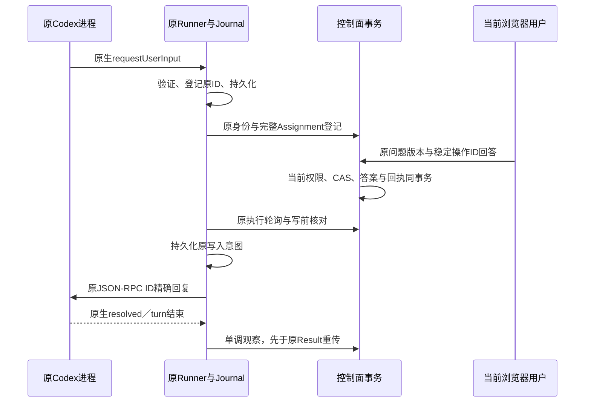

# 原执行问答领域与AI SOP

状态：1.0.0当前实现；负责人：主集成／控制面／Runner；关联需求：T-TOOL-INPUTS-187。依据：[共享合同](../../contracts/tool-inputs.md)、[生成接口](../api/openapi.json)、[验证](../quality/tool-inputs-verification.md)。

`codexcontract`负责固定原生请求、问题、答案生成及安全证据；`toolinputcontract`负责问答领域记录；控制面负责当前权限、事务、答案CAS和回执；Runner负责原进程、独立检查点与单写入器；Web负责当前节点的人机交互。问答不扩展工具权限的Choice、IsGrant或存储联合类型，不引入第二派发器。

原生ID保留number／string类型；approval与input共用32个请求上限，同ID跨类型或改变正文均拒绝。原问题及答案只保存在受当前项目权限保护的问答记录中，日志与执行Evidence仅保存身份、摘要、问题数量和投递事实。密码题在Journal／HTTP之前整请求拒绝，服务端再次验证。

`suma_tool_inputs`保存原tenant/project/run/node/attempt/fence/worker/dispatch、准确profile及完整受保护Assignment。双唯一键分别约束原操作和原生会话请求；状态、版本、答案、观察及命令回执同事务提交。初始schema缺唯一键或存在未声明结构时，在任何其他DDL和业务写入前拒绝；不自动修旧库。

新回答要求当前浏览器写权限、待答版本、数据库时间、原节点期限、原原生请求未关闭及当前执行资格。原回答回执在完成当前人授权后、重新检查新工作资格前恢复，不能因稍后暂停或租约变化把一次已提交操作变成第二次回答。机器新写仍必须复核当前有效身份、准确lease/fence及授权库存。

检查点区分答案观察、写入意图、写开始、完整写和原生关闭。写前存储期间的关闭事实暂存并按单调序号合并；不持driver锁等待HTTP或日志。断线只重传原HTTP及观察；已开始但无法证实完整写入时进入unknown，不重答、不重启模型、不resume旧thread。普通与Pool入口都先恢复原观察，再提交Result。

观测回传保留当前机器凭据与租约边界；失效或撤权不会被历史数据恢复绕过。终态之后尚未上传的事实留在原本地Journal等待核对，不把本地记录冒充已被平台确认。新输入授权、结果事实与停止事实保持独立。

AI开发SOP：

1. 先核对当前合同、受保护节点和真实profile能力，不从可编辑Config或旧协议标志推断能力。
2. 修改原生协议时先锁定本机版本／Schema；已核对SHA不重做相同导出，不调用付费模型测试字段。
3. 问题、答案与授权分别建模；只允许稳定固定失败码进入安全证据，禁止粘贴原始错误、路径或敏感正文。
4. 保存原意图后才写进程；早关闭、写入未知、当前撤权和原操作重放均走同一业务规则。
5. 只运行新增／受影响检查；真实CLI、受控模型、HTTP／SQLite、合成GUI和生产验收分开记录。
6. 阶段提交只包含源码、合同和紧凑证据，缓存、进程私有配置、数据库与日志留在忽略目录。
