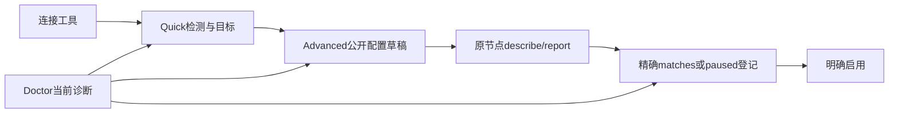

# 工具管理架构与 AI SOP

状态：限定实现与验证完成；suma1.0.0；T-TOOL-MANAGEMENT-193。负责人：主集成代理；关联[合同](../../contracts/tool-management.md)、[PRD](../product/tool-management.md)、[交互](../design/tool-management.md)及[验证](../quality/tool-management-verification.md)。原31／P0–P7范围继续。

采用原工具目录、当前授权、库存、profile和执行节点流程构建一个接入协调入口。Quick负责检测与目标选择，Advanced接续公开配置草稿，Doctor解释当前前提并导航准确下一步；三者共享当前scope，不建立第二工具中心、派发器、配置权威或修复服务。

## 领域与读取边界

ToolProfileListQuery是HTTP、CLI和领域读取共用的当前列表合同。服务端先验证当前actor、组织和项目权限，再规范化state/query并核对游标。无搜索时保留SQL计数和keyset快路径；搜索在原项目1000档案上限内，用Go对五个公开字段执行统一Unicode小写字面contains，避免数据库排序规则差异和私有JSON检索。

列表默认active，即enabled与paused；历史revoked需明确筛选。公开接入草稿按actor／组织／项目／caller绑定并使用nonce，不能把迟到结果应用于新目标。草稿只协调界面，不授权命令、不替代fresh库存，也不存密钥值或私有执行材料。

diagnostics在原当前授权读取事务中复用四前提，并附加可选、非空的ToolProfileImpact。影响读取先用既有租户／项目／运行状态索引选取最多200个活动run，再按run主键检查最多2000个node。只返回原ToolBinding准确profile ID／SHA的非终态引用，最多5个公开样本，不返回Node spec、私有路径或凭据。

覆盖状态保留complete、partial、unknown及明确reason。已观察引用数与全局总数不同；边界超限不制造零引用，坏来源不掩盖成完整，数据库或授权错误继续返回错误。pending等未执行节点保留真实0 attempt／fence及空worker，不伪造执行者。

## 配置、维护与恢复

配置身份不可变。调整沿目标机器的新配置准备、真实describe/report及原matches，选择已有精确档案或登记新paused档案，再明确启用。历史计划与摘要不能被界面原位改写。停用与移除分别对应原pause和永久revoke；无物理DELETE、新PATCH、表或API路径。

撤销改变后续派发资格，不保证既有外部进程已停止。影响说明不执行取消、清理Journal、自动修复或重发任务。所有写入仍沿当前权限、预期版本、稳定操作ID和原回执；未知结果核对原操作，不能借一次刷新建立新的效果。

## AI SOP

1. 确认当前组织、项目、工具方向和目标节点，沿唯一连接入口开始；先查已有精确接入，避免重复登记。
2. 判断当前能力是本机原生扫描、授权节点读取还是既有上报。缺少fresh目标信息时导航该目标，不能回退到另一worker或宣称扫描成功。
3. 只接续公开草稿；在目标机器准备配置并明确describe/report，按原当前权限完成paused登记及单独启用。
4. 遇异常先看Doctor四前提和准确下一步。只有已授权能力存在时才执行本机重扫；配置、安装、修复和模型健康分别验证。
5. 维护前查看当前范围影响及覆盖限制，再明确pause或revoke。需要停止既有执行时打开原运行流程，单独取得真实停止事实。
6. 对未知回执保留原scope、版本、操作ID和草稿，先核对再继续；验证新增及直接受影响边界，不重复已绿SDK或正式质量链。

Go类型、OpenAPI和TS合同由原生成器统一管理。源码、模拟源、实际HTTP、界面和生产证据分别归档；完整31项、P0–P7及分布式平台目标保持active。

## T-TOOL-EXPERIENCE-198 目标交接与AI SOP

目标沿Quick当前选择 → Workspace受scope约束的connectionSelection → ToolSetupGuide → RemoteRunnerSetupGuide传递。expectedWorker与配对worker一致才能使用配对草稿；否则目标固定并走原identity准备。公开配置的nonce和caller检查沿现有模型保留，不新建状态库或派发器。

AI维护步骤：读取原诊断及目标 → 解释原因 → 用户明确打开准确配置 → 在原机器完成安装／账号／配置准备 → 原报告／matches／暂停登记 → 独立明确启用。失联或未知效果沿原检查／核对操作；不将打开指南、命令生成或界面刷新当作真实探测、修复完成。后续Doctor动作合同及配置换新原子交接仍待实现，不能由本次导航修复推导。
