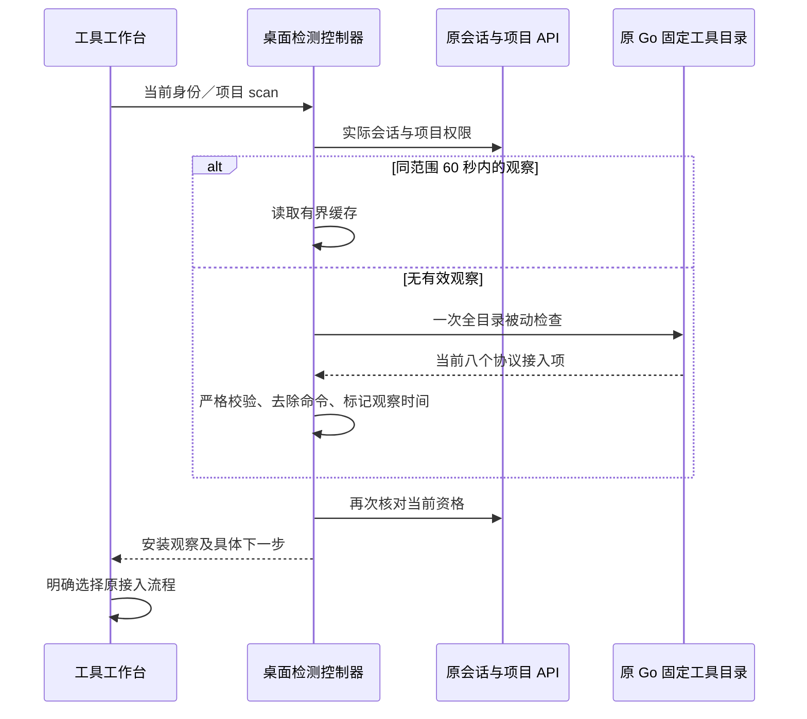

# 工具自动检查架构与 AI SOP

T-TOOL-ONBOARDING-176；1.0.0；状态：本阶段源码与限定验证完成。负责人：桌面桥接、工具工作台。领域合同：[tool-onboarding-scan](../../contracts/tool-onboarding-scan.md)；需求：[自动检查与登记](../product/tool-onboarding.md)。

## 边界与数据流

Web 扫描组件负责当前身份、项目、可视状态及明确行选择；Electron 主进程负责实际窗口、会话授权、有界观察缓存和进程生命周期；已有 Go 安装探测目录负责固定工具入口和并行被动检查。返回渲染层前逐行校验并去除启动命令。正式执行仍只经过原托管 Runner 和 Go 调度器。

单调时间决定 60 秒有效期，UTC 时间仅用于展示来源。缓存最多一份，绑定用户／组织／项目；不会因为读取而延长有效期。相同范围的进行中批量请求共用一个进程；同时发生的单项请求可以等待该批量并投影原单项结果。完成缓存不能替代原单项即时重核。每位等待者在返回前再次通过当前权限检查。

窗口关闭、当前调用者改变或探测超时沿原生命周期清理。每个合并等待者有独立截止时间，原扫描完成不能撤销等待者的超时保护，等待者超时也不能停止其他用户正在等待的原进程。停止请求不等于进程已经退出；未收到关闭证据时保持原准入限制，不启动重复子进程。缓存观察也不是健康证明、认证证明或派发授权。

## 登记来源与恢复

探测清单进入高级表单时同时携带原身份、项目、节点及观察有效期。文字编辑保留来源；失败文件读取保留原来源；明确有效手工输入才成为未验证手工配置。提交时直接核对有效期，不依赖定时器是否已经重绘按钮。

新登记和原未知结果核对分别处理。新登记过期须重新读取并明确采用，保留名称；原未知结果继续使用原请求和原操作标识核对，不因为清单现在过期而制造第二次登记。服务器仍检查真实当前权限和正式配置。没有新增通用审批或租约机制。

## 后续开发 SOP

1. 新增工具先实现原 Go 目录和正式执行适配合同，区分编辑器、候选入口、配置和实际运行能力；不能只增前端卡片。
2. 调整全目录时同步闭合 IPC 校验和 Web 目录，并用一次缺失／重复／未知项用例检查协议漂移；初始版本不增加旧目录回退。
3. 保持扫描无开发目标、无登录、无模型调用。密钥仅引用现有受控环境，不复制到观察、日志或清单。
4. 只验证改变的授权、并发和交互分支，复用未变 Go 二进制及已通过检查。记录实际 CLI 观察和受控组件验证的不同范围。
