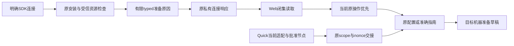

# 工具准备诊断架构与 AI SOP

T-TOOL-PREPARATION-203；suma 1.0.0；负责人：主集成代理。状态：本阶段限定实现与验证完成，见[验证报告](../quality/tool-preparation-recovery-verification.md)。关联[合同](../../contracts/tool-preparation-recovery.md)、[PRD](../product/tool-preparation-recovery.md)、[交互](../design/tool-preparation-recovery.md)。

宿主只在它实际执行的检查边界分类：明确不支持的原生版本、既有安装身份复核失败、必要资产缺失、资产清单／字节／布局不成立、Node运行时不可用和明确凭据引用不可用。使用内部typed错误，不从原错误文本、路径或stderr猜原因；未分类情况保留原通用失败。

`connection.preparation_reason`是桌面私有DTO的可选观察字段，严格限制在两个SDK的`unavailable`响应。它不成为新的持久配置、健康表或执行状态，不修改Go正式配置摘要及Worker库存权威。普通status与回执恢复不新增探测；连接阶段沿原资产和权限检查。

工具与节点交接沿既有Quick、Workspace、ToolSetupGuide和RemoteRunnerSetupGuide。正式适配描述符决定原配置入口；当前调用者、组织、项目、节点和nonce约束采用范围。同一节点的新工具请求必须与旧配置草稿隔离，A→B→A不复活旧请求。未知适配不生成默认配置。

SDK资源读取和诊断不引入模型调用。此前Multica参考基线`5a2cc891ac338eed1919aa11a1eef5957cd82cec`的发现与状态收敛模式继续采用，具体许可及复用边界见[参考记录](../integrations/multica-claude-sdk-connect.md)。本阶段复用suma现有模块，不复制受附加许可限制的源码。

## AI 开发与排障 SOP

1. 先核当前适配协议、实际节点和原操作；原效果未知时先恢复原回执。
2. 仅依据可信检查边界输出闭集原因。日志及公开响应不记录凭据值、私有路径或原始进程输出。
3. 精确配置与指南只定位当前来源。模型／引用字段修改是草稿，不能推导真实认证成功。
4. 明确准备新目标时消费当前nonce；普通刷新不得重新采用旧草稿或改写新目标。
5. 在实际目标机器沿既有准备、报告、登记和明确启用流程继续。不得用浏览器生成命令证明目标机器已执行。
6. 只验证受影响的资产、诊断及交接边界。保存原失败和最终来源，不重复未变化Go、SDK模型或完整质量链。

不新增业务表、HTTP路径或派发器。原Runner新增明确的`--prepare-codex-stdin`配置准备模式，复用固定原生协议与独占新文件写入器；七项私有输入不含任意命令、模型或秘密值。准备时检查所选原生文件，不启动厂商CLI；输出仅证明新配置已形成。正式版本保持1.0.0，第三方协议版本及SDK固定版本与产品版本分开。
