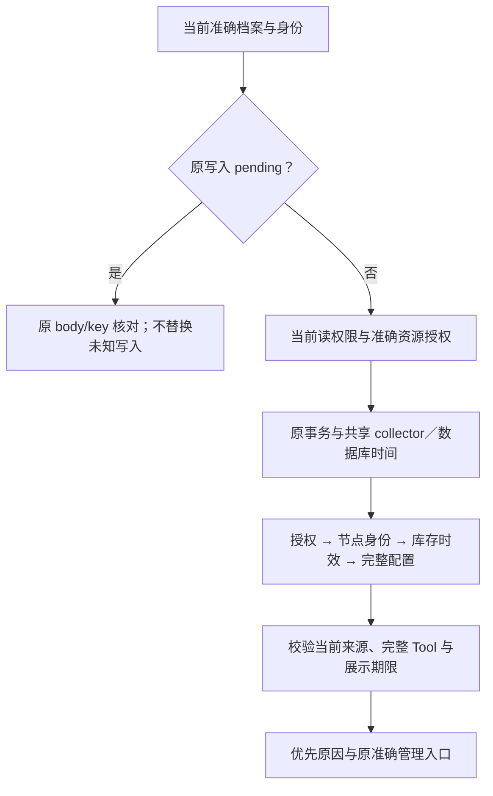

# 工具配置体检架构与 AI SOP

T-TOOL-DOCTOR-181；suma 1.0.0。以[领域合同](../../contracts/tool-profile-diagnostics.md)与共享 DTO 为准，关联[产品](../product/tool-profile-diagnostics.md)及[交互](../design/tool-profile-diagnostics.md)。当前限定实现与验证见[阶段报告](../quality/tool-profile-diagnostics-verification.md)，完整生产验收仍待完成；完整 31 项／P0–P7 目标保持 active。

体检沿原当前读事务、数据库时间与唯一可用性 collector，不增加调度、repair、SDK 执行链、授权租约或业务写入。

## 当前读取与 DTO

`GET /api/v1/tool-profiles/{id}/diagnostics?project_id=...` 在查档案前校验当前 `browser-project-read` 和准确 resource-id；API／Agent／Runner／Pool 令牌不获此权限。

读取保持原 `withCurrentRead`，复用 `toolProfileObservationLockedTx`／`toolActivationLockedTx`／`toolWorkerReasonTx`。诊断与观察共享内部 collector，禁止复制可派发规则或从中文 Reason 反推状态。

`ToolProfileDiagnostics {tool:ToolProfile,checked_at,expires_at,checks,next_action}` 携带完整原 Tool。checks 恰四项，固定顺序 `authorization,worker,inventory,profile`。

单项闭合为 `{code,status,reason,reason_diagnostic?,next_action}`；status 仅 `pass,blocked,not_checked`。展示诊断只携身份，动作由固定领域结果生成，不从 Key 或任意原文推断权限。

## 单一事实与时效

worker 只复用原私有／Pool 身份资格，不产生心跳；身份有效不代表在线。未启用仍读取当前节点与库存，不因首项阻断抹去后续事实。

库存未上报、过期或未来时间时，inventory 阻断，profile 为 `not_checked`，不采纳旧 Observation。库存新鲜才检查原 command、完整 `EqualProfile` 和 `Observation.Available`。

原 `Tool.Available`、`Reason` 与 Observation 保持唯一原可用性语义；不加 ready 布尔。总体建议选固定顺序中首个阻断项，与原 Available 判断优先级一致。

`checked_at` 取同一数据库时间；`expires_at ≤ checked_at+60s`，有新鲜库存时还不得超过原库存期限。TTL 只约束显示，不授予任何后续权限。

客户端自请求起点用单调计时扣除网络耗时；过期隐藏可操作建议。API caller、账号、组织、项目、工具 ID／版本改变即隔离迟到响应；版本不符须刷新原详情。

## 固定建议与原写入

`next_action` 仅 `none,review_profile,open_worker,register_profile,refresh`。暂停／启用人失权→review；撤销／完整配置改变→register；节点／凭据／池／库存问题→worker；未知→refresh；全部已知前提通过→none。

review 仅打开父级原 CAS 启用确认，非撤销已启用档案须明确重新审阅；worker 仅定位原准确节点；register 进入原快捷配置。没有绑定当前来源的父级入口就只显示原因／重读。

原 pending 优先，报告不能清除日志或替换原 body／稳定 key。所有后续写仍经原当前授权、`expected_version` CAS、明确确认和原操作回执。

## AI SOP

1. 固定当前 caller、账号、组织、项目与准确 Tool／版本；先核对原 pending，不另造写入。
2. 无 pending 时只读诊断，核对完整 Tool、固定四项与有效期限，保留原 Available／Reason。
3. 分别解释授权、节点身份、库存、完整配置；库存旧时明确配置未检查，不声称节点在线。
4. 只展示当前准确父级入口；用户明确确认后才沿原 CAS 操作，期限或身份变化就重读。
5. CLI 复用原会话／视图／client 读取同 GET，严格校验 scope、完整 Tool、四项及期限，只输出事实。

不调用模型／CLI／SDK，不派发、启用、续期或修复。定向检查、实际 HTTP／SQLite、合成 UI 与真实厂商证据分开记录，本说明不预写通过结论。
