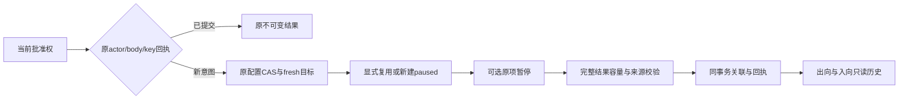

# 配置换新架构与 AI SOP

状态：T-TOOL-REPLACEMENT-200限定验证完成；suma1.0.0；关联[需求](../product/tool-profile-replacement.md)、[合同](../../contracts/tool-profile-replacement.md)、[交互](../design/tool-profile-replacement.md)。

控制面复用原`beginAuthorityTx`、`purposeBrowserProjectApprove`、当前组织／项目锁、`commandReceipt/saveCommandReceipt`及完整EqualProfile。请求固定原source ID和版本，目标为明确worker／完整Profile；嵌套reuse固定已有目标ID／版本。新请求没有活跃匹配才建paused，显式复用不改变对方状态；原配置只在明确选择时暂停。

关系表只保存不可变审计事实，不作为运行配置或权限来源。tenant/project/id主键，出向和入向各有scope／时间／ID索引；与profile变更和原操作记录同一事务。所有下游可读取的容量和类型条件在提交前验证，超限或关系插入失败必须回滚前序写入。历史使用固定九位UTC字符串和ID排序，游标绑定当前actor、租户／项目／profile／方向／limit；不能跨scope复用，8MiB页预算不越过未返回项。

回执先恢复原事实，再考虑后续新状态；原actor已失权仍先被当前授权拒绝。读历史不回放写操作，不重算当时available和maintenance；新的派发／启用仍读取当前正式profile及原门禁。Role、机器身份、凭据引用、工作区隔离、质量和部署不由关联记录授予。

## AI开发与维护 SOP

1. 读取当前原配置和版本，独立保存source；目标选择使用当前fresh完整报告和准确匹配，不从名称推断相同。
2. 无匹配时准备新名称；已有匹配必须选择准确ID／版本。解释新建保持暂停、复用保持原状态，以及暂停原项不会证明原进程停止。
3. 一次确认提交，先持久保存原body／key再发送。未知响应只按原操作恢复，不能重新匹配后换版本／key重发。
4. 分别核对旧、新、disposition、提交actor与关系ID；请求不等于执行、关系不等于启用，2xx不匹配仍视为原回执未确认。
5. 查看交接时快照与当前配置分别加载；明确启用沿原确认和CAS。跨机器执行、停止、候选和独立验收继续按原领域取证。
6. 故障排查优先原回执及关系；检查提交前容量、原子回滚、当前授权、候选新鲜度、scope游标和schema预检。禁止清库或隐式放宽权限来恢复通过。

技术实现复用现有Go事务、成熟SQL驱动、统一配置模型、React/Radix组件及写恢复入口，没有引入新执行框架或依赖。Multica能力与许可参考沿[T199采用边界](tool-doctor-maintenance.md)，本阶段独立实现配置准备与审计，未复制受限制源码。

验收范围与剩余限制见[限定验证](../quality/tool-profile-replacement-verification.md)。
