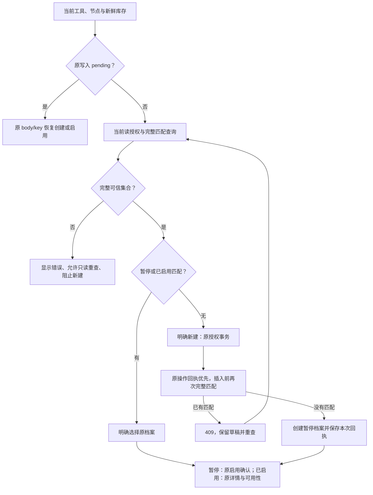

# 工具档案复用架构与 AI SOP

T-TOOL-PROFILE-REUSE-180；suma 1.0.0。以[冻结合同](../../contracts/tool-profile-reuse.md)为准，关联[产品流程](../product/tool-profile-reuse.md)与[交互设计](../design/tool-profile-reuse.md)。当前限定实现及验证见[阶段报告](../quality/tool-profile-reuse-verification.md)，完整生产验收继续待办。

复用沿原工具档案、库存、授权事务和操作回执实现。完整 Profile 使用现有 `toolcontract.EqualProfile` 比较；不增加表、JSON 唯一索引、匹配票据或调度器。

## 只读查询合同

`POST /api/v1/tool-profiles/matches` 接收闭合请求 `{project_id,worker_id,profile}`。请求按完整 `ValidateProfile(profile,true)` 校验，读取档案前强制当前 `browser-project-read` 权限与 HTTP 项目绑定；不接受 Runner／Pool 令牌，不产生业务或操作回执写入。

HTTP 200 返回 `ToolProfileMatchList {project_id,worker_id,profile,items,total}`。返回的项目、节点和 Profile 必须与请求一致；`items` 是当前租户／项目／准确节点全部记录经完整比较后的集合，无分页或截断，`total` 等于其长度。项目原 1000 项上限保持。

每个条目继续使用原 `ToolProfile` 当前状态及可用性投影。匹配和健康分别判断；撤销记录可展示但不参与复用。界面不得用档案名称、部分摘要或第一页列表代替完整身份比较。

## 创建与恢复边界

原 Create 在当前授权事务内先恢复本次稳定 key/body 的回执，再于 INSERT 前检查相同节点和完整 Profile。已有暂停或已启用匹配时返回稳定 `tool_profile_match_exists`，不返回另一操作的 201；撤销历史不阻止明确新建。

并发创建沿原组织／项目授权锁串行化，原 Worker 来源和当前权限门禁保持。启用沿原版本 CAS。读匹配没有授权效力，也不能代替创建时的事务内复核。

客户端原 pending 优先。账号、组织、项目、adapter、worker、完整 Profile、库存期限或 API caller 变化后，迟到查询不得恢复旧选择。查询失败不会产生未知写入，也不能清除原写入日志。

## AI SOP

1. 先确认当前 scope、完整库存配置及原 pending；存在 pending 就恢复原操作。
2. 无 pending 才查匹配，校验响应绑定、完整集合与数量，不把错误当空集。
3. 向用户展示原状态和当前可用性，等待明确复用、新建或启用决定。
4. 新建遇 409 后重查；写入未知则保留原 body/key，禁止另造操作替代。
5. 分别记录匹配、当前健康、用户选择和启用事实，不推定模型、候选或验收结果。

CLI 复用原 client 和项目核对，严格有界读取同一请求；不加 key、confirm 或自动写入。定向检查与实际交互证据由阶段集成记录，不以本架构说明替代。
