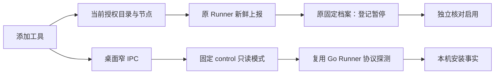

# 工具快速接入架构

T-TOOLS-151。本阶段连接既有目录、节点、库存与固定工具档案；桌面增加独立的本机只读安装观察。字段与操作以[合同](../../contracts/tool-quick-connect.md)为准。

## 原领域保持单一权威

`ToolQuickConnect`从当前Adapter目录筛选现有执行入口，合并当前授权私有／Pool节点身份。节点和配置的唯一候选可自动选中；多候选明确选择。`tool-discovery`继续在服务端核验当前资格和原数据库接收时间，前端按剩余期限及单调时间保守失效。快速接入不增加调度器、权限源或配置生成服务。

登记复用 `ToolWriteRecovery` 及原工具命令。准确响应才确认原暂停配置，随后通过原版本CAS单独启用。未知结果保留原请求和操作标识；读取、回执恢复、重新授权是不同动作。

## 桌面边界

`installed-tools.cjs`只接受准确主窗口／主frame和固定loopback服务。探测前后使用父窗口Session读取真实本人、准确项目、真实本人；子进程只接收固定工具ID和语言。业务凭据、Node注入选项和任意程序地址不能由渲染页传入。

桌面复用发行包中已有control程序，不新增探测依赖或Runner资源。control与Runner的独立CLI分支均调用 `runner.DiscoverInstalledTools`，先于业务配置、数据库和执行状态读取。固定目录仅包含Codex JSONL、CodeBuddy CLI与DSH multica；PATH项、包元数据、脚本入口、输出及时间均有界。已知包bin禁止越界和链接逃逸；npm shell shim不执行。现有Go探测继续负责固定协议、受限环境、输出脱敏与OS进程控制。

报告没有worker或派发资格；本机command预设只留在CLI边界，IPC剥除后返回安全安装事实。文件路径留在本机技术详情，不写入平台库存。

取消先通知Go上下文，确保Unix单独进程组中的探测也进入停止路径；主进程先软停再硬停，只有真实close解除占用。未确认关闭返回失败并保持busy。应用退出有界等待清理；此路径不扩展既有Unix分离后代的停止证明范围。

## 托管Runner的后续设计

本阶段没有节点凭据托管、加密本机journal、后台Runner或自动连接。当前节点发行仅在首次成功响应返回token，幂等回执不包含secret；普通GET不能补回丢失凭据。

后续应由受控本机组件维护私有加密journal，绑定当前本人、组织、项目、节点、原发行操作与准确配置。先持久记录操作，再安全接收并保存一次性凭据；恢复时先核对原操作是否已发行，不能因HTTP超时新建节点或再次发行。无法取得原secret时明确显示不可恢复状态，按当前授权处置原凭据后才能新建。网页只呈现安全节点状态和确认动作，不接管secret。此方案是后续方向，不是当前已实现能力。
