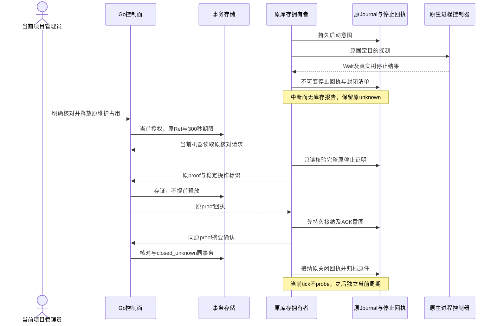

# 工具维护能力与未知恢复架构

状态：限定实现与验证完成；T195；suma1.0.0；负责人：主集成代理。[需求](../product/tool-recovery.md) · [合同](../../contracts/tool-recovery.md) · [验证](../quality/tool-recovery-verification.md)。

## 原权威与新增事实

复用原控制面、认证库存、Worker唯一库存拥有者、Journal、原生进程控制器和当前权限。维护能力是版本化协议声明，不是工具健康。停止证据是实际进程生命周期的持久记录，不是权限；当前管理员的有限核对授权也不代替停止证据。

## 停止证据与恢复

Collector绑定原inspection引用及不可变来源；spawn前持久意图，normal／nonzero／timeout／cancel均收束Wait和Stop／Finish，保存真实失败及未知。不可忽略停止错误，也不能无界等待输出管道。完整清单覆盖全部启动意图；摘要用于绑定原件，不能把摘要本身当进程停止证明。

Windows继续使用原悬停启动、Job分配、KillOnClose及active0核验。原生启动数指被拥有的工具进程树数量，不推算历史所有后代进程总数。没有全树停止事实的环境、硬崩溃无回执或漏启动覆盖均不得提交强停止证明。

节点只在没有待发原库存时提供proof；已准备库存先沿原操作恢复。服务端存proof不释放占用，节点持久接纳后才通过原ACK闭合。晚到原检查报告不能覆盖关闭后的新库存；丢ACK恢复同原payload，不能重probe或重kill。

`closed_unknown`是维护占用结束，原检查结果仍未知。当前管理员可以处理旧发起人撤权或旧配置变化，但不能借此扩大任务、安装、模型、部署或其他项目的权限。当前机器凭证／Pool依据漂移时明确阻断并提供隔离、重新配对的原入口。

## 能力与时间

维护协议由连续Worker／Pool拥有者通过原认证库存声明，逻辑instance属于持久Journal，跨同Journal重启保持。独立能力水位绑定准确节点及当前身份；旧库存ACK不续水位。

状态读取提供server checked_at；客户端以expires_at减checked_at，再扣请求时延和后续单调经过时间。保留旧数据时保留旧读起点，不能用本机墙钟或打开弹窗的时间续期。新检查要求fresh支持；核对允许准确last-known声明已过期，仍逐次验证当前身份与有期核对授权。

## AI 开发与排障 SOP

1. 先区分能力声明、当前库存、原检查、停止证据和占用关闭五组事实。
2. 原请求已开始时，来源变化只提示source_changed，保留claimed／unknown；未开始才可被superseded。
3. 检查原collector清单及每个停止回执的摘要、原Ref、覆盖和树停止结果；不要操作旧PID或删除Journal。
4. 检查当前核对授权、proof原操作、节点持久ACK及控制面关闭版本；回执未知只恢复原操作。
5. 缺证明或身份无法匹配时给出隔离／重配对路径，不显示已停止、已完成或已修复。
6. 只验证新增及直接受影响边界；真实OS、协议、界面和生产的覆盖分别记录。新表沿当前组件初始化，不回填兼容或重置用户数据。
