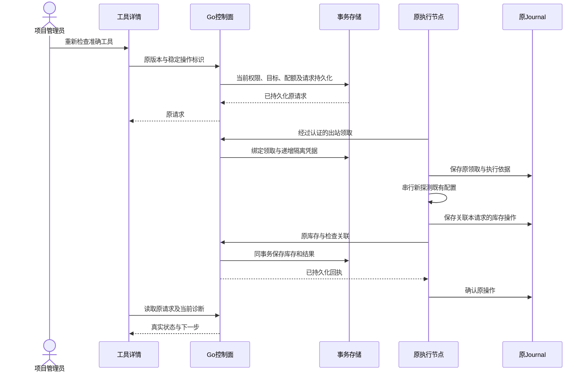

# 工具重新检查架构与 AI SOP

状态：限定实现与验证完成；suma 1.0.0；T-TOOL-REINSPECTION-194；负责人：主集成代理。[需求](../product/tool-reinspection.md) · [合同](../../contracts/tool-reinspection.md) · [交互](../design/tool-reinspection.md) · [采用记录](../integrations/multica-tool-reinspection.md) · [验证](../quality/tool-reinspection-verification.md)。

## 边界与数据流

控制面拥有检查意图、当前授权、准确目标及持久状态；原Worker拥有本机探测与原Journal。浏览器发起受约束的管理请求，不直接执行程序，也不把缓存状态作为执行回执。检查只读取既有配置，不承担业务任务开发、安装、授权变更或自动启用。

普通周期库存和显式重新检查共用一个库存处理者。旧的未确认库存先恢复其原回执，随后才开始本次新探测；旧报告及其他节点的报告不能满足新请求。业务调度仍由原Go DAG执行，维护请求不创建第二套开发任务分发权。

## 一致性与恢复

创建采用原稳定操作标识和工具版本。请求冻结准确profile、完整摘要及节点身份，共享池冻结相应项目授权依据。领取、上报与恢复均重新核验当前权限和依据。响应超时不能据此推断服务端未提交，过期、失联及晚到响应也不能绕过原隔离凭据。

Worker通过持久化原领取标识恢复丢失的领取回执；通过原库存操作恢复已经发生的探测结果。未确认的本机效果不自动重做。请求状态与库存结果同事务推进，避免库存已写入而界面永久等待，或检查已完成却没有对应报告。

执行失败、结果未知、当前配置不匹配及授权失效是不同事实。完成意味着本次检查及关联报告已持久化，不能推导为模型健康、开发任务成功或人工验收。表、接口和状态的准确字段以领域合同及生成Schema为准。

## 资源、隔离与可扩展性

按准确worker限制未结束请求；使用期限、范围索引和有界读取控制积压。不接受调用方提供的任意执行载荷。单机与分布式复用同一事务和隔离语义，数据库适配继续使用当前组件初始化和原查询方言；不重置现有数据库或补写未注册旧Schema。

本地安装发现与远程已登记配置检查保持各自能力边界。可复用Multica准确目标、分层发现、串行控制与异步请求生命周期的模式；许可证、来源和采用方式单独记录，不复制自动批准或静默更换固定版本的行为。

## AI 开发与故障排查 SOP

1. 从原工具、用户选择或公开草稿取得准确目标；核对组织、项目、adapter和worker，拒绝本机状态回调夺取远程目标。
2. 读取原配置、当前权限和未结束请求；若存在未知操作，先恢复原请求，不能以新标识绕过。
3. 沿共享合同实现控制面与Worker，复用库存事务、Journal和原鉴权；不要新开同Journal进程。
4. 用实际消费者验证“旧fresh不能完成新请求”“丢回执不重复探测”“错误节点和旧隔离凭据被拒绝”。只扩展直接受影响检查。
5. 排查时先看请求与领取、Journal原操作、库存回执和当前权限四组事实；原始私有日志及凭据不进入公开错误或Git。
6. 记录真实HTTP、进程和界面的证据范围。未覆盖厂商、多机或数据库环境必须明确保留，不用模拟结果代替。
