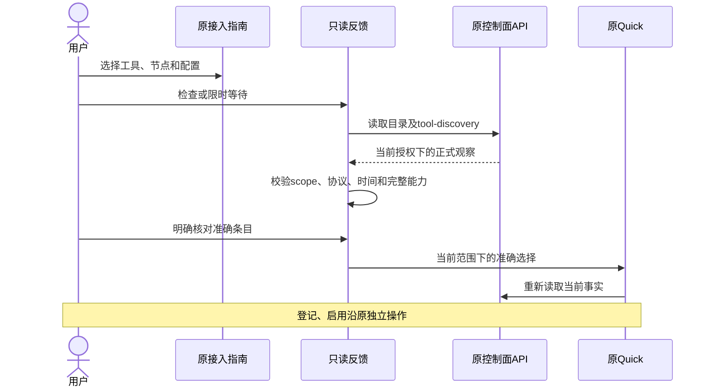

# 工具上报反馈架构与AI SOP

版本1.0.0；T-TOOL-REPORT-FEEDBACK-204；负责人：主集成代理；状态：本阶段实现与限定验证通过。需求见[PRD](../product/tool-report-feedback.md)，本地类型和不变量见[合同](../../contracts/tool-report-feedback.md)。

## 模块边界

原RemoteRunnerSetupGuide负责公开配置草稿与命令；反馈组件负责限时只读生命周期；纯模型复用正式适配目录读取器、库存解析器和Quick完整协议匹配。原Workspace负责重新核对当前上下文和写入阻塞，然后启动准确Quick草稿。Quick继续负责新鲜事实、已有匹配、暂停登记及独立启用。

## 一致性和并发

服务端数据库时间是新观察判定依据。等待固定baseline.asOf与baseline.observedAt，仅接受fresh且observedAt严格晚于这两个固定边界的新观察；统一时间解析保留9位小数。即使时钟回退导致原清单观察时间晚于原读取时间，也不能把相对原观察退后的报告当成新上报。客户端monotonic时间仅用于总等待时限和保守扣除剩余TTL，不充当上报时间权威。

一次只允许一个读取；调用者、项目、节点、工具及草稿采用代次绑定请求。取消、卸载或代次改变后，迟到成功和失败均不得覆盖新范围。页面隐藏不发新读，但总截止继续。响应到达已耗时部分与后续经过时间从remainingMs扣除，到期立即撤掉继续资格。范围形状校验不是授权。

原报告幂等回执可能恢复成功而不刷新库存。现有库存没有operation或文件因果字段，本阶段不补造字段、不新增轮询写入，也不借用运行SSE充当库存流。

## AI开发与排障SOP

1. 先确认当前项目、准确Worker和适配协议；不要根据产品名猜协议。
2. 读取正式目录及当前库存，区分无清单、过期、不可用、权限和网络未知。
3. 需要新观察时明确建立基线；遇原ACK恢复先核对原操作，不更换身份重复注册。
4. 返回准确Quick重新核事实；只能使用未过期且available的观察，不能由反馈直接登记或启用。
5. 变更读取器或协议匹配时运行对应定向检查；界面变更只验证受影响状态。证据、截图、私有SQLite及临时配置放忽略目录，Git只包含源码、设计与精简报告。

可定位证据见[限定验证](../quality/tool-report-feedback-verification.md)。严格operation／文件因果和真实厂商执行仍是独立验收范围。
