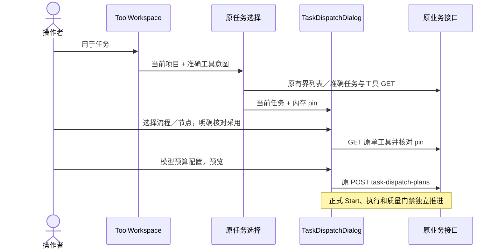

# 工具任务交接架构与 AI SOP

版本：1.0.0。阶段：T-TOOL-TASK-HANDOFF-213。状态：实现已落，验证结果见[最终质量报告](../quality/tool-task-handoff-verification.md)。负责人：工作台／任务派发／主集成。关联：[合同](../../contracts/tool-task-handoff.md)、[产品](../product/tool-task-handoff.md)、[设计](../design/tool-task-handoff.md)。完整31项／P0–P7继续。

## 领域边界

交接是 UI 内存中的准确目标意图。正式权限、任务版本、工具档案、项目路由、派发计划、执行和质量证据继续由原领域负责。无新后端接口、数据库表、调度器或模型配置权威。

| 模块 | 职责与复用边界 |
|---|---|
| `ToolWorkspace` | 从当前工具建立意图；保持单一 Modal；关闭回焦；正式计划创建后跳转原任务地址 |
| `ToolTaskHandoffDialog` | 复用 `useTaskWorkspacePage` 有界任务读取；选择后准确重读任务和工具 |
| `tool-task-handoff-model` | 公开六字段 pin、当前完整工具／观察校验、准确任务读取；任务沿当前 `RecordItem` 合同处理合法空值 |
| `TaskDispatchDialog` | 原任务／流程／节点选择、工具选择、模型预算、知识、预览和 Start |
| `TaskDispatchToolHandoff` | 用户明确发起原单工具 GET；核对 pin 后采用；显示短状态和边界 |

pin 固定 `project_id`、`id`、`version`、`worker_id`、`profile_sha256`、`name`。名称用于展示；采用依赖准确 ID、版本、执行节点及完整摘要。原完整配置解析器和观察匹配规则仍是配置合法性依据。

## 来源、选择归属与恢复

组件归属绑定当前 actor、组织、项目、API caller、任务版本、流程版本和 Agent 节点。来源或目标变化使用单调 epoch／intent，A→B→A不能接收旧结果；关闭、搜索、刷新或选择变化会终止旧采用资格。

派发父组件记录“由交接采用”的选择归属。重新核对先清除仍由交接拥有的准确 A 及模型选择；失败不保留旧 A 可预览。用户手工或原候选面板选择 B 会移交选择归属并推进意图代次，旧 A 回调不得覆盖或清除 B。卡片“已采用”状态由父组件实际选择决定。

原 `selectionScope`、`modelKey` 和模型组件继续绑定实际派发依据。完整任务兼容性、路由及预算由原候选／预览／Start执行检查。原未知写入保留 body、path、操作标识和 caller，交接不能绕过恢复锁；形成正式计划前不持久化 UI pin。

## AI 开发与维护 SOP

1. 先读取合同及当前工具、任务、派发类型，按 UI／共享解析器／正式业务边界确定文件归属。
2. 复用原任务分页、完整配置解析和单项 GET；扩展公开 pin 时同步核验内存边界与所有消费者。
3. 修改采用逻辑时同时检查当前选择归属、模型绑定、来源 ABA、手动选择和原未知回执；以准确版本为依据。
4. 只运行受改模块的必要检查。来源不变的原执行／质量证据复用；在代表实际旅程记录真实 HTTP、数据库、预览、运行及模型调用的各自范围。
5. 对外进度与交付引用最终质量报告；阶段代码完成后由主集成统一提交，缓存、凭据和临时文件不进入 Git。
