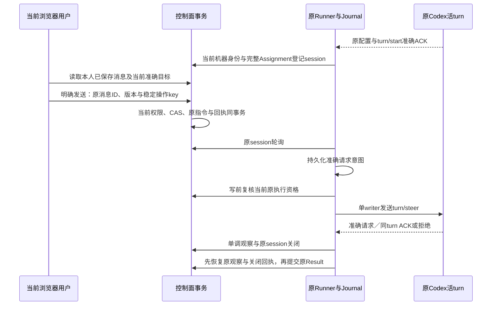

# 原执行追加指令领域与 AI SOP

状态：suma 1.0.0 当前实现中；需求：T-TURN-STEERING-188。权威来源：[领域合同](../../contracts/turn-steering.md)、`internal/codexcontract/steering.go`、`internal/steeringcontract/types.go`。关联：[产品](../product/turn-steering.md)、[交互](../design/turn-steering.md)、[English](../en/turn-steering.md)。验证证据独立于本实现说明。

## 模块与数据边界

`codexcontract`定义准确原生来源、唯一文本参数、摘要和安全证据；`steeringcontract`定义 session、原消息、指令及浏览器请求。控制面深模块负责当前权限、领域存储、事务 CAS、原回执和 Result 核验；Runner 复用原 app-server、Journal、单一 stdin writer、原 Client 与 Worker 生命周期；Web 复用任务讨论、范围读者和未知操作恢复。领域独立于工具审批和问答，不引入第二派发器、替代工作区或新模型调用层。

`CodexSteeringSource`固定 `codex-turn-steer-v1`、原 `thread_id`、`turn_id` 与 `binding_sha256`。Runner 仅在原配置和 turn 启动 ACK 后、停止或关闭前公布 live source。`SteeringSession`固定 project／task／run／node／attempt／fence／worker／dispatch／profile、source、版本与期限；状态只有 active／closed，可操作项仅 send。active 是记录状态，当前可发送权由服务端另算。

`SteeringMessage`保存原已持久化本人 human 消息的 ID、sequence、author、完整 body 与 SHA-256。`SteeringInstruction`固定 session、执行 tuple、actor、期限、版本及可选观察；每 session 同消息唯一、总量最多 32。`MaxSteeringTextBytes=32000`与共享 `ValidSteeringText`沿原讨论 producer 规则：有效 UTF-8、最多 32,000 字节／8,000 Unicode 字符、非空白且不含 NUL；其余字符经 JSON 完整保留，不截断。浏览器只传 `SteeringCreateRequest` 中的 project／task／message／session ID、任务与 session 期望版本及操作 key；原文与原生地址由当前服务解析。日志和 `CodexSteeringEvidence`只保留来源、instruction ID、消息摘要及观察，不复制正文。

领域存储和索引由原控制面登记；指令、状态、观察和操作回执在原事务内一致提交。1.0.0 只采用当前 schema 声明；唯一性与无写预检沿现规则执行。未声明结构拒绝，不补旧形状、不重置用户数据。

## 接口、授权与恢复

| 调用方 | 接口与结果 |
|---|---|
| 当前浏览器 | `GET /tasks/{id}/execution-steering?project_id&message_id` → `SteeringContext` |
| 当前浏览器 | `POST /task-execution-steering` → `SteeringInstruction` |
| 普通 Runner | `POST /runner/steering/sessions`、`/poll`、`/observations`、`/close` |
| Pool Runner | 对应 `/pool-runner/steering/sessions`、`/poll`、`/observations`、`/close` |

机器 Open 返回 `SteeringOpenResult`：有 session 时无 reason；原身份与完整 scope 有效，但属于非受管任务开发执行的普通 workflow 时，合法返回 HTTP 200、仅 `reason=not_task_execution`，无 session、无追加能力，不影响原普通工作流。权限、数据库和未知 HTTP 错误不能静默降为此正常结果。Close 返回 session，Poll 返回 session 与 instructions，Observation 返回 instruction；成功均为 HTTP 200。请求沿普通完整 Assignment 或 PoolRunnerAssignmentRequest，严格生成 Schema 拒绝未知字段。Result 继续走原接口。

浏览器读取与原回执恢复先核当前人的项目权限。新发送还需本人消息、未验收任务、准确 session、当前执行资格、版本及数据库期限。授权后先恢复同 key／同 body 原回执，再检查 fresh 状态和版本；不能把已经提交的操作变成第二次追加。`SteeringContext.reason`闭集为 `not_own_message`、`task_accepted`、`no_live_turn`、`current_execution_unavailable`，不暴露私有 Record。

机器始终先核当前有效身份与完整原 scope；旧回执不能复活过期或撤销身份。已提交的 exact observation／close 回执优先于 fresh live 门恢复。active session 的 fresh poll／write 复核原提交者当前权限、原运行、预算／pause、库存／Grant 与 lease／fence。session 已 closed 后，当前机器身份与完整原 scope 有效的 Poll 可只读取得最终不超过 32 条完整 instructions，不再套 fresh 新工作资格门；仅用于补齐 Close 前后尾项与 Result 证据，不能发起 native 写入。已经开始的真实投递事实按观察规则保留，不误套新工作资格而改写事实。

## 原生协议与证据

唯一原生参数为 `threadId`、`expectedTurnId`、`input=[{type:"text",text:原正文}]`、`clientUserMessageId=instruction.id`。共享 `BuildSteeringParams`与 `SteeringParamsDigest`产生固定参数及 JSON SHA-256，不接受模型、沙箱或其他原生覆盖。clientUserMessageId 用于关联，不能当成厂商幂等保证。

追加请求的 pending ACK 映射独立于启动 `waitingID`，复用原单调客户端 RequestID。原生 server 发起的 approval／input ID 与客户端追加请求方向不同，不能混为一张等待表。ACK 必须匹配原 typed request ID，且返回 turnId 与预期完全相同。

持久化写入意图 → 写前平台核对 → 原单 writer → 记录完整写出与原生响应。`CodexSteeringObservation`用单调 sequence 累积 observed、write_started、write_written、native_accepted、native_rejected、turn_closed 及固定 failure_code；参数摘要绑定准确正文和请求。ACK 早于写回调时先暂存再合并，不丢事实、不碰撞序号、不持 driver 锁等待 HTTP 或 Journal。关闭先于新写入时禁止派发，已经开始的写入保留迟到结果。

write／ACK 不确定时只重传原 HTTP 和观察，不再写 native、不换 key 自动重试、不新建 turn、不 resume。原 turn 停止或结束后关闭 session，未派发项如实未送达。普通／Pool 均先恢复观察和 Close，再恢复 Result。成功 Result 必须准确匹配全部登记指令、持久观察和闭合 session；unknown 阻止成功，拒绝或未派发关闭不能伪装成接受。native 接受、模型遵从、代码候选、独立测试、人工验收和部署各自成立。

## AI 开发 SOP

1. **确定范围。** 先读当前状态、当前领域合同和相关 source；把共享类型、控制面、Runner、Web、文档分配给明确所有者。保持 1.0.0 单一当前实现，不引入历史别名、迁移兼容或第二执行链。
2. **固定来源。** 以本机已核对协议 Schema 和准确版本为字段依据，复用已验证导出，不重复 SDK／依赖构建。交互参考本地 Multica `5a2cc891ac338eed1919aa11a1eef5957cd82cec`；外部 Web 参考与此本地 pin 分开记录。只借鉴公开交互和串行活 turn 机制，使用 suma 既有深模块，不复制受限制代码，也不带入 timeout 原生重发或新回合 fallback。
3. **先锁不变量。** 定向覆盖本人原消息、准确目标、当前权限／完整 Assignment、CAS、同 key 同 body、32 条与字节上限；再覆盖 ordinary／Pool 一致性。共享修改由主集成收敛，避免并行改接口。
4. **审查外部作用。** 先持久化准确原意图，再当前核对与单 writer。检查早关闭、ACK 先于回调、部分写、错误 turn、RPC 拒绝、丢 ACK、撤权、租约变化及 Result 重放；unknown 永不触发 native 重发。
5. **保护用户状态。** 恢复键包含 user／org／project／task，旧意图保留旧 session／message／tuple／body／key；新 attempt 不掩盖待核对写入。源切换与迟到响应核 epoch，撤权清私有内容，讨论各动作聚合 busy。
6. **做有意义的验证。** 只跑新增和直接受影响检查，复用输入未变的成功结果；最终类型、词条与组件构建集中执行一次。真实 CLI、受控模型、控制面 HTTP／SQLite、合成 GUI、真人验收分开记，不把任一层称为真实厂商完整验收。
7. **保存证据并交接。** 记录准确源码摘要、命令／环境、原失败和修复范围；有 representative 中英／390px／键盘实证才报告对应覆盖。缓存、数据库、日志、截图、私有配置与二进制留忽略目录，提交仅含源码、合同和紧凑报告。

完整 31 项／P0–P7、58 项限定／34 项待交付／92 项总账保持进行中。真实厂商、物理多机、其他数据库、跨平台安装、完整 App 与生产需独立证据；原 T171 显式 GUI 停止缺口保留。
