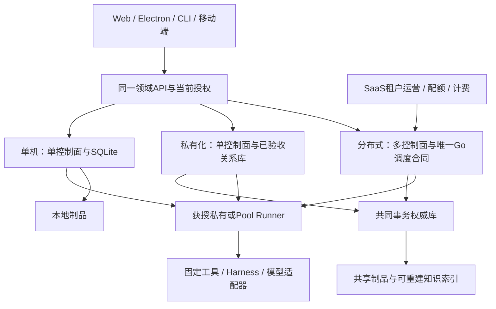

# 统一能力编排与部署架构

阶段：T-DESIGN-135（继续 T-PLATFORM-DESIGN-134）；日期：2026-10-29；产品：1.0.0。

状态：架构细化，新增合同与能力待实现；本文不是实现、真实集成或生产验收证明。
体验依据为[统一体验设计](../design/unified-experience.md)，完整范围和实施顺序仍由[唯一实施计划](../delivery/implementation-plan.md)管理。
参考源码基线为 `3e09a51`；专项报告只证明其记录的源码、环境和场景，不能自动扩大到当前全部能力。

集成时已保留远端 `e8f441e` 的项目焦点读取合同与客户端MCP配置导出，见[专项说明](../product/enterprise-workbench.md)。该增量不改变唯一Go DAG、预算约束范围或本文待实现的统一manifest与配置解析边界。

本轮继续保留 `b1439b3` 的[资源工作日历](resource-calendars.md)：正式智能规划已绑定完整日历与版本，依据变化使旧预览失效。组织级容量、HR、实际工时和真实浏览器仍按[原专项报告](../quality/resource-calendars-verification.md)记录，不由交互样稿补造验收。

进一步集成 `57589dd` 的[人员工时合同](../../contracts/worklogs.md)：当前身份、任务版本、不可变更正历史与组织跨项目每日额度由既有事务权威控制。人员登记不进入模型费用账本，不构成测试或业务验收；真实GUI与数据库范围仍以[专项报告](../quality/worklogs-verification.md)为准。

## 1. 当前能力分级

分级采用“已有实现与限定证据”“已有代码但目标环境待验”“设计待办”，不以菜单、配置或接口数量计算完成率。

| 能力 | 当前事实与边界 | 源码及权威合同 |
|---|---|---|
| 唯一 Go DAG | 已有增量扫描、持久唤醒、attempt／fence及原领取回执；生产吞吐与长期规模待验 | `internal/dag/scheduling_claim_scan.go`；[内核合同](../../contracts/scheduling-kernel.md) |
| 私有与 Pool | 同一 Engine；Pool 双边授权、独立机器槽位、两级资源准入与加权份额已有 SQLite 限定证据 | `internal/dag/pool_claim.go`；[Pool 合同](../../contracts/execution-pool-core.md) |
| 公平调度 | 持久固定点虚拟服务按成功准入推进，避免不活跃主体积攒旧信用；不等于算力或 Token 公平 | `internal/dag/pool_fairness.go`；[执行池](../../contracts/execution-pools.md) |
| 模型网关 | 原生编码与 Octop 共有 attempt 级 Go HTTP/SSE 网关、请求账本和剩余总输出许可 | `internal/runner/model_gateway.go`、`internal/modelgateway/`；[网关架构](model-gateway.md) |
| 其他模型路径 | OpenCode、Codex、只读规划等仍遵守各自固定执行与用量合同；未全部接入上述网关 | [OpenCode](../../contracts/opencode-sdk.md)、[Codex](../../contracts/codex-app-server.md)、[智能意图](../../contracts/intelligent-operations.md) |
| 智能输入 | 最多八步需求／设计／知识草稿提案、预览和同库原子采用已有限定证据 | `internal/platform/intelligent_operations_apply.go`；[原合同](../../contracts/intelligent-operations.md) |
| 自动化 | 持久 cron／人工触发、固定流程修订、错过／重叠策略与去重已有本机证据 | `internal/platform/automation.go`；[事件合同](../../contracts/automation-events.md) |
| 配置 | 各领域已有固定版本、默认值及部分预览；通用继承解析和全平台配置中心待实现 | `internal/platform/scheduling.go`；[平台基础需求](../product/platform-foundation-prd.md) |
| 部署 | 本机运行及容器／数据库覆盖模板已有；Helm 固定单副本 Recreate，集群和商业 SaaS 待验／待实现 | `deploy/helm/suma/templates/deployment.yaml`；[容器交付](../deployment/containers.md) |

内核早期合同中的迁移／generation叙述仅作历史取材；当前初始化按[单一初始版本](initial-version.md)执行，不据此新增兼容分支或改写用户数据。
现有 `/healthz` 主要证明数据库可连接和服务响应，不证明工具、模型、索引、执行池或发布目标健康。

## 2. 状态所有权与应用边界

控制面保持模块化单体，Runner、知识索引与制品适配器可独立部署；是否拆进程由权限、扩缩和故障隔离需求决定。

| 所有者 | 正式状态 | 不得代替的事实 |
|---|---|---|
| 身份与授权 | 主体、会话、角色、当前授权、凭证来源与范围 | 团队归属不等于项目访问；身份标签不是可信凭证 |
| 项目与规划 | 需求、设计、任务、排期、依赖和固定计划依据 | 运行成功不能直接改变业务验收 |
| 执行与调度 | 流程、运行、attempt、fence、租约、路由和核对 | 取消请求不等于实际停止 |
| 质量与交付 | 测试计划、候选与测试引用、人工验收、发布批准 | 外部工具完成不能生成通过结论 |
| 知识资产 | 原文、来源、修订、发布与采用关系 | 索引不是正文权威；文本技能不授予执行权限 |
| 能力连接 | 工具／模型／插件声明、版本、连接和秘密引用 | 配置、探测、授权和真实调用分别记录 |
| 用量与运营 | 观察、预留、估算、对账与平台收费记录 | 费用估算不是供应商账单 |
| 协作与通知 | 讨论、同步水位、渠道映射和投递回执 | 消息送达不是业务命令已采用 |

应用用例负责跨域编排，域模块不得直接改写其他域的表。
当前授权、业务写入、稳定操作回执、审计和 outbox 在同一 SQL 事务内成立；外部调用不放入该事务。
检索、通知和统计采用可恢复的异步投影；投影失败不重做已经提交的领域动作。
共享列表、错误、版本和恢复语义，不引入万能 CRUD、任意 `action` 分派或第二套任务调度器。

## 3. 固定任务封套

封套是现有计划、运行与证据之间的关联合同，采用强类型组成，不新增一套可写的“统一任务状态”。
具体 HTTP／CLI／MCP 命令继续由领域应用服务拥有；以下字段是设计要求，实际线协议扩展由公共合同生成器统一交付。

| 字段组 | 内容 | 可信来源与校验 |
|---|---|---|
| 业务依据 | task、requirement、design及各自修订／摘要 | 客户端可选择引用；服务端按当前权限读取正式版本 |
| 执行目的 | 受支持的编码、测试、分析等固定 purpose | 由具体应用入口确定，模型不能指定可信 purpose |
| 工具与能力 | 档案ID、修订、摘要、适配器协议与能力要求 | 服务端固定目录与当前库存；客户端不能自报已验证能力 |
| 上下文 | 显式知识引用、仓库／工作区与来源约束 | 已发布资产和正式绑定；正文不能扩大权限 |
| 执行路由 | 私有或 Pool、grant修订、所选策略 | 服务端复核双边授权并固定到运行 |
| 模型与限额 | 受支持绑定、参数、请求／总量上限和报价引用 | 当前模型选项及准入服务生成；秘密不进入封套 |
| 时间与资源 | 排队／执行截止、资源声明、并发限制 | 服务端策略约束；用户输入只能处于可授予范围 |
| 操作关联 | 原命令ID、请求摘要、计划修订 | 客户端稳定key由服务端绑定完整请求与调用者 |
| 执行身份 | tenant、project、actor证明、run、node、attempt、fence | 仅服务端认证、派发和领取过程产生 |
| 交付要求 | 候选来源、独立测试及人审要求 | 质量合同与固定任务依据；模型不能回填批准事实 |

封套不携带凭据正文、任意环境、自由网络目标或可伪造的验收结果。
未支持的字段／能力明确拒绝；不能为表面统一将 Codex、OpenCode 或只读模型路径伪装成共同网关。
计划启动时固定依据，后续新配置只影响新计划；运行中调整必须有独立命令和明确允许的边界。

## 4. 适配器与 Harness 扩展

各工具的实际范围、官方协议和验收层级见[开发工具能力矩阵](../integrations/development-tool-matrix.md)；本节不替代逐工具合同。

Adapter manifest 至少声明以下内容：

- 稳定适配器ID、实现版本、协议版本、支持平台和安装来源摘要。
- 输入／输出Schema、支持purpose、所需宿主能力及最大输入输出边界。
- 工作区模式、许可命令、网络范围、秘密引用与模型鉴权归属。
- 进度、产物、用量完整性、取消、实际停止证明和结果核对能力。
- 超时、可重试条件、原操作恢复及会话恢复是否受支持。
- 能力探测方式、已执行验证引用与尚未覆盖的环境。

manifest是能力声明；启用、当前授权、机器库存、最近探测和正式任务验证分别保留事实。
Harness只接收固定目标和获授宿主工具，不直接取得数据库连接、平台管理员密钥或第二套派发权限。
MCP工具调用进入统一领域服务；A2A任务绑定原远端任务ID、原操作和本地DAG节点，不复制远端状态作为业务验收。
SDK升级必须固定实际版本并验证输入、进度、取消、产物与未知结果语义，不能仅凭启动成功更新能力状态。

## 5. 策略与配置解析

本节为待实现的统一解析规则；已有领域合同有更严格限制时继续优先，不提前放宽已验证边界。
默认来源顺序为平台默认→组织→项目→本次计划；团队是可选择模板，明确采用后落为项目／计划值，不形成隐式并列继承层。

| 字段类别 | 解析规则 | 界面说明 |
|---|---|---|
| 普通可覆盖字段 | 按允许层级选择最近显式值，不做任意深度合并 | 显示值、来源、修订与默认原因 |
| 授权与资源范围 | 取当前可授予范围交集，下层不得扩权 | 显示限制来源及拒绝原因 |
| 配额与预算 | 同时满足各层独立额度，实际许可受最紧约束 | 区分总额、剩余额、预留和未知占用 |
| 工具／模型／知识 | 仅从当前有权且兼容的目录选择并固定修订 | 不可用时阻止，不静默换提供方 |
| 执行路由 | 明确私有／Pool绑定及grant版本 | 新默认不改变已启动运行 |
| 秘密 | 只继承受允许的秘密引用，不返回值 | 配置成功与凭据验证分开 |
| 自动策略 | 固定作用域、允许动作、次数／费用／期限和门禁 | 显示辅助、受控执行或自主维护边界 |

解析输出包含逐字段来源、受限原因、最终版本与摘要；预览不创建执行、不预留预算、不代表长期授权。
采用时复核当前权限、来源、配置与策略版本，变化后保留草稿并要求新预览。
AI只能提出封闭结构化计划；不能改写自己的策略、扩大权限或自行批准验收。
当前智能输入仍限于三类同库草稿动作；跨外部效果采用逐步执行与核对，不承诺跨提供方原子回滚。
自动修复次数、连续失败停止和审批规则沿[统一体验设计](../design/unified-experience.md)固定，未知效果优先核对。

## 6. 选择、并发、公平与背压

派发顺序：当前授权→固定来源及验收依赖→工具与模型兼容→路由及库存→资源／预算准入→公平选择→原子领取。
硬约束失败提供结构化原因和可操作下一步，不能为了提高吞吐绕过门禁。
Pool继续采用租户→项目的持久加权份额；项目内优先级、等待和运行轮转独立表达。
当前公平算法以成功准入为服务量，权重不是执行时长保证、成本份额或预计完成时间。
不活跃／阻塞主体不得积攒无限历史信用；策略变更须明确对现有等待项的生效方式。

背压增量建设沿原Go调度链实施：

- 保持候选扫描、动态展开、事件读取和网关响应缓存有界。
- 为项目／Pool待执行量、外部请求速率、制品上传和outbox积压定义独立上限。
- 准入拒绝返回稳定原因与重试建议；调用方不得自动新建任务规避限额。
- Runner空轮询使用有界退避与抖动，活动任务心跳不被空闲退避拖延。
- 事件慢消费者断开后按持久游标续传；不得无限缓存或丢帧后跳过未知区间。
- 资源回收依赖实际结果或受权核对；排队超限不能释放未知副作用持有的预留。

新增限制要有实际单位、范围、上限来源与观察时间，不使用没有测量依据的健康分或预测时间。

## 7. 生命周期、用量、事件与观察

提案有效、计划采用、运行完成、候选封存、独立测试、人工验收和发布成功分别展示，不合并成一个完成百分比。
排队截止、执行截止、单请求截止及取消请求分别建模；截止时间不因断线、重启或自动重试刷新。
本机进程树收到停止请求后收集真实停止证明；远端缺证明进入核对，不能超时即标成功取消。
新重试有新attempt／fence；迟到事实可补充原历史，不得改写当前尝试或越权释放额度。

| 用量状态 | 账务处理 | 用户表达 |
|---|---|---|
| 完整已报告 | 按固定引用费率计算估算，依合同释放剩余预留 | 真实计数与估算费用分别显示 |
| 部分已报告 | 保留已知小计，未证明部分不按零处理 | 明确缺失范围与待核对部分 |
| 未报告／未知 | 按当前合同保守保留许可或hold，不自动重复外发 | 无费用数字时显示未知，不显示免费 |
| 供应商对账 | 追加来源明确的对账记录，不覆盖原请求事实 | 区分估算、供应商确认和平台收费 |

共同网关仅对其实际覆盖路径实施逐请求许可；其他适配器明确标识观察能力与限制能力，不宣传全工具硬预算。
事务事件和outbox使用原操作与领域身份关联；重放投影幂等，不重放外部副作用。
响应缓存必须绑定attempt、请求摘要和大小上限；缓存损坏、缺失或旧会话不能授权重新调用供应商。
观测关联至少包含请求／操作、租户／项目、run／node／attempt／fence，默认去敏、有界、分页且受当前授权。
健康分层为进程存活、请求就绪、组件实际探测、能力资格、生产验收；当前DB连接探针只对应其中有限一层。

## 8. 部署拓扑与开放门槛

该图描述目标部署选择，不代表当前全部拓扑可运行；多控制面仍共享同一调度规则和事务状态，不另建第二调度器。

| 包级别 | 默认组成 | 开放门槛 |
|---|---|---|
| 本机包 | 单控制面、SQLite、本地制品、明确工作区Runner | 新库初始化、重启、目录权限、目标OS与恢复实测 |
| 团队私有化包 | 单控制面、已验收关系库、独立Runner／索引服务 | 实数据库事务竞争、真实远端Runner、TLS、秘密与备份恢复 |
| 分布式包 | 多控制面、共同事务库、共享制品和分布式Runner | 多实例领取／Tick／撤权／回执竞争、失联恢复与无重复外部作用 |
| SaaS包 | 分布式能力加租户运营、配额、对账和收费 | 租户隔离、实际商业对账、限流、容量、保留与恢复演练 |

现有Helm单副本Recreate保持当前限制；增加replicas之前必须证明数据库锁序、初始化竞争、共享秘密、制品可达及事件恢复。
数据库不可用时停止新派发；活动执行依固定截止、现有租约和本地journal处理，恢复后按原身份核对。
备份包含一致数据库、制品、秘密恢复材料与必要执行日志；不能只复制运行中的SQLite文件或只切回旧数据库。

## 9. 失败场景与验收

| 场景 | 必须观察到的行为 | 必要证据 |
|---|---|---|
| 两控制面竞争最后槽位／预算 | 仅一次准入；败方无残留预留，重放得到原回执 | 实数据库并发、资源账本和回执核对 |
| Pool预览后撤权 | 领取拒绝，不降级私有或换工具执行 | 预览／撤权／领取竞争及当前权限证明 |
| 模型已收请求但响应或ACK丢失 | 保持未知与预留；只核对原操作或读验证缓存 | 网络故障、账本、无第二次外发证明 |
| Runner崩溃且旧进程仍写入 | 旧fence不能提交当前结果；未停止前不重用写工作区 | 进程树、journal、attempt与候选证据 |
| 提案后来源／策略发生变化 | 原预览失效，保留草稿并重新校验 | 版本竞争、原确认不可复用 |
| cron补跑遇到重启／重复分钟 | occurrence唯一、补跑有界、未知运行仍占重叠条件 | 固定时区、重启与持久去重检查 |
| 索引／通知故障及慢消费者 | 正式动作不重复，投影恢复且旧索引不能绕过撤权 | outbox水位、续传与权限负向检查 |
| 恢复后密钥／制品／journal不一致 | 维持受限状态，核对后才恢复派发 | 独立恢复演练和证据集合校验 |

用本地协议夹具验证故障语义，用真实厂商／物理主机／数据库验证对应外部能力；两类结果分开记录。
只对变化合同执行必要回归，在共享合同与部署里程碑执行集成检查，不重复无关模型调用或历史全套验证。

## 10. 实施依赖与交付约束

1. 先统一当前来源、状态所有权、公共DTO与能力矩阵，再扩展任务封套和配置解析。
2. 先实现强类型配置预览／采用及当前授权，再开放持久策略和新的AI动作。
3. 先补适配器取消／核对／用量合同，再扩大工具自动派发与跨工具预算范围。
4. 先证明原调度准入、背压和数据锁序，再启用多控制面；共享库驱动存在不等于此项完成。
5. 先完成真实用量、供应商对账与租户隔离，再开放收费和SaaS运营。
6. 每阶段同步原实施计划、能力状态与精简验证摘要；不建立第二份权威待办表。

新增接口、配置和UI须提供中英文、来源／限制说明及可恢复的错误状态，界面沿统一体验渐进展开。
当前运行数据、凭据、活动预览和其他代理改动保持原样；本文不授权部署、迁移、清理或扩大自动执行权限。

## 11. 模型供给、接续与配置的细化边界

本节对照[架构主规格](../suma-architecture-design.html#s21)及[交互场景](../design/unified-experience.md#7-主规格到可操作场景t-design-135)细化目标，不增加第二套调度器、状态库或权威计划。T-DESIGN-135仅实现这些场景的本地样稿。

| 边界 | 输入与权威检查 | 固定结果 | 不允许的替代 |
| --- | --- | --- | --- |
| 供给通道 | 订阅、自有密钥、本地、托管分别声明身份来源、能力、驻留、用量可观测性及限制 | 有版本的可用模型选项、排除原因、预算单位和来源摘要 | 订阅OAuth不是通用API授权；未知计费不是免费；登记模型不是可调用证明 |
| 模型选择 | 当前授权→协议及能力→驻留／上下文→准入预算→明确选型 | 模型／部署／参数／报价／策略版本与用途 | 模型生成评分不能代替约束；不静默换供应商、网络范围、模型或计费主体 |
| Harness接续 | 原attempt、停止／外部效果核对、固定候选、已公开摘要、目标工具能力及新授权 | 新的交接提案和目标绑定；原运行与新执行独立关联 | 请求停止不等于已停；不能复制私有推理、旧令牌或任意进程会话；不能默认自动启动 |
| 团队分配 | 当前项目成员、职责、容量及未开始任务版本 | 负责人／执行者／审阅者和明确交接资料 | 团队归属不授予访问；已分配不等于已接收；独立审阅冲突应阻止确认 |
| 规则决策 | 可信事件ID／作用范围、固定规则修订、当前授权、预算及失败指纹 | 决策、原因、原操作引用和有界尝试 | 事件正文不能指定Shell、SQL、通用action或审批事实；未知作用不走重试分支 |
| 配置解析 | 类型、单位、来源版本、允许覆盖集合、组织／项目上限与资源约束 | 有效配置快照、逐字段来源、差异与拒绝原因 | 用户偏好不覆盖凭据、权限、网络或预算；配置回退不能改写活动执行历史 |

配置不是统一“后层覆盖前层”：语言、主题、密度可按用户偏好覆盖；权限、网络、并发、费用和有效期只允许按策略收紧；凭据只接受受控秘密引用，不能由通用配置正文接管。预览返回来源版本与请求摘要，采用事务重新检查授权、CAS和额度；来源变化保留草稿，重新解析后再批准。

模型与Harness之间使用固定能力及公开资料合同。模型换供给通道、运行换设备、工具换Harness均需分别确认能力、权限、预算、驻留及停止状态；不承诺所有厂商支持相同暂停、流式追加、恢复或精确计量。原生与Octop的现有统一网关证据不可扩大为全工具接入。

规则预览仅解释匹配对象和原因，模拟使用显式样本；正式激活须由当前授权主体固定修订。默认最多一次自动修复，管理员明确提高上限但最多三次；相同失败指纹连续两次停止，效果未知优先进入原操作核对。消息ID、事件ID、决策ID、领域命令ID与外部操作ID有独立语义，幂等范围绑定主体、项目、用途与请求摘要，读取原回执仍检查当前权限。

## 12. 从交互样稿接入正式领域

前端共享壳层只管理导航、局部草稿、焦点、筛选与详情；模型、协作和交付样稿分别拥有本地状态。生产接入应将这些状态改为领域读取模型及可恢复草稿，公共壳层不拥有验收、预算或授权事实。

- 需求整理保存原文、来源修订、建议和差异；采用替换内容前保留旧稿，后续编辑与撤销必须先比较，不能丢稿。
- 缺陷以修复周期关联候选、准确独立回归和人工决定；重开保留旧周期，不能将旧通过直接带入新周期。
- 发布集合只引用正式应用版本、制品和批准。部分成功按成员保留事实；未知成员核对原操作，回退需要新的数据及制品资格。
- 离线接纳先重新鉴权，再比较共同基础、本地和远端；结构化状态不用正文CRDT覆盖。解决提案与正式接纳分离，撤权或冲突不删除原件。
- 查询投影共享范围与水位，展示部分、未知、过时；事件恢复不能重复正式命令。并发与成本分别在原准入／账本权威收紧，不从图表数值决定许可。

现有合同复用优先于新增API。需要新命令时先补当前授权、版本、幂等、原回执、失联与重复提交的负向合同，再接入UI；适配器按具体平台、版本、能力和验证环境逐项开放。单机、私有化、多控制面与SaaS继续沿第8节独立验收。
