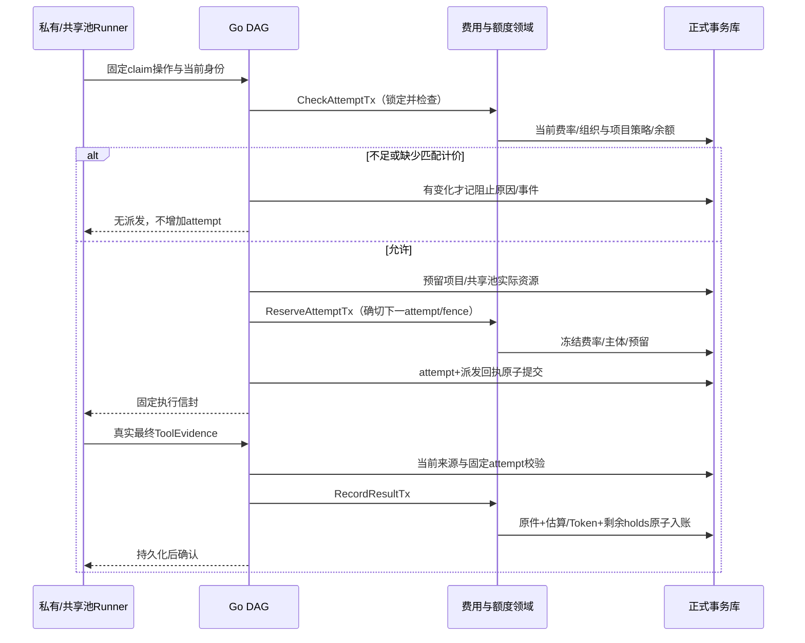

# Token、费用估算与执行额度架构及 AI SOP

状态：T-P4-024 限定本地已验证；产品1.0.0。负责人：平台／调度／工作台。关联需求14、18、13及FND-I18N-001。[正式合同](../../contracts/usage-accounting.md)。完整平台与多层级商业结算范围保持进行。

## 产品流程与事实

设置“用量与额度”按UTC自然月展示当前项目及当前授权组织账户。输入和输出构成已报告Token；缓存、缓存写入及推理计数原样独立展示。缺失是未知，实测0为0；费用按币种分列，不能换汇相加。顶部金额仅包含已定价且已报告的部分，未计价／未知不代表免费。早于账本启用的运行不会回填或推算成已计量。

组织管理员为有固定模型和地址的只读Suma规划工具配置不可变费率版本，填写每百万输入／输出Token金额和输入／输出预留。初期CNY／USD，API采用整数micros，1货币单位=1,000,000micros；界面最多6位货币小数，以十进制字符串与BigInt转换，不用浮点乘法。计价是运营者配置的估算，不是厂商账单。未知模型CLI照常记录真实Token并标未计价。

组织和项目分别设置观察或限制模式及月Token／费用估算额度。null表示无限，0为严格0。组织策略须组织管理权限；项目策略须项目管理权限。费率同时要求组织与项目管理，防止项目管理员通过改价绕过组织限制。当前权限在幂等重放前重新核验，客户端不按角色字符串自行授予写入资格。

领取前检查两个scope，资源预留成功后固定同一attempt/fence的金额及Token预留、费率和策略版本；预算不足不消耗attempt／槽位。最终结果只计算一次，完整上报释放未用预留；部分、未知、停止及人工业务核对保留未决额度。实际超额仍记录，不改写成预留上限，之后准入按真实余额拒绝。

额度是平台受管执行的准入控制。输入预留仍为明确估计，第三方私有CLI调用和厂商额外收费无法用当前机制保证硬上限；逐模型请求网关／精确输入许可仍待交付。

## 模块与事务边界

- `internal/toolcontract`与Runner：复用最终ToolEvidence及complete／partial／unreported语义。Progress存在截断及各工具累计差异，不累加成第二份账单。
- `internal/dag/accounting.go`：启动时注入AttemptAccounting，Check／Reserve／Result／Resolution共享现有领取或结果事务，不接收客户端插件、权限或外部请求。
- `internal/platform/usage_accounting*`：权限、不可变费率、policy CAS、账户锁、精确估算、不可变事实、人工确认和有界读取。Go标准库math/big避免乘法／累计溢出；超浏览器安全整数的公开合计为null，原始精确值和预留保留。
- `cmd/suma-control`：在开始处理请求／后台任务前启用Service hook。纯DAG库可不依赖业务账本；产品控制面不绕过该hook。
- `UsageWorkspace`：复用原API上下文、写入恢复和语言目录，一个设置入口，进阶表单折叠。原模型／用户原文与宿主标签分离。

Check只锁和检查，不收费。Reserve失败回滚项目及共享池资源和派发，不留下部分金额。重放领取不再次预留；完成回执重复不重复结算。租约过期不释放财务预留，业务reconcile成功／未开始也不是Token实测0。费用核对使用独立记录与人工确认，不能随DAG原result覆盖而丢失已知用量。

晚到回执经过原执行资格与证据校验后，在同一事务保存独立结果事实。人工结算完成时保留其已确认的金额、额度和依据。先确认后收结果的尝试会登记原结果摘要；已有摘要的尝试保留原修订。该规则同时适用于项目和共享池收到的有效回执。 [阶段验证](../quality/usage-confirmed-receipts-verification.md)

## 用量证据

尝试记录下的「用量证据」复用不可变事实表和现有复合索引。项目授权与读取同事务，按 UTC 纳秒时间和 ID 倒序分页，游标只接受该项目当前尝试的事实。查询沿用现有尝试范围索引，先按补齐的小数秒键确定有界页面，再读取所选证据原件。 [精度验证](../quality/usage-evidence-order-verification.md)浏览器按需读取，关掉或切换范围时中止旧请求。原始与后续回执展示已报告的计数，人工确认展示审核的计数。原结果依据 `source_result_sha256` 标记，核对只显示事实类型和摘要。已确认汇总仍来自账本投影。 [验证](../quality/usage-evidence-verification.md)

## 数据与读取

新增policy、rate、account_guard、account、attempt、fact六表及有界查询索引。账户按tenant/scope/project/UTCmonth/resource隔离，resource分别tokens、cost:CNY、cost:USD。每笔attempt固定run/node/attempt/fence/worker/profile及费率；原结果、业务核对和人工确认进入独立不可变fact。

默认账期在当前权限事务读取数据库时间；显式月份严格校验。列表先在数据库按相同数据库时间、当前node的确切attempt/fence计算有效未知状态，再筛选、计数和keyset分页。人工结清的旧记录不会因同node仍待业务核对而重新计为财务未知。游标绑定tenant/project/month/state，不在客户端分页后过滤。

费率只展示有界最新100项并返回总量；未加载费率不自动推断version0。财务大整数原件与账户值保留，浏览器无法精确显示时明确未知。组织全量余额仅组织管理员可读，普通项目成员只看本项目及组织限制是否启用。

## 运维与人工确认 SOP

1. 确认当前项目、账期和计量覆盖范围，先核对输入／输出与完整性，再看估算金额。不要把未上报／未定价当0或把原调度admission_units当费用。
2. 组织管理员核对固定模型、地址、币种和计价依据后发布费率。金额以界面货币小数输入，预留与实际输出预算匹配；不把模型密钥填入配置或原因。
3. 根据容量启用组织／项目额度，明确确认可能阻止新执行。节点等待时先检查费率、币种、限额及未决预留，再决定调整配置；不通过换凭证或重放制造第二笔派发。
4. 执行成功、开发测试、业务验收和财务结算各自查看。实际Token超预留会如实记录，不能裁剪为预算数。
5. 未知／部分结果先查看原attempt与独立事实；业务not_started不会自动退款。核实证据后，由同时有组织管理和项目批准权限的人员填写完整计数、证据引用、原因并明确确认。任何已知计数不能降低；标为人工确认，不冒称厂商实测。
6. 网络未知复用原操作标识及请求；确认费用状态和余额已持久后再继续。当前财务人工确认不修改代码、任务验收或生产权限。
7. 升级先独立构建、克隆数据验证，再由集成代理备份／维护迁移／前向切换。必要验证覆盖权限、并发、事务和回执；原日志、数据库、截图、密钥及产物留.cache，不进Git。

## 完整目标与尚未验收

本轮覆盖组织／项目额度与固定模型费率的执行闭环。团队／个人／专家组／Agent可验证计费主体、共享模型速率、逐调用硬许可、厂商账单／支付结算、平台SDK、多币种结算、全自动调优、OceanBase／PostgreSQL实际矩阵、分布式性能和跨平台安装继续推进。当前实现和本地协议验收不能替代这些交付。
