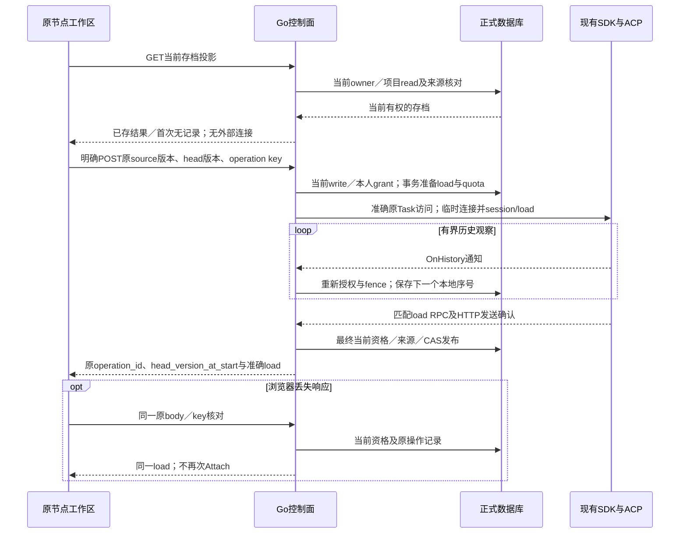

# 原云任务会话加载与存档架构

状态：T-WORKBUDDY-CLOUD-COLLAB-164限定实现与验证完成；[阶段证据](../quality/workbuddy-cloud-collaboration-verification.md)；产品1.0.0；2026-10-31。负责人：控制面、工具接入、工作台与主集成。关联[冻结合同](../../contracts/workbuddy-cloud-collaboration.md)、[原云任务执行](../../contracts/workbuddy-cloud-execution.md)。本阶段提供明确加载与存档读取，完整人工输入、权限处理、取消及实时协作继续按合同交付。

## 模块与正式事实

Go控制面仍是当前账号／项目资格和操作记录的权威。`workbuddycloudcontract/collaboration.go`定义闭合DTO；`workbuddy_cloud_collaboration*.go`实现私有来源、事务准备、采集、发布及HTTP。原149 `workbuddy`／`workbuddyacp`和固定ACP Go SDK负责准确任务访问与会话协议，不由页面直接连接供应方。

`head`维护当前加载尝试和最近确认加载，`load`维护一次采集及不可变回执绑定，`entry`按本次实际到达顺序保存有界展示投影。它们属于当前platform数据基线，初始化先检查现存schema，不重置或回填用户资料。存档与原DAG外部等待、供应方任务状态、测试及业务验收独立；加载不会改变原节点执行状态。

浏览器组件独立挂在准确原run／node工作区。当前owner可以读取本域存档，明确加载还需当前write与本人账号授权。没有默认共享给所有项目成员，也不将会话正文自动送入知识索引、通知活动或模型上下文。加载成功只表示本次协议与持久发布确认，覆盖范围始终未核实。

## 外读及恢复顺序

网络I/O不持数据库锁。当前资格撤销、来源失效、限额、断线或HTTP／RPC不一致均不能发布为loaded；可保留获准前缀及旧last_loaded。过期loading先由DB时间明确表达，再由新的明确操作事务fence；旧回调不能追加到新load。没有自动重连、票据刷新重发输入或新key重试。

## 回执与数据保护

回执必须同时对应原operation_id、head_version_at_start、原expected_submission_version和固定身份／摘要；load.version不替代head起点。观察导致submission_version增长不等于换了原task；写入新加载仍需准确当前起点。协作域GET的来源冲突会清除本域已显示正文，普通暂时读取失败保留旧数据并提示；POST的版本／quota冲突不会被误作全局撤权。原云任务仍有权读取的事实不被子域错误清空。

DTO不含ACP URL、ticket、原RPC引用或raw packet。只保留用户／assistant文本、工具和计划摘要；思考、原始参数／结果、外部资源及未知扩展不直接进入展示正文。字面内容不执行、不自动访问链接，没有事件时间时不捏造时间。最多500条／1MiB文本、单项64KiB、30秒采集；一个原节点最多一项有效加载、每项目最多四项。超过限制标为limited而不是悄悄截断。

## 操作与AI开发SOP

1. 从准确原run／node进入，先读取当前有权存档，核对来源与覆盖未核实标记。
2. 需要新观察时明确“连接并加载原会话”；页面、语言切换或普通刷新不自动外读。
3. 核对原操作回执与load状态；loaded不代表供应方任务完成，interrupted／limited保留本次前缀与旧确认结果。
4. 本地分页只读取已保存序号；消息文字相同仍是不同观察，不能按文字去重。
5. 丢响应沿原body／key恢复；读取旧存档不擅自清除未确认请求。输入、权限及停止须等待各自真实协议对象和门禁，不能通过历史文字猜测。

验证分为闭合合同／授权事务、受控官方SDK协议、真实HTTP／App与供应方生产四层，分别保留证据。只有对应报告所列环境与场景可以宣称通过；规模、多机、其他数据库、完整人工协作和生产不由本架构说明替代。
