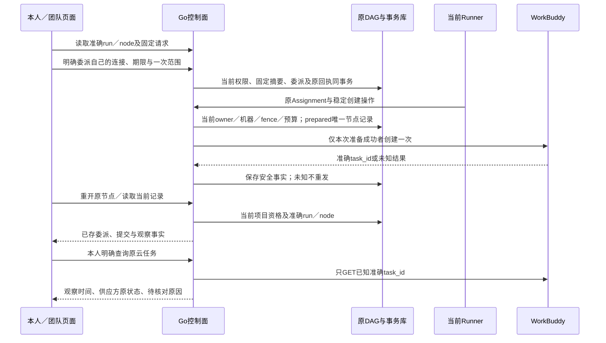

# WorkBuddy云任务：统一控制面与原运行协作

阶段T-WORKBUDDY-CLOUD-152；速码1.0.0。本页记录已接入的领域／HTTP、控制面客户端与原运行页工作区，以及后续执行边界。[领域合同](../../contracts/workbuddy-cloud-execution.md)拥有字段与状态约定，唯一平台实施计划不变。专用公开Runner领取、Execute组合和真实供应方验收继续待办。

## 一条派发链

派发、协议进度、测试与验收继续分离。正式云任务创建由现有Go DAG决定执行身份；浏览器保存委派不启动DAG，不更换负责人，不自动创建任务。当前新增Runner控制面客户端不会调用供应方，也没有本地直连降级。

图中Runner到控制面的领域命令和鉴权已实现；专用公开领取及Execute调用仍待接线，不能据此推定Runner会自动执行整条链路。

## 模块与状态所有权

| 模块 | 职责 |
| --- | --- |
| `internal/workbuddycloudcontract` | 固定NodeBinding、委派／创建／观察请求、安全事实及严格JSON；不授予权限 |
| `internal/platform/workbuddy_cloud_*` | 同库委派与一次提交、当前资格、准确来源与本人观察；复用原加密连接 |
| `internal/runner/workbuddy_cloud_client.go` | 原项目／Pool机器身份调用控制面，核对完整Assignment和原任务；无自动重试 |
| `internal/workbuddy`及`internal/workbuddyacp` | 已固定供应方REST与ACP类型／流；不拥有平台完成状态 |
| `Workflow.tsx`与`workflow-cloud-task-model.ts` | 在原节点详情核对准确工作流修订、节点类型／协议及当前来源，项目缓存隔离后挂载云工作区 |
| `WorkBuddyCloudTaskWorkspace.tsx`与读取模型 | 读取当前授权来源、本人连接、版本化命令与原操作恢复；复用共享运行快照触发平台重读 |
| `WorkBuddyCloudTaskPanel.tsx` | 呈现固定请求、期限、事实与下一步；区分平台记录读取和本人供应方观察 |

冻结节点使用`external_workflow`、`plugin=workbuddy-cloud`、`workflow=workbuddy-cloud/v1`。正文仅来自不可变节点`config.workbuddy_cloud`；机器请求不能替换prompt、连接、供应方task_id或网络地址。当前通用external workflow不是该协议的可替代执行器。

两个领域表的唯一约束均覆盖租户／项目／run／node；提交再绑定准确委派及Assignment，防止换attempt或另一副本绕过一次创建。Runner本地143检查点不再作为这条控制面链路的外发权威，也不能并行调用旧Create组合。

## 原运行页与读取一致性

原运行页从准确`workflow_id／workflow_version`读取不可变定义，核对选中节点的类型、plugin及workflow协议。NodeRun只提供实际节点身份与运行事实，不承载配置依据。项目作用域的工作流缓存及安装定义对象来源证明共同防止跨项目同ID／版本误用、旧定义过渡或迟到响应误挂。草稿未发布、定义不可用或运行读取被拒绝时不挂载云工作区；已打开子工作区的身份／主来源拒绝保留恢复壳层并移除受保护内容。

父容器按当前用户／组织／项目／run／node读取`CloudNodeView`，复核固定请求摘要及委派／提交关联，并单独读取本人连接。另一成员私有连接返回404时，仍保留获准的项目共享任务事实；主来源或当前身份拒绝则移除受保护内容。

原运行共享快照的`run.version`作为工作区的只读刷新提示。提示不进入组件作用域或恢复键，因而不会重新挂载编辑器、清空本scope草稿或替换原操作。父容器合并在途读取，后续版本或明确刷新意图补读一份快照；不增加卡片轮询，不自动调用供应方或刷新OAuth令牌。

正常状态提供次级“读取当前记录”，只GET平台节点／连接及已存事实；它也覆盖运行快照先于云提交落库的时序。本人“查询原云任务”才使用版本化Observe命令向供应方GET原task_id。读取新快照不能证明未知写入已经完成或未发生，恢复仍使用原body与稳定操作ID。

展示层按实际侧栏容器宽度自动单列，保留14–16px正文与44px操作区域。完整运行／节点ID留在DOM、title和准确路由中，视觉上下文最多两行。该布局调整不改变来源身份、服务端授权或回执语义。

## 当前授权及恢复

真人委派沿已有浏览器项目写权限和原视图校验。机器保留真实项目Runner或Pool机器证明，先锁定全部owner／机器参与的组织集合，再核对当前成员资格、双边Pool授权、准确grant版本、worker、attempt、fence、租约及run running。既有候选回收允许paused；该许可不用于创建云任务。

连接固定owner、账号／app、实际scope和grant代次。普通token轮换不废弃已授权grant；断开、重新授权或换账号不会让旧委派自动恢复。长期OAuth与ACP材料只留在控制面，不进入Runner响应、普通JSON或错误正文。

prepared在供应方POST前提交。只有本次事务成功者持有内存发送资格；进程重启、重复操作与其他副本不能从数据库重建此资格。保存回执失败、网络未知及已发送后崩溃保留待核对。供应方返回的准确晚到事实可按原prepared保存，返回调用者前仍重验当前资格；保存事实不授予新的外发权。

已知任务的本人观察是独立明确命令。它只GET原task_id，可在旧机器退出、委派到期／撤销后帮助核对；仍要求本人当前项目写资格及原连接当前授权，不能借此恢复机器执行或创建第二个任务。项目团队只读取持久安全事实；私有委派只返回给原owner。

云提供方尚无已验证的硬额度控制。组织或项目任一执行预算为enforce时拒绝创建；观察保留`unreported`，不把未知token／费用记零。切换预算后仍允许本人明确核对已经发生的任务。

## 集成验收及后续

私有领域、Runner客户端、共享Initialize、正式路由、生成合同、Web父容器与原节点挂载均已接入并完成定向检查。源码、实际命令、环境和浏览器完成范围由阶段质量报告统一记录，组件测试不替代页面验收。公开Pool领取当前仍拒绝external_workflow，领域测试使用原调度器与真实机器证明，不代表WorkBuddy专用公开领取已开放。

后续完整闭环继续包括：原DAG专用领取资格、Runner Execute组合、持久ACP进度与权限交接、初始云任务停止证明、可信产物导入、固定代码候选、独立测试和人工验收。供应方任务已创建或status为completed不替代其中任何一项。
