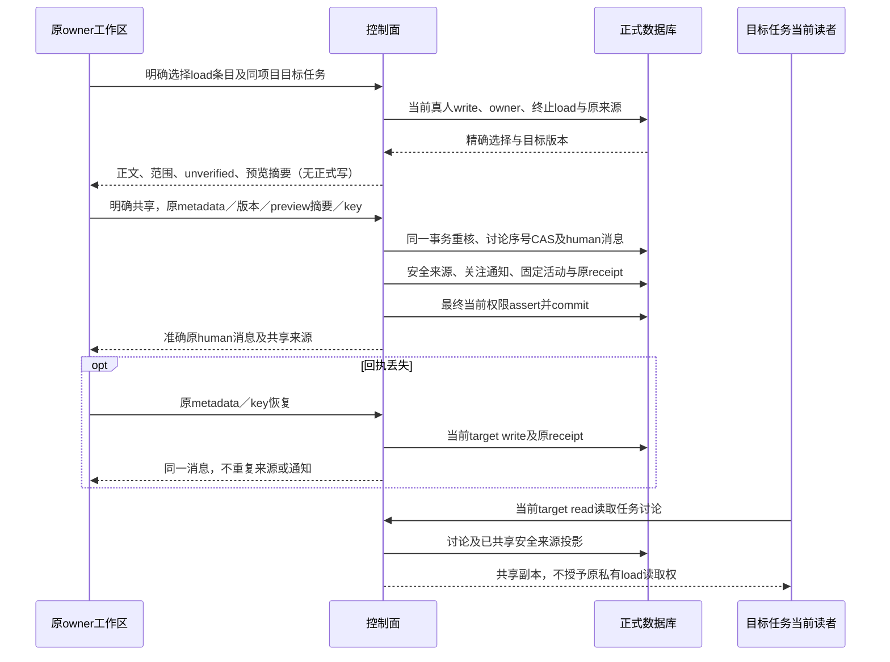

# 原云观察到团队讨论的明确共享

T-WORKBUDDY-HISTORY-SHARE-165；1.0.0；2026-10-31。状态：本阶段限定实现与验证完成；[阶段证据](../quality/workbuddy-cloud-history-sharing-verification.md)区分源码检查、真实App／HTTP和未验范围。负责人：讨论、云工具接入、工作台与主集成。关联[冻结合同](../../contracts/workbuddy-cloud-history-sharing.md)、[私有会话架构](workbuddy-cloud-collaboration.md)、[讨论与提及](task-conversation-mentions.md)。

## 领域边界

私有`CloudHistoryLoad`属于原owner的观察存档，`TaskConversationMessage`属于目标任务的协作事实。明确共享把选定字面内容复制到后者；两者不会通过一个普通外键自动继承彼此权限。分享不改变原供应方任务、DAG、平台任务版本、代码候选、测试或人工验收。

控制面只读准备预览，然后在单一当前授权事务内保存明确共享。复用既有终止load、来源校验、讨论序号CAS、关注通知、活动和command receipt；不引入新的队列、调度器、模型调用、供应方SDK或浏览器存储实现。

## 模块接口

- `workbuddycloudcontract/history_sharing.go`：闭合选择、预览、提交及安全来源DTO，正式上限和摘要约束。
- `workbuddy_cloud_history_sharing*.go`：当前私有来源准备、无写预览、同事务明确共享、初始schema与批量共享元数据投影；HTTP只接浏览器当前真人。
- `task_conversation.go`的`appendTaskConversationMessageTx`：唯一消息／序号／通知／固定活动实现；当前caller拥有receipt、来源关系、最终assert和commit。原Append保持原语义，新share不先提交普通消息。
- 工作台独立共享组件：明确选择和目标、只读预览、范围说明、原操作恢复；任务讨论显示独立共享来源。预览正文留在当前受保护内存，恢复journal只含metadata。

## 来源、复制与恢复

预览以准确终止load版本及有序选项为依据。服务端读取原文字，逐项保存sequence／kind／text摘要，确定正文连接方式并绑定目标task版本；调用方不能插入自己的正文、作者或来源。正文与现讨论一致，只显示字面文字，不执行HTML、命令或隐含工具请求。

共享来源只发布原run／node／submission／load定位、终止状态、覆盖未核实及选中摘要；原请求摘要、vendor task ID、完整未选会话、票据和账号授权不公开。`message.run_id`仍指目标任务当时的上下文，不能用它冒充云来源。

新操作必须当前有权访问原来源和目标task；已提交操作以当前目标write和原receipt恢复。后续task版本变化、原云OAuth断开或原来源变化都不会迫使用户重复发消息。已发布副本按照当前task read独立读取，撤销原云连接不会自动收回副本；分享前需要明确说明。

原receipt不是新授权。当前账号或项目撤权仍阻止读取／恢复；未提交的预览遇到来源或任务变化必须清除／重读。metadata读取只验证已共享关系与消息正文摘要，不通过私有load重新扩大或收紧现任务读者权利。

## AI与人工操作SOP

1. 从准确原节点进入已保存观察，辨认终止状态及coverage未核实。
2. 只选需要的受支持条目，显式选定同项目任务，确认平台任务而非vendor ID。
3. 预览精确文字和目标任务范围；如有敏感内容，取消并重新选择，不能让系统默默截断或改写。
4. 明确共享后按准确消息回执定位讨论。供应方assistant文字仍是引用内容，消息作者是发起共享的真人。
5. 回执不明沿原metadata／key恢复；读取私有存档不代表共享已成功，不能改key再发。
6. 任务读者通过讨论读取已共享副本；确需更多内容时由原owner再次明确选择，而不是转发私有ticket或共享账号。

## 验证和待办

正式合同、当前权限、同事务故障回滚、原receipt恢复及现Append回归需要定向验证；UI需覆盖中英、代表窄屏、选择／预览／范围确认和未知恢复。真实App／HTTP、受控SDK准备与真实供应方分别记录，未取得对应证据前不能将本说明作为验收结论。

自动共享、团队全量转录、知识发布、Prompt输入、权限回答、远端停止、跨窗口恢复提供方、其他数据库／操作系统、物理多机及生产继续后续交付。完整31项要求、P0–P7和58限定／34待办／92总账不变。

本阶段后补跨页选择缓存：同一load选第51条后刷新前50条，再选第2条，保留两条原文且不产生undefined。当前代码以独立1项纯组件浏览器／55条合成GET验证；原11项App／HTTP及其图像仍归属修复前输入，不重写为当前源码执行。
